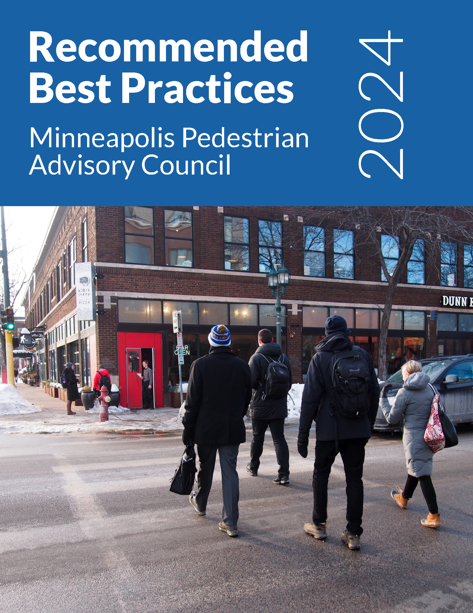

# Introduction 
I am sharing my idea for a special taskforce under the [P&P subcommittee](https://lims.minneapolismn.gov/Boards/Meetings/PAC-PP) dedicated to thoroughly reviewing city, county, and state policies, laws, and standard practices related to pedestrian infrastructure and policies. The primary aim of the taskforce would be to examine existing policies, regulations, and practices concerning pedestrian infrastructure (for instance, traffic circles, slip lanes, RRFBs, No Turn on Red, etc.) and to understand their implications on our city's walkability and safety beyond our personal anecdotes. While I don't want to take away from the PAC's ability to make recommendations based on our lived experiences (these are powerful and important), I think it would be beneficial to have an additional layer of evidence-based recommendations that could be used to support our decisions. 

This taskforce would develop a comprehensive recommendation system that could serve as a standardized method for evaluating various aspects of projects presented to the PAC, ensuring consistency and clarity in our decisions. We could pull together all sorts of evidence, like articles and case studies, to back up our recommendations and put it all together into a "2024 Recommended Best Practices" guide from the PAC. We could make the recommendations broad (such as eliminating No Turn on Red) or provide specific examples for where we think certain infrastructure or policy changes would be most impactful throughout the city. I think it could be a great way to standardize how we evaluate certain projects as well as provide Public Works, City Council, etc. an ability to anticipate where the PAC stands and can get a head start on some of our recommendations early on in the design/policy stage.

<small>Potential cover for the 2024 Recommended Best Practices guide from the PAC</small>

## Evaluation criteria
The committee would begin by developing a standardized evaluation system that could be used to assess the impact of various pedestrian infrastructure and policy changes. The evaluation system could be based on the following criteria:
* Safety
* Accessibility
* Equity
* Efficiency
* Sustainability
* Difficulty of implementation

The committee would then use the following evaluation system (or something like it) to assess the impact of various pedestrian infrastructure and policy changes on the city's walkability and safety. The committee would also consider the potential benefits and drawbacks of each recommendation, as well as the potential costs and feasibility of implementation.
## Example of a recommendation system
<table>
    <tr>
        <th>Strength of recommendation</th>
        <th>Wording</th>
        <th>Symbols</th>
        <th>Implications</th>
    </tr>
    <tr style="border-bottom: 1px solid black">
        <td>Strong recommendation for the use of an intervention</td>
        <td>“We recommend...”</td>
        <td style="background-color: green; text-align: center;">↑↑</td>
        <td>Evidence strongly supports the efficacy of the intervention in enhancing safety and walkability. Implementation is recommended as policy.</td>
    </tr>
    <tr style="border-bottom: 1px solid black">
        <td>Weak recommendation for the use of an intervention</td>
        <td>“We suggest...”</td>
        <td style="background-color: lightgreen; text-align: center;">↑</td>
        <td>Evidence supports the efficacy of the intervention, but there are circumstances where the intervention may not be appropriate. Implementation is recommended in all cases unless certain conditions or circumstances are present.</td>
    </tr>
    <tr style="border-bottom: 1px solid black">
        <td>No recommendation with respect to an intervention</td>
        <td>“We cannot make a recommendation with respect to...”</td>
        <td style="background-color: yellow; text-align: center;">–</td>
        <td>The evidence is insufficient or mixed, and a clear recommendation cannot be made. (e.g., unclear or balanced benefit-risk ratio, no data available).</td>
    </tr>
    <tr style="border-bottom: 1px solid black">
        <td>Weak recommendation against the use of an intervention</td>
        <td>“We suggest against...”</td>
        <td style="background-color: #FAA0A0; text-align: center;">↓</td>
        <td>Evidence suggests that the intervention may not be effective in enhancing safety and walkability. Implementation is not recommended unless certain conditions or circumstances are present.</td>
    </tr>
    <tr style="border-bottom: 1px solid black">
        <td>Strong recommendation against the use of an intervention</td>
        <td>“We recommend against...”</td>
        <td style="background-color: #FF0000; text-align: center;">↓↓</td>
        <td>Evidence strongly suggests that the intervention is not effective in enhancing safety and walkability. Implementation is not recommended as policy.</td>
    </tr>
</table>

Once the taskforce settles on a recommendation system, we could compile a list of policies and infrastructure treatments to begin with. Here is a simple example of what that could look like:
* No Turn on Red
* Slip lanes
* Traffic circles 
* RRFBs

It would be my job to compile information on each of these topics and prepare a brief for the taskforce to review. The taskforce would then review the evidence and work to develop a recommendation based on the evidence. I was thinking that we could either have a seperate meeting for the taskforce or add it to the P&P subcommittee meeting. I am open to suggestions on how to best implement this idea. 

## Consensus 
Each draft recommendation would be presented with relevant evidence or justification; this would be followed by open discussion, preliminary voting or collection of suggestions for alternative wording, and then the final vote. Unlike our other resolutions where we don't keep track of who voted for what, I think it would be important to keep track of at least the number of votes for and against each recommendation.

Strong consensus was defined as 90% agreement or higher, and consensus as 70–89% agreement. Agreement of the majority could be defined as 50–69% agreement. If consensus was not reached, the recommendation would be revised and re-voted on at a later date or tabled.

## Example of a recommendation
For example, here is a recommendation that the city introduce No Turn on Red at all signalized intersections.

#### Summary
<table>
    <tr>
        <th colspan="2" style="padding: 10px; border: 1px solid black; text-align:left;">Should the city institute No Turn on Red (NToR) at all signalized intersections?</th>
    </tr>
    <tr>
        <th rowspan="2" style="padding: 10px; border: 1px solid black; text-align:left">Position</th>
        <td style="padding: 10px; border: 1px solid black;">We <b>suggest</b> that the city institute No Turn on Red at all signalized intersections.</td>
    </tr>
    <tr>
        <td style="background-color: lightgreen; text-align: center; padding: 10px; border: 1px solid black;">↑</td>
    </tr>
    <tr>
        <th style="padding: 10px; border: 1px solid black;">Implications</th>
        <td style="padding: 10px; border: 1px solid black;">NToR would significantly increase pedestrian safety and accessibility. It could improve equity. It would not have an impact on efficiency or sustainability. Implementation would require public education. Signage would need to be updated.
        </td>
    </tr>
</table>

#### Background
Historically, turning right on red was illegal in many cities. The practice of turning right on red widespread after the 1975 federal Energy Policy and Conservation Act mandated states to allow it to save fuel, reducing travel time for turning vehicles by 1-5 seconds. However, subsequent studies, including [a 1981 report](https://rosap.ntl.bts.gov/view/dot/1322) by the US Department of Transportation, highlighted a significant increase in accidents involving pedestrians and bicyclists at intersections allowing these turns. Problems arise when drivers focus more on vehicular traffic from the left, often missing pedestrians on the right. More recently, [a 2022 study](https://ite.ygsclicbook.com/pubs/itejournal/2022/may-2022/live/index.html/#p=40) in Washington D.C. reported that prohibiting right turns on red at 100 intersections resulted in only minimal increases in vehicle waiting times, suggesting that safety benefits of such prohibitions may outweigh the slight delays in traffic flow.

In Seattle, [a recent report](https://www.seattle.gov/documents/Departments/SDOT/VisionZero/SDOT-Vision-Zero-TopToBottomReview-Overview.pdf) found that between 2016 and 2020, right turn on red crashes accounted for 9% of all pedestrian crashes at signalized intersections. They have since [passed a policy](https://seattle.gov/documents/Departments/SDOT/SDOT%20Policy%20-%20No%20turn%20on%20red%20signs%20-%20Final%20-%20signed.pdf) to establish the broad use of NTOR restrictions throughout the city. Researchers in Las Vegas, Miami, and San Francisco studied the effectiveness of tailored approaches to reducing pedestrian crashes and found that NTOR was deemed as a "moderatly effective" countermeasure.

A [study by MnDOT](https://mntransportationresearch.org/2024/02/15/new-project-evaluation-of-static-and-dynamic-no-right-turn-on-red-signs-at-traffic-signals/) that will complete June 2024 is determining which type of sign can be used to protect pedestrians during right turning vehicles. The study will evaluate the effectiveness of static and dynamic no right turn on red signs at traffic signals.

#### Relevant laws, statutes, and policies
Minnesota law permits drivers to turn right on red as long as there isn't a “no turn on red” sign posted at the intersection ([Minn. Stat. § 169.06](https://www.revisor.mn.gov/statutes/cite/169.06)), as does the city of Minneapolis ([Minneapolis Code of Ordinances § 474.630](https://library.municode.com/mn/minneapolis/codes/code_of_ordinances?nodeId=MICOOR_TIT18TRCO_CH474VEOP_ARTIGE_474.630TRCOSI)).

#### Recommendation
We suggest that the city institute No Turn on Red at all signalized intersections. Temporary prohibitions during peak times might also be sufficient.

#### Additional references
* [Wayzata residents want their static 'no turn on red' sign back](https://www.google.com/url?sa=t&source=web&rct=j&opi=89978449&url=https://www.startribune.com/wayzata-residents-want-their-static-no-turn-on-red-sign-back/600340944/&ved=2ahUKEwi1pfD05vqFAxUEC3kGHYSMBpI4FBAWegQIFhAB&usg=AOvVaw0uDtZEAPv9CqT1Pw6VfBMV)
