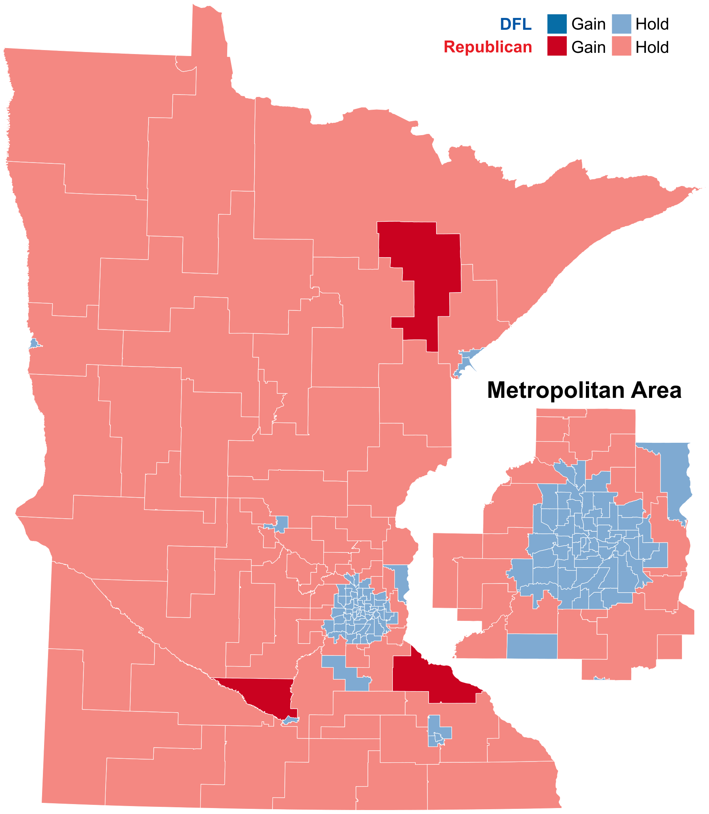

I am releasing a set of maps showing the general election results of the 2024 Minnesota House of Representatives elections. The maps are available on Wikimedia Commons and can be shared and reused under the [Creative Commons Attribution-Share Alike 4.0 International license](https://creativecommons.org/licenses/by-sa/4.0/).

All Minnesota House election maps I have made can be accessed [here](/visualizations/maps-election-statehouse-mn).

**By vote share** ([source](https://commons.wikimedia.org/wiki/File:2024_Minnesota_House_of_Representatives_election_by_district.svg))

**By pick-ups** ([source](https://commons.wikimedia.org/wiki/File:MN_House_2024_gains.svg))

**By party control** ([source](https://commons.wikimedia.org/wiki/File:MN_House_2024_seats_won.svg))

