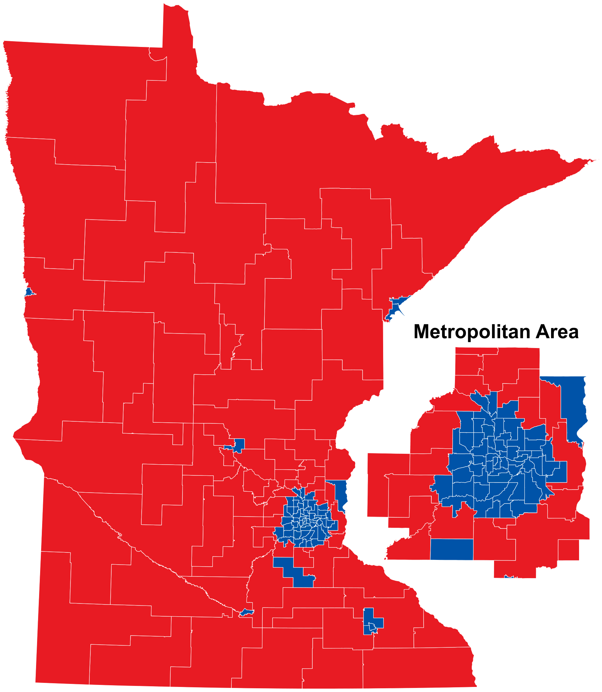

I am releasing a set of maps showing the general election results of the 2024 Minnesota House of Representatives elections. The maps are available on Wikimedia Commons and can be shared and reused under the [Creative Commons Attribution-Share Alike 4.0 International license](https://creativecommons.org/licenses/by-sa/4.0/).

All Minnesota House election maps I have made can be accessed [here](/visualizations/maps-election-statehouse-mn).

**By vote share** ([source](https://commons.wikimedia.org/wiki/File:2024_Minnesota_House_of_Representatives_election_by_district.svg))

Both parties got roughly 50% of the vote. The DFL's largest vote share was in Minneapolis and the metro area. They held on to suburban districts, but with narrower margins that in previous elections. The GOP's takeover of the Iron Range is now complete, with the last DFL-held district in the region outside of Duluth flipping. The GOP also made gains in Greater Minnesota.

**By pick-ups** ([source](https://commons.wikimedia.org/wiki/File:MN_House_2024_gains.svg))

Republicans flipped three swing districts, bringing party breakdown an even 67-67. This would mean an end to the two-year Democratic-Farmer-Labor trifecta. The House was last tied in 1979.

**By party control** ([source](https://commons.wikimedia.org/wiki/File:MN_House_2024_seats_won.svg))

