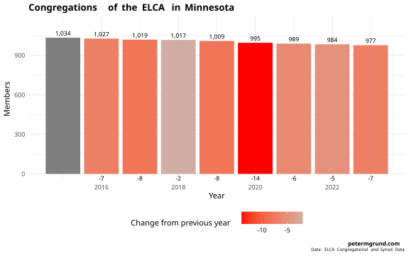
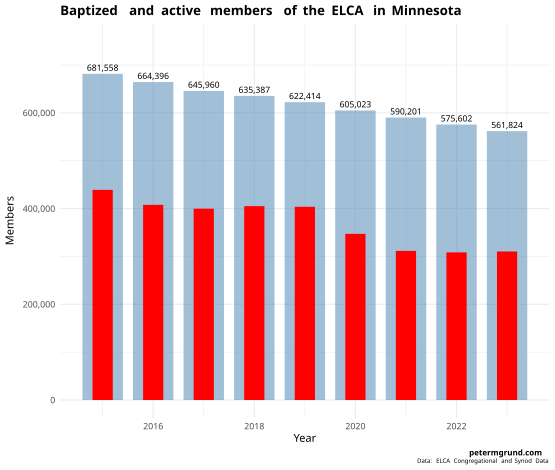
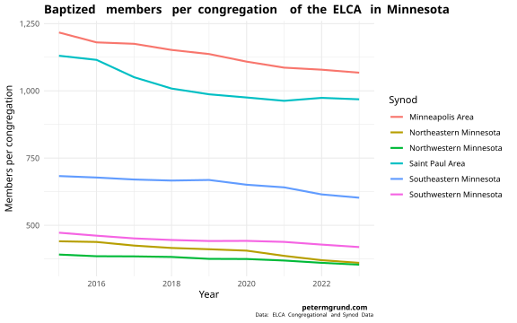
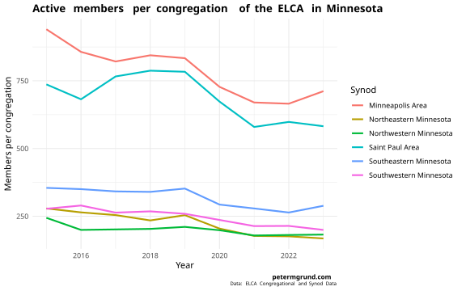
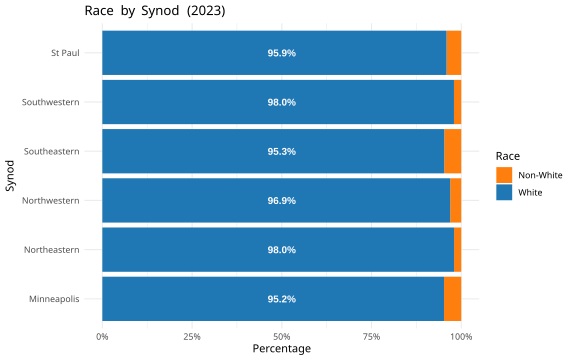
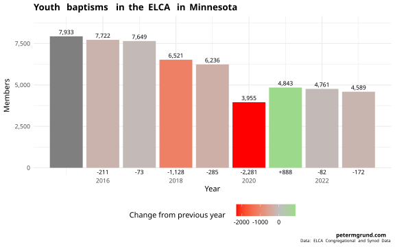
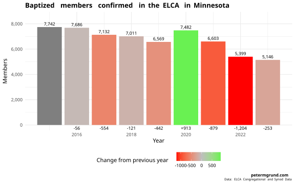

Since my last post on the [history of ELCA membership in Minnesota](/posts/2021/12/31/elca) back in 2021, the Church has released additional statistics on the makeup of the Evangelical Lutheran Church in America in Minnesota. Recent statistics from 2015 to 2023, however, reveal that this decline varies across the state’s six synods, with some showing promising signs, particularly in active participation since the COVID-19 pandemic. This article examines the latest Church data on congregation numbers, membership, active participation, racial composition, and post-COVID recovery efforts within the ELCA in Minnesota.

## Statewide
Across Minnesota, the ELCA has experienced declines in both congregations and membership over the past decade. The total number of active ELCA congregations dropped from 1,034 in 2015 to 977 in 2023, resulting in a net loss of 57 congregations. 

Baptized membership also fell, with the six synods reporting 561,824 members in 2023, down approximately 14,000 from 575,602 in 2022. This figure represents about 10% of Minnesota’s population, in line with the [Pew Research Center's estimate](https://www.pewresearch.org/religious-landscape-study/state/minnesota/) of 12% in 2024.

The metric of “active participants” tracks individuals engaged in congregational life beyond formal membership, such as regular worshipers and ministry participants (importantly, congregations can define for themselves how "active" one must be to be considered as such). In 2023, active participants numbered 310,338, or 55% of baptized members, a slight increase from 308,452 in 2022. This marks the first year-over-year gain since the early 2000s, despite the Church losing roughly 15,000 baptized members annually since 2010. 

This suggests to me that while inactive members continue to drift away, the ELCA has managed to retain its core engaged constituency post-COVID. Only time will tell if this trend will continue.

## Synod-specific data

Minnesota’s six ELCA synods, each reporting its own statistics, reflect consistent declines with some regional variation. All synods lost congregations between 2015 and 2023, though the St. Paul Area Synod saw the smallest drop, losing just four.  

Synods with larger baptized populations naturally have more members per congregation, but this ratio declined across the board over the period. 

The number of active members per congregation followed a similar downward trajectory, with a particularly sharp decline between 2019 and 2021, especially in the St. Paul and Minneapolis synods, likely due to pandemic-related disruptions.  

## Race and ethnicity

The ELCA in Minnesota remains strikingly homogenous. In 2023, 96.2% of its members were non-Hispanic White, far exceeding the 75.6% White share of Minnesota’s overall population according to recent census estimates. Even in the state’s most diverse urban areas, such as Minneapolis and St. Paul, synods reported memberships that were over 95% White. 

As Minnesota’s population continues to diversify, this lack of racial diversity poses a challenge. In response, the ELCA has begun offering services in languages like Spanish and Hmong to attract non-White members, though these efforts are still in their early stages.

## Sacraments since COVID

Mainline churches, including the ELCA, hoped for a post-COVID recovery in membership and activity. Key indicators offer a mixed picture. Baptisms and confirmations experienced a few years of adjustment following COVID, with disruptions likely affecting these rites in 2020 and 2021, but they now appear on track to align with pre-COVID trends.

