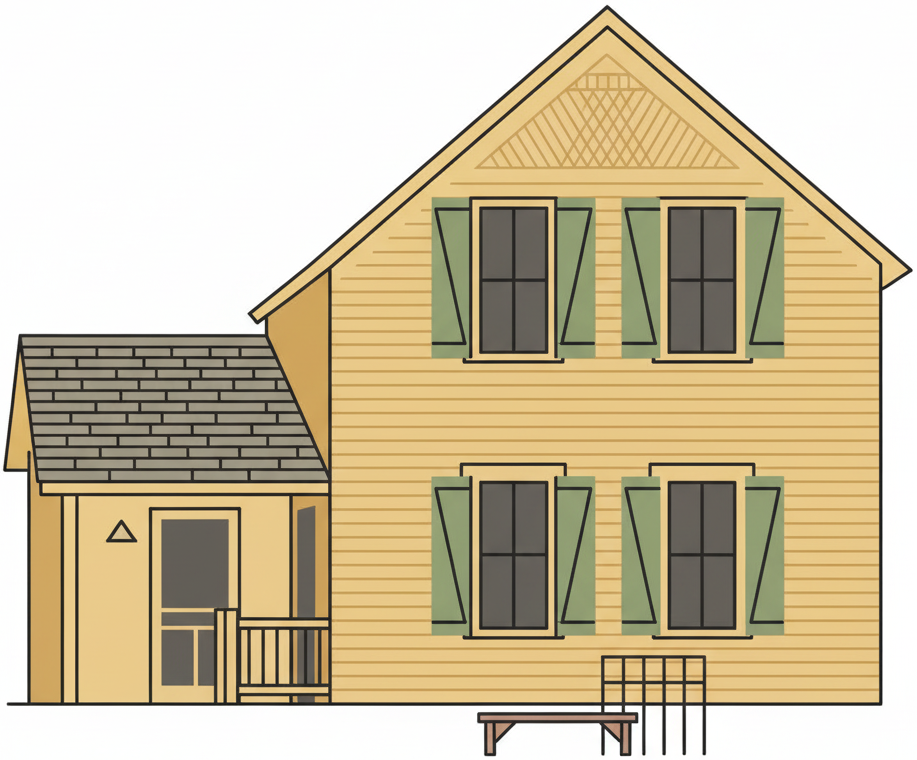
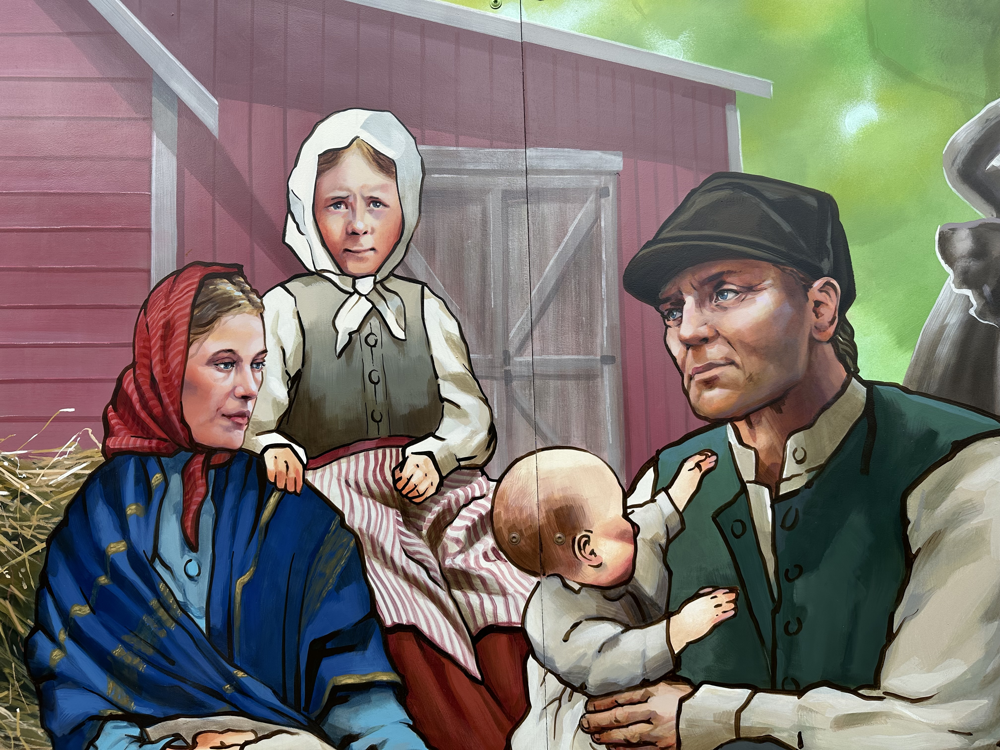
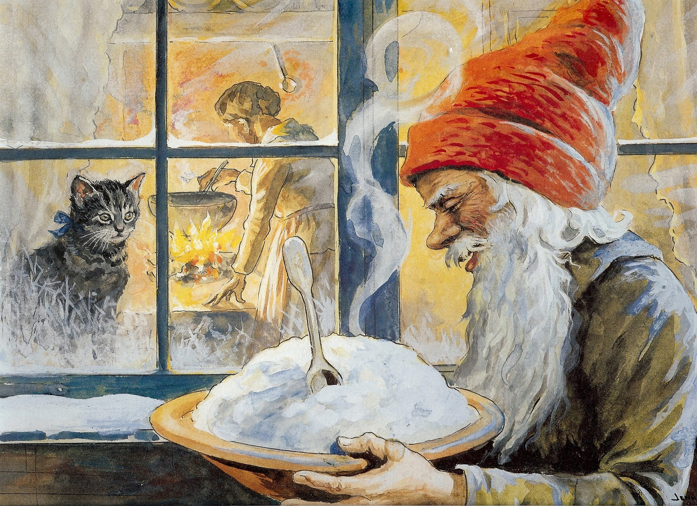
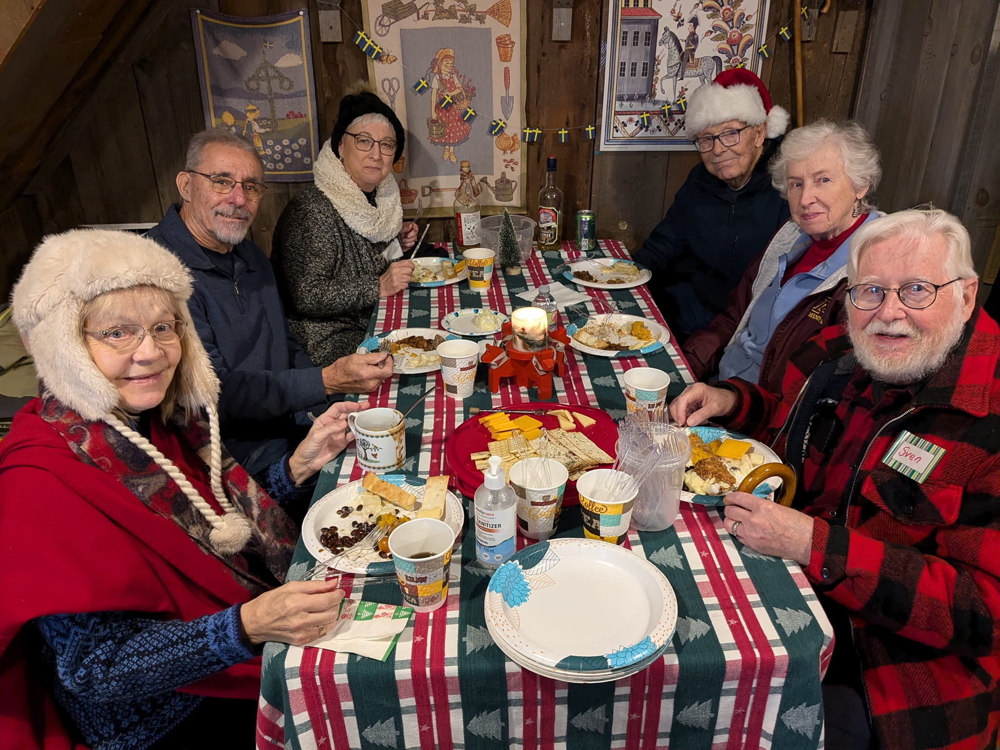
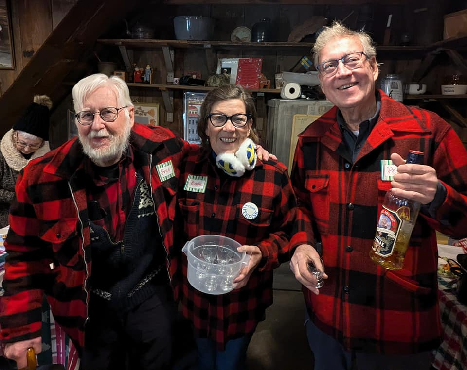
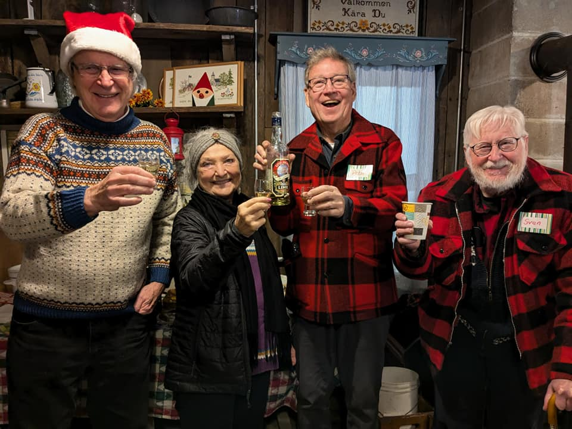
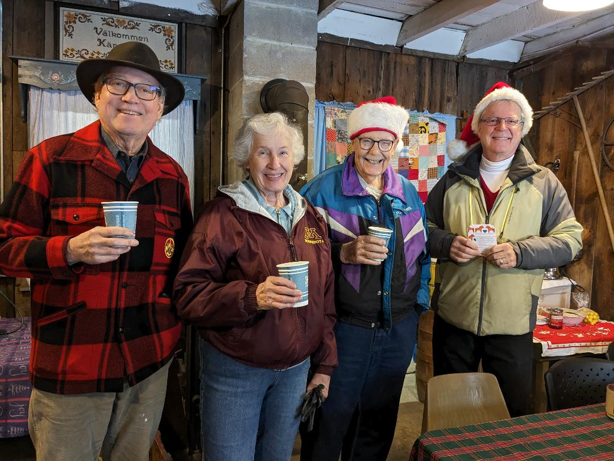
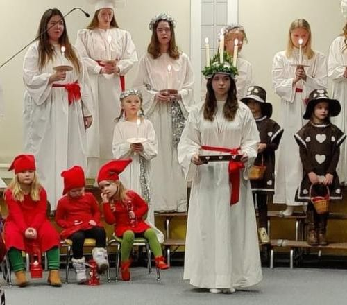
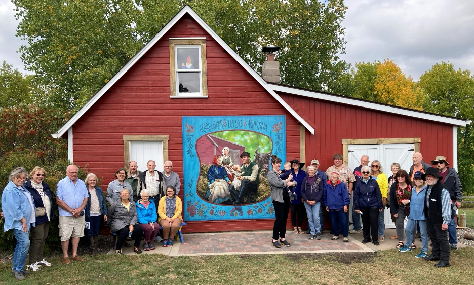

<html>
<head>
    <meta charset="UTF-8">
    <title>December 2025 Newsletter</title>
    <link rel="stylesheet" href="https://cdnjs.cloudflare.com/ajax/libs/font-awesome/6.0.0/css/all.min.css">
    <link rel="preconnect" href="https://fonts.googleapis.com">
    <link rel="preconnect" href="https://fonts.gstatic.com" crossorigin>
    <link href="https://fonts.googleapis.com/css2?family=DM+Sans:wght@400;500;700&family=Playfair+Display:wght@400;600;700&display=swap" rel="stylesheet">
    
</head>
<body>

<!-- ACCESSIBILITY MENU -->

    <button class="accessibility-toggle" onclick="toggleAccessibilityMenu()"><i class="fas fa-universal-access"></i> Accessibility</button>
    

        
Normal text

        
Large text

        
Larger text

        
Dyslexia-friendly

        
More spacing

        
Highlight links

        
Reset all

        
Close menu

    

<!-- IMAGE MODAL -->

    ✕ Back to newsletter
    
    

<!-- HEADER -->
<header class="hero-header">
    
    <h1>Friends of the Karl Oskar House</h1>
    
Nya Duvemåla

    
Preserve, Share and Celebrate Swedish Immigration and Culture

    December 2025 issue
</header>

<!-- HERO IMAGE -->

    
    
Mural of Karl Oskar, Kristina, and two children in 19th-century traditional dress

<!-- TABLE OF CONTENTS -->
<nav class="toc-container">
    
In This Issue

    

        <table class="toc-table">
            <thead>
                <tr>
                    <th>Article</th>
                    <th>Page</th>
                </tr>
            </thead>
            <tbody>
                <tr>
                    <td><a href="#new-features">New Features</a></td>
                    <td>2</td>
                </tr>
                <tr>
                    <td><a href="#word-from-president">Word from the President</a></td>
                    <td>3</td>
                </tr>
                <tr>
                    <td><a href="#new-co-editor">New Co-Editor</a></td>
                    <td>4</td>
                </tr>
                <tr>
                    <td><a href="#upcoming-events">Upcoming Events</a></td>
                    <td>4</td>
                </tr>
                <tr>
                    <td><a href="#karl-oskar-hus">Karl Oskar Hus (Chapter 4)</a></td>
                    <td>5</td>
                </tr>
                <tr>
                    <td><a href="#linn-family">The Emigration and the Linn Family (Chapter 1)</a></td>
                    <td>6</td>
                </tr>
                <tr>
                    <td><a href="#joke">Sven's Joke of the Month</a></td>
                    <td>7</td>
                </tr>
            </tbody>
        </table>
    

</nav>

<!-- NEW FEATURES -->
<article id="new-features" style="margin: 40px 0;">
    <h2 class="section-header">New Features</h2>
    

        
Digital subscribers will now receive each newsletter in two formats:

        <ul style="margin: 15px 0 15px 25px;">
            <li><strong>PDF:</strong> Optimized for printing</li>
            <li><strong>HTML:</strong> Web-accessible format</li>
        </ul>
        
The HTML version supports <a href="https://www.w3.org/WAI/fundamentals/accessibility-intro/">Web Content Accessibility Guidelines</a> for users with disabilities or low vision. New accessibility features include:

        <ul style="margin: 15px 0 15px 25px;">
            <li>Screen reader compatibility</li>
            <li>Text-to-speech software compatibility</li>
            <li>Interactive accessibility menu (click "Accessibility" button in top-right corner)</li>
            <li>Multiple text sizing options: Normal, Large, and Larger</li>
            <li>Increased spacing option</li>
            <li>Clickable images that open in enlarged view with captions</li>
        </ul>
        
To access these features, download the .html file to your computer and open it with a web browser like Google Chrome. If you try to view it directly in your email, it will not work.

        
We hope you enjoy these new features. Questions? Contact co-editor Peter Grund.

    

</article>

<!-- WORD FROM THE PRESIDENT -->
<article id="word-from-president" style="margin: 40px 0;">
    <h2 class="section-header">Word from the PresidentBy Gary Noren</h2>
    

        

            
            
Portrait of Gary

        

        
As winter settles in—I'm writing this with a forecast of 4–8 inches of snow for the Chisago Lakes area—we're delighted to invite you to one of our most cherished traditions: the Friends of the Karl Oskar House God Jul Party and potluck.

        
This year, we'll gather on December 8 at 11:30 in our cozy Verkstad (work shed), warmed by the wood-burning stove. Last year I remember the inside temperature getting into the high 40s, so dress warmly. It's a perfect setting for good food, good company, and a shared appreciation of our heritage. It's always a joy to see the space fill with laughter, stories, and favorite family dishes—those simple, heartfelt moments that keep us strong and connected.

        
The legend of the Tomte reminds us of this same spirit of resilience and community. Deeply tied to the natural world, the Tomte symbolizes the steady rhythm of the forest and the enduring strength found in caring for one another. Even in the harshest winters, these loyal guardians remain steadfast in their duty to protect and nurture.

        
Thank you for supporting the Karl Oskar House and helping us keep these traditions alive. I look forward to celebrating God Jul with all of you.
  
        

        

            

                
                
Tomte eating his porridge

            

            

                
                
God Jul celebration in the Verkstad

            

        

        

            

                
                
God Jul celebration in the Verkstad

            

            

                
                
God Jul celebration in the Verkstad

            

        

    

</article>

<!-- NEW CO-EDITOR -->
<article id="new-co-editor" style="margin: 40px 0;">
    <h2 class="section-header">New Co-EditorBy Peter Grund</h2>
    

        

            
            
Portrait of Peter in Duluth

        

        
Hej, my name is Peter Grund and I am excited to help Sven with the formatting and digital design of the newsletter for the Karl Oskar House. I was born in Duluth in 2000 and my family moved to Chisago County in 2004. My father's side is Scandinavian (both Swedish and Norwegian). I've lived in Minneapolis since 2018 while I attended the University of Minnesota, where I met my wife. We married this past July, and she's now in her fourth year of a clinical psychology PhD program. I work as a data analyst for the State of Minnesota.

        
My interest in Swedish heritage began in early 2020 when I had planned to attend a <em>folkhögskola</em> to take a "Swedish as a Second Language" course over the summer break between semesters. The COVID pandemic cancelled those plans so I turned to genealogy/family history. I knew my family was Swedish but little else. Through census records I traced my family back to <a href="https://www.torsby.se/otherlanguages/otherlanguages/english/somefactsabouttorsby.4.5827be98156f48b31ba25297.html">Torsby kommun, Värmland</a>.

        
At that time, I was still in college and didn't have capacity to volunteer, but now with more free time, I want to get involved in this community. I believe there's a real need to engage younger people.

        

    

</article>

<!-- UPCOMING EVENTS -->
<article id="upcoming-events" style="margin: 40px 0;">
    <h2 class="section-header">Upcoming Events</h2>
    

        

            

                
Monday, December 8 • 11:30 AM

                
Julfest – Christmas Party

                
Join us in the Verkstad at the Karl Oskar House for the annual volunteer Julfest potluck. Bring a dish to share! Wear your warmest clothes and be prepared to finish this sentence: It wouldn't be Christmas without...

            

            

                
            

        

        

            

                
Saturday, December 13 • 9:00 AM

                
Sankta Lucia Program

                
Chisago Lakes Lutheran Church, 1 Summit Ave, Center City, MN 55012.

            

            

                
            

        

    

</article>

<!-- KARL OSKAR HUS -->
<article id="karl-oskar-hus" style="margin: 40px 0;">
    <h2 class="section-header">Karl Oskar Hus / Nya Duvemåla • Chapter 4By Carla Norelius</h2>
    

        
In January 2023, we applied for a grant through the East Central Regional Arts Council to (1) support the summer music program, (2) purchase new chairs for the Verkstad, (3) build a kiosk explaining the history of the Karl Oskar House, and (4) hire an artist to create a mural of the Karl Oskar and Kristina family on the Verkstad's exterior wall. Many volunteers contributed to the development of the kiosk content, the art selection process, and the installation.

        
The East Central Regional Arts Council connected us with Twin Cities artist Lilli Lennox, whom we commissioned to portray the family, their environment, and the hardships of emigrant life. A subcommittee worked for months to select a design that would tell the story. One early comment on a draft noted that Kristina looked too happy—"like she won the lottery." The final design, we believe, captures both the difficulty of the times and the family's commitment to their future.

        
The mural has received an overwhelmingly positive response. Thank you to the East Central Regional Arts Council for supporting this project.

        

            
            
Inauguration of the mural. The artist, Lilli Lennox, is in the center holding her baby.

        

    

</article>

<!-- LINN FAMILY -->
<article id="linn-family" style="margin: 40px 0;">
    <h2 class="section-header">The Emigration and the Linn Family • Chapter 1By John Linn</h2>
    

        <h3 style="color: var(--swedish-blue); margin-top: 0;">Magnus Jonasson Linnell and the Tipping Point</h3>
        
In the early 1850s, the Chisago Lakes region of Minnesota became a magnet for Swedish immigration from Småland, a mostly rural area of southern Sweden that had been hard hit by overpopulation, hunger and economic strife. These immigrants came for many reasons, but mostly for the inexpensive and fertile land and the free lifestyle promised by the less populated states of the west.

        
In <em>The Emigrants</em>, the first of Vilhelm Moberg's fictional novels of Swedish emigration from Småland, he writes:
   
        

            
This is the story of a group of people who in 1850 left their homes in Ljuder parish, in the province of Småland, Sweden, and emigrated to North America. They were the first of many to leave their village. They came from a land of small cottages and large families. They were the people of the soil, and they came of a stock which thousands of years had tilled the ground they were leaving.

            
— Vilhelm Moberg, <em>The Emigrants</em>

        

        
Although the names Karl Oskar and Christina Nilsson are wholly a creation of Moberg's imagination and the events of their journey to Chisago County are a composite of many different immigrant experiences, Moberg's story is in fact very real. Those events in those times really happened. They just happened to many Swedes over many journeys to their new homes in Minnesota.

        <h3 style="color: var(--swedish-blue);">The First Småland Immigrant to Chisago Lakes</h3>
        
In the summer of 1852, several Swedish families lived around the Chisago Lakes, but none of them were from Småland. The first Swede to immigrate from Småland was Magnus Jonasson[1]. In America, his children took the surname Linnell, but there is no record of Magnus adopting that surname. Magnus was referred to as Magnus Jonson.

        
Magnus was intent on creating a Swedish colony in America and anticipated that his persuasive nature would entice many of his friends and relatives in Sweden to follow him. And indeed that was true. However it took more than just a persuasive personality to draw those many thousand of Kronoberg Swedes to Chisago Lake. For these people to leave Sweden required a rapid spread of news from the New World and almost instantaneous sociological change. And it took more than just a few letters of encouragement from the first emigrant.

        
In his book <em>The Tipping Point</em>, Malcolm Gladwell defines three kinds of people that enable a dramatic social phenomenon such as this one to happen: a Salesman, a persuader or charismatic person with powerful negotiating skills; a Maven, a person who accumulates knowledge; and a Connector, someone who knows a large numbers of people and who makes introductions.

        
Gladwell would recognize Magnus as a Salesman. And Magnus appears to be just that when he wrote back to Sweden to attract so many others from parishes in and surrounding his home parish of Furuby to come join him in his new home at Chisago Lake. But two others individuals also contributed to this tipping point phenomenon, his brother Johan Jonasson and his childhood friend Maria Petersdotter.

        <h3 style="color: var(--swedish-blue);">References</h3>
        <ol style="font-size: 11pt; color: var(--text-muted);">
            <li>Moberg, Vilhelm, <em>The Emigrants: A Novel</em>. New York: Simon and Schuster, 1951. Print.</li>
        </ol>
    

</article>

<!-- JOKE -->
<article id="joke" style="margin: 40px 0;">
    <h2 class="section-header">Joke of the MonthBy Sven Sjöstedt</h2>
    

        

            

                
An old lady had been having lunch in the restaurant car of a train and could not find her seat again.

                
She met the conductor and asked if he could help her. He asked if she remembered the number of her car and seat.

                
"No," the old lady answered, "but I know there was a big farm with many cows outside the window."

            

            

                
                
A train crossing a bridge in northern Sweden

            

        

    

</article>

<!-- GET INVOLVED -->
<article style="margin: 40px 0;">
    <h2 class="section-header">Get Involved</h2>
    

        

            

                <h3>Become a Member</h3>
                <ul style="margin: 0 0 0 20px; padding: 0;">
                    <li>Individual: $20 annually</li>
                    <li>Family: $30 annually</li>
                </ul>
                
Mail checks to: <strong>PO Box 12, Lindstrom, MN 55045</strong>

            

            

                <h3>Volunteer Opportunities</h3>
                
<strong>Currently needed:</strong>

                <ul style="margin: 0 0 0 20px; padding: 0;">
                    <li>Newsletter contributors</li>
                </ul>
            

        

    

</article>

<!-- FOOTER -->
<footer class="footer-section">
    <h2 style="text-align: center; margin-bottom: 15px;">Stay Connected</h2>
    

        Website: <a href="https://friendsofthekarloskarhouse.org">friendsofthekarloskarhouse.org</a> 
        Facebook: <a href="https://www.facebook.com/LindHistSoc">Friends of the Karl Oskar House</a>
    

    

        

            <strong>General Info</strong>
            Gary Noren 
            garynoren@gmail.com
        

        

            <strong>Newsletter</strong>
            Sven Sjöstedt 
            svendasvede@aol.com 
            Peter Grund 
            peter_grund@me.com
        

        

            <strong>Music Events</strong>
            Marilyn Wahlstrom 
            mjwahls@msn.com
        

    

</footer>

</body>
</html>