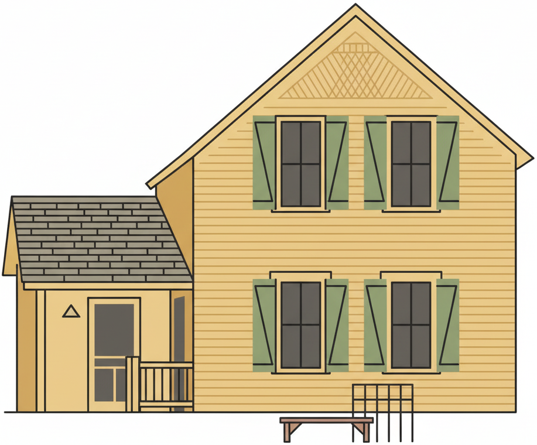
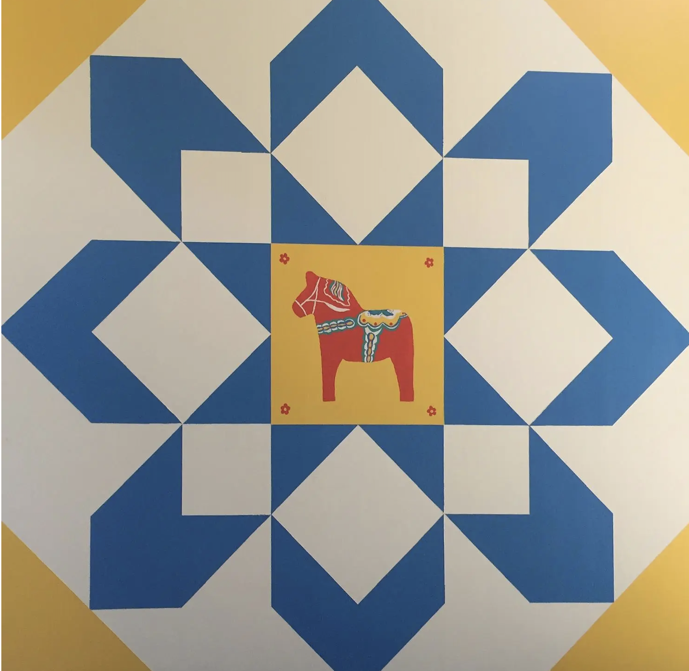
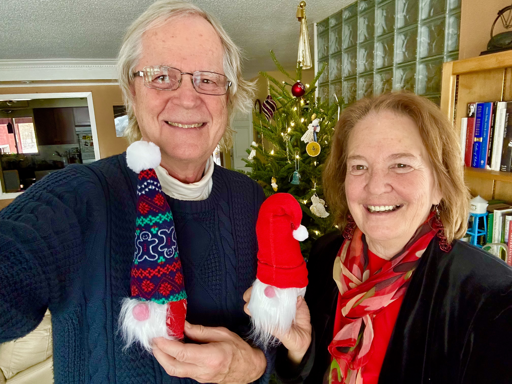
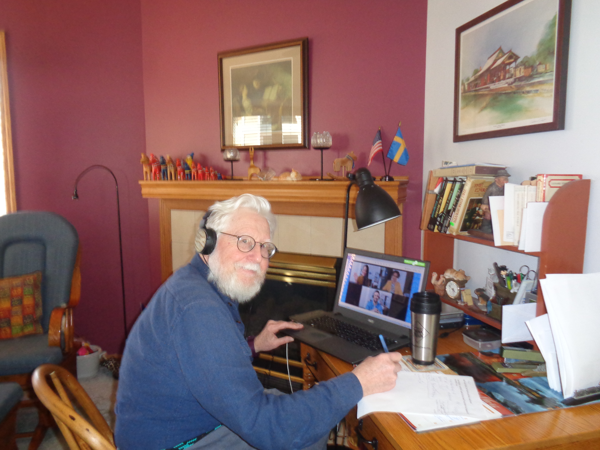
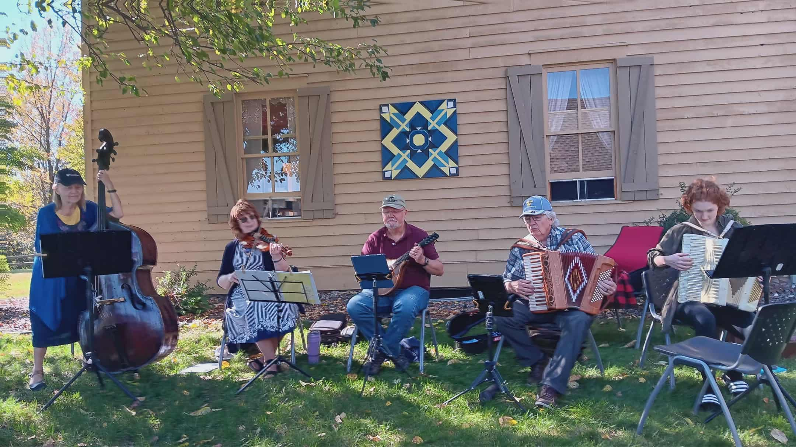
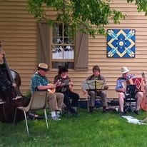
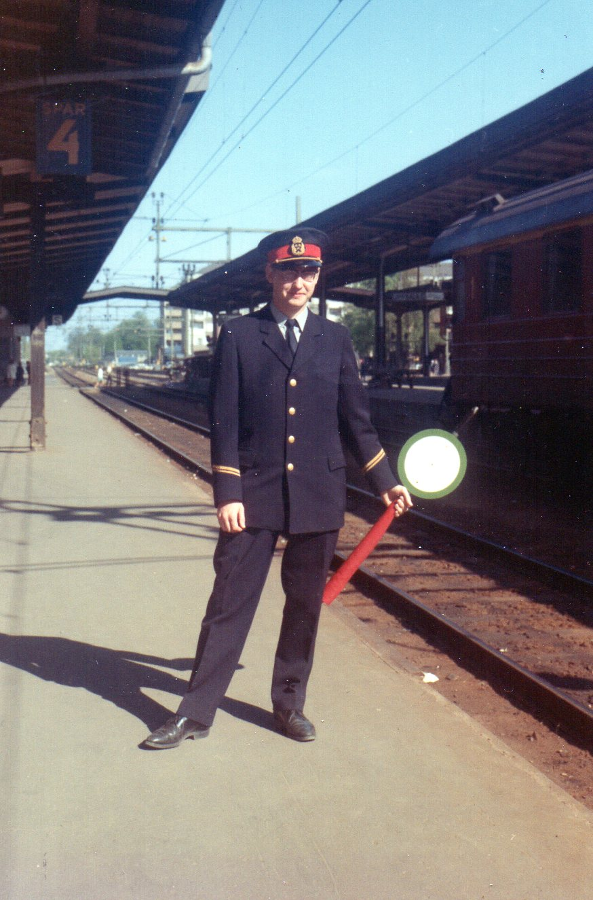

<html>
<head>
    <meta charset="UTF-8">
    <title>January 2026 Newsletter</title>
    <link rel="stylesheet" href="https://cdnjs.cloudflare.com/ajax/libs/font-awesome/6.0.0/css/all.min.css">
    <link rel="preconnect" href="https://fonts.googleapis.com">
    <link rel="preconnect" href="https://fonts.gstatic.com" crossorigin>
    <link href="https://fonts.googleapis.com/css2?family=DM+Sans:wght@400;500;700&family=Playfair+Display:wght@400;600;700&display=swap" rel="stylesheet">
    
</head>
<body>

<!-- ACCESSIBILITY MENU -->

    <button class="accessibility-toggle" onclick="toggleAccessibilityMenu()"><i class="fas fa-universal-access"></i> Accessibility</button>
    

        
Normal text

        
Large text

        
Larger text

        
Dyslexia-friendly

        
More spacing

        
Highlight links

        
Reset all

        
Close menu

    

<!-- IMAGE MODAL -->

    ✕ Back to newsletter
    
    

<!-- HEADER -->
<header class="hero-header">
    
    <h1>Friends of the Karl Oskar House</h1>
    
Nya Duvemåla

    
Preserve, Share and Celebrate Swedish Immigration and Culture

    January 2026
</header>

<!-- HERO IMAGE -->

    
    

<!-- TABLE OF CONTENTS -->
<nav class="toc-container">
    
In This Issue

    

        <table class="toc-table">
            <thead>
                <tr>
                    <th>Article</th>
                    <th></th>
                </tr>
            </thead>
            <tbody>
                <tr>
                    <td><a href="#word-from-president">Word from the President</a></td>
                    <td></td>
                </tr>
                <tr>
                    <td><a href="#upcoming-events">Upcoming Events</a></td>
                    <td></td>
                </tr>
                <tr>
                    <td><a href="#happenings">Happenings at the Karl Oskar House during 2025</a></td>
                    <td></td>
                </tr>
                <tr>
                    <td><a href="#barn-quilts">Karl Oskar Hus (Chapter 5)</a></td>
                    <td></td>
                </tr>
                <tr>
                    <td><a href="#linn-family">The Emigration and the Linn Family (Chapter 2)</a></td>
                    <td></td>
                </tr>
                <tr>
                    <td><a href="#joke">Sven's Joke of the Month</a></td>
                    <td></td>
                </tr>
            </tbody>
        </table>
    

</nav>

<!-- WORD FROM THE PRESIDENT -->
<article id="word-from-president" style="margin: 40px 0;">
    <h2 class="section-header">Word from the PresidentBy Gary Noren</h2>
    

        

            
            
Gary and Marty holding Tomtens.

        

        
Marty and I spent an enjoyable part of Christmas day making Tomten. What are Tomten you ask? The American Swedish Institute explains:

        
“You've probably seen the miniature creatures with beards as long as their frames and pointy red hats around the Turnblad Mansion, but do you really know what tomten are?

        
Tomte is a charming character from Swedish folklore who rules over their household with an iron thumb. Traditionally, tomten are known to wear grey robes and a woolly red hat. They may look like gnomes, but don’t let that fool you, tomten have many more duties than their holiday creature lookalikes.

        
Tomten work overtime to ensure their space is spotless. These creatures are described as having an active hand in the caretaking of their homes and farms. They’re hard to spot on account of their tiny size and overnight work schedule as they help take care of their home properly. Their salary? Rice porridge, of course—and you better not forget the butter.”

        

    

</article>

<!-- UPCOMING EVENTS -->
<article id="upcoming-events" style="margin: 40px 0;">
    <h2 class="section-header">Upcoming Events</h2>
    

        

            

                
2nd Monday of month • 7pm CST

                
Pratstund i svenskbygderna

                
Vill du prata svenska så kan du delta i vår “Pratstund i svenskbygderna” under värdskap av Friends of the Karl Oskar House på Zoom den andra måndagen i månaden klockan 19 till 20 (CDT). Det är inget speciellt ämne vi talar om utan bara en trevlig pratstund vänner emellan. Du behöver inte kunna svenska flytande. Det här är närmast till för andra och tredje generation eller du behöver inte alls vara svensk men vill prata svenska.

                
↳ <a href="https://us02web.zoom.us/j/81524319160">Click here to join the Zoom meeting</a>

                
You can also join by copying and pasting the following URL into your browser: <a href="https://us02web.zoom.us/j/81524319160">https://us02web.zoom.us/j/81524319160</a>

                
Meeting ID: 815 2431 9160</a>

                
Passcode: NWW2021</a>

            

            

                
            

        

        

            

                
January 9, 2026 • 10:30-11:30am • Lindberg Stuga

                
January 23, 2026 • 10:30-11:30am • Classroom A

                
Swedish Conversation Group

                
Use or practice your Swedish skills in this fun conversation group led by Sven, a longtime ASI volunteer originally from Sweden. Check in at the front desk, purchase some fika from FIKA if you wish and enjoy a morning of conversation på svenska.  group in Classroom A, both on the lower level of the Turnblad Mansion. Free; no RSVP required.

                
Address: 2600 Park Ave, Minneapolis, MN</a>

            

            

                
            

        

    

</article>

<!--HAPPENINGS-->
<article id="happenings" style="margin: 40px 0;">
    <h2 class="section-header">Happenings at the Karl Oskar House in 2025</h2>
    

        

            
            
Nya Duvemåla Folkmusiklag performing

        

        

            <ul>
                <li><b>Annual meeting:</b> Our annual meeting was on April 12th at 10:00 at the Chisago Lakes HS Wildcat Community Center with regular  agenda including fika and music by the House band, Nya Duvemåla Folkmusiklag. The keynote speaker was Dr. Michelle Terrell who shared discoveries made during past archaeological studies in the greater Chisago Lakes area.</li>
                <li><b>Entertainment:</b> There was musical entertainment at the Karl Oskar House site during the summer by Cloudberries, Tjärnblom, Nya Duvemåla Folkmusiklag, Twin Cities Hardangerfelaelag, Tom Sullivan, American Swedish Institute Male Chorus, Twin Cities Scandijam Trio, and Lauluaika. The season begun and ended with Nordic Folk Music Jam.</li>
                <li><b>Other activities:</b> A group from the Sámi Cultural Center of North America informed about their culture. We played the Swedish lawn game Kubb some Sundays.  We celebrated Midsummer with music and ring dance lead by Karl and Chris Ruser, including "små grodorna". The Chisago Lakes Ambassadors participated in the celebration.</li>
                <li><b>Visitors:</b> We had several groups from Sweden visiting as well as separate visitors, local and from far away. During the last week of September, we had seven classes of students visit.</li>
            </ul>
        
    
        

    

</article>

<!-- BARN QUILT-->
<article id="barn-quilts" style="margin: 40px 0;">
    <h2 class="section-header">Karl Oskar Hus/Nya Duvemåla • Chapter 5</h2>
    

        <h3 style="color: var(--swedish-blue); margin-top: 0;">What is a barn quilt?</h3>
        
In old times the belief was that this ornamentation on barns served as a prayer to keep animals safe, barns from fire, farms safe from the witch’s curse, and overall protection of all that dwelt inside.
        
        
Today barn quilts are not only used to bring color against a drab wood backdrop, but they’ve become an expression of the owner. The art is used to reflect the owners religious beliefs, a hobby they enjoy, to memorialize a loved one, or reveal something about their town or location. The variations are limitless.

        
Within many cultures, the humble quilt has represented hard work, individuality, warmth, and resourcefulness. Quilts tell the story of our indigenous peoples, immigrants and pioneers. Created as a representation of these iconic artforms, barn quilts are quilt block patterns, colorfully painted on wood squares of varying sizes. These squares started appearing on farmstead barns more than 100 years ago, and many farms were known by their unique quilt pattern.

        
Artists create barn quilts with wood and paint, not fabric and sewing.

        
The goal of the Chisago Lakes Barn Quilt Trail was to heighten awareness of our area’s Swedish heritage, showcase talent of local artists, and add color and interest through the business sectors and near local attractions and historical sites. Thus the Swedish colors, blue and yellow, a Dalahäst or other typical items, colors or patterns.

        
Each handmade quilt tells a story–of the quilter, and of that point in time. Color choices, the pattern, the material used and the occasion are unique. A quilter can easily describe the story of a quilt they made no matter how much time has passed.

        
Our barn quilt at the Karl Oskar House is designed and painted by our member Gloria Peterson.

        

             
             
Gloria Peterson playing nyckelharpa in front of the quilt.

        

        <h3 style="color: var(--swedish-blue);">References</h3>
        <ol style="font-size: 11pt; color: var(--text-muted);">
            <li>https://chisagolakes.org/chisago-lakes-barn-quilt-trail/</li>
        </ol>
    

</article>

<!--  -->
<article id="linn-family" style="margin: 40px 0;">
    <h2 class="section-header">The Emigration and the Linn Family • Chapter 2By John Linn</h2>
    

        <h3 style="color: var(--swedish-blue); margin-top: 0;">Magnus Jonasson’s Extended Family in Småland</h3>
        
Magnus Jonasson was born 7 December 1813 at Västorp Lambritsgård, Furuby parish in Kronoberg County, Sweden.⁴ His father was Jonas Svensson—also known as Jonas of Västorp—born in Näsby Södergård in the Dädesjö parish in 1775. His mother was Ingrid Magnusdotter, born in 1779 in Sjöhagen, Nöbbele parish. Jonas had been married once before in Solberga parish, Jönköpings Län,⁵ but his first wife died. The marriage to Ingrid appears to have been arranged as Ingrid's parents bought a share of Lambritsgård that they then gave to Ingrid. Jonas then ran the farm.

        
Magnus's older brother was Johan Jonasson Linnell, born 24 October 1811 in Lambritsgård. Johan was the person that first inspired Magnus to make his dangerous journey. Gladwell would label Johan Jonasson as a Maven because Johan was blessed—or cursed depending on your point of view—by a great wanderlust and curiosity. Johan left his home in Lambritsgård at an early age to become an apprentice cabinetmaker in Växjö. After completing his training he became a journeyman and worked in various places in Sweden. He eventually found himself traveling to America on the ship Carolina, leaving from Stockholm and arriving in New York on 24 October 1846.⁶
        
        
Johan met a group of followers of Erik Jansson—or Janssonites as they were called—on board ship.⁷ Erik Jansson was a religious radical—at least according to the Swedish Lutheran Church. He demanded that the church return to its more pious roots. The Janssonites that Johan met most likely were traveling to the newly established utopian Swedish colony at Bishop Hill, Illinois. Johan wrote back to his younger brother Magnus about his adventure and about the tales the Janssonites must have told him of abundant land and pious living that they hoped to find in their new home in Illinois. Back in Sweden upon hearing Johan's exciting tales, Magnus began making plans to emigrate, too.

        
Another farm named Amundsgård was situated next to Magnus and Johan's home at Lambritsgård. The farmhouses for the two farms were only a few hundred yards apart. Over the years, families moved back and forth between these two farms and there seemed to be a lot of cooperation between the many families involved in their operations. The children of the farm families grew up together, worked together, went to church together, and clearly became friends.

        <h3 style="color: var(--swedish-blue);">References</h3>
        <ol style="font-size: 11pt; color: var(--text-muted);">
            <li>4. Kyrkoböcker, Född, “228.1004.47900 [Kronoberg] Furuby, C:4, Births, Baptisms, 1780 - 1815, 0/113, Image 61 of 66” Genline AB Sweden, Hallvägen, Johanneshov, Sweden. Other records report 1 November 1813. Online http://www.genline.com/.</li>
            <li>5. Husförhörslängder, “Södra-Solberga-AI-1-1792-1808-Bild-143-sid-273” Arkiv Digital AD AB, Lyrestad, Sweden. Online http://www.arkivdigital.net/.</li>
            <li>6. Olsson, Nils W. Swedish Passenger Arrivals in New York, 1820-1850. Chicago: Swedish Pioneer Historical Society, 1967. Print.</li>
            <li>7. Adolfsson, Sven, Magnus Jonasson Linnell, a Real Karl Oskar.</li>
        </ol>
    

</article>

<!-- JOKE -->
<article id="joke" style="margin: 40px 0;">
    <h2 class="section-header">Joke of the MonthBy Sven Sjöstedt</h2>
    

        

            

                
As an old railroader, I choose another train story.

                
I was standing on the plattform when Ole and Sven came rushing out from the station building. Ole exclaimed with an exited voice: "Oj! Now we missed the train!" "How do you know that?" Sven asked calmly.

                
Ole replied: "Can't you see the tracks after it?"

            

            

                
                
Sven standing on a train platform

            

        

    

</article>

<!-- GET INVOLVED -->
<article style="margin: 40px 0;">
    <h2 class="section-header">Get Involved</h2>
    

        
Why join our organization? You get fellowship, information, education, entertainment. Knowing that you help promote a good cause and saving cultural immigration history.

        
Why are dues necessary? We are a not-for-profit organization and exist because of dues and gifts. All board members and workers are non-paid volunteers. Money is needed for maintaining facilities and hosting programs.

        
<b>Time to pay your dues for 2026.</b> To pay, direct checks to the treasurer at in-person events or by mail.

        

            

                <h3>Become a Member</h3>
                <ul style="margin: 0 0 0 20px; padding: 0;">
                    <li>Individual: $20 annually</li>
                    <li>Family: $30 annually</li>
                </ul>
                
Mail checks to: <strong>PO Box 12, Lindstrom, MN 55045</strong>

            

            

                <h3>Volunteer Opportunities</h3>
                
<strong>Currently needed:</strong>

                <ul style="margin: 0 0 0 20px; padding: 0;">
                    <li>Newsletter contributors</li>
                </ul>
            

        

    

</article>

<!-- FOOTER -->
<footer class="footer-section">
    <h2 style="text-align: center; margin-bottom: 15px;">Stay Connected</h2>
    

        Website: <a href="https://friendsofthekarloskarhouse.org">friendsofthekarloskarhouse.org</a> 
        Facebook: <a href="https://www.facebook.com/LindHistSoc">Friends of the Karl Oskar House</a>
    

    

        

            <strong>General Info</strong>
            Gary Noren 
            garynoren@gmail.com
        

        

            <strong>Newsletter</strong>
            Sven Sjöstedt 
            svendasvede@aol.com 
            Peter Grund 
            peter_grund@me.com
        

        

            <strong>Music Events</strong>
            Marilyn Wahlstrom 
            mjwahls@msn.com
        

    

</footer>

</body>
</html>