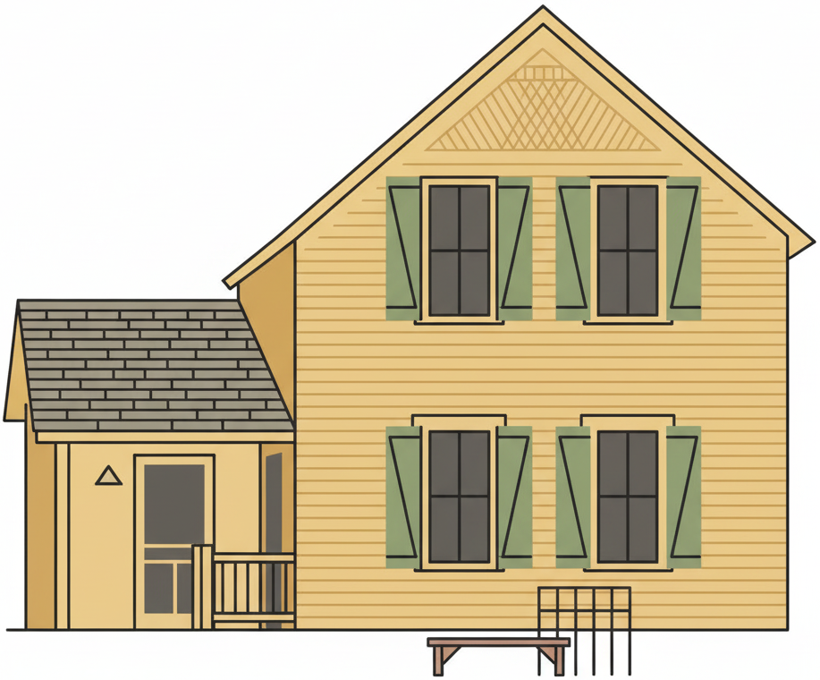
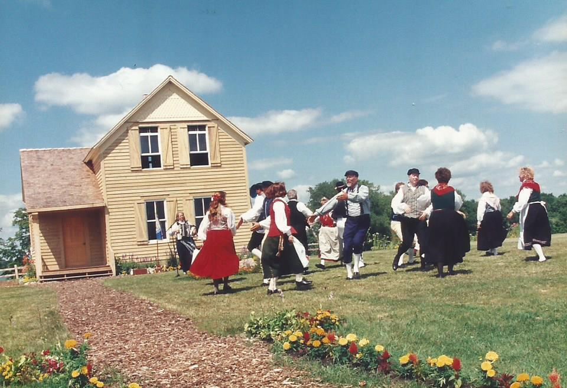
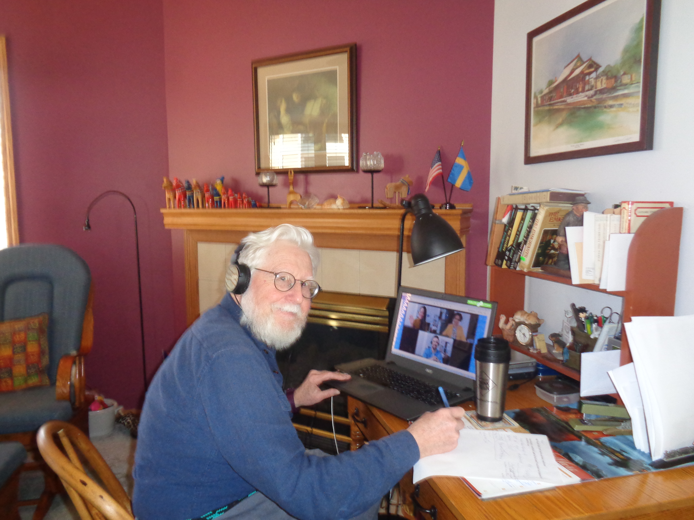
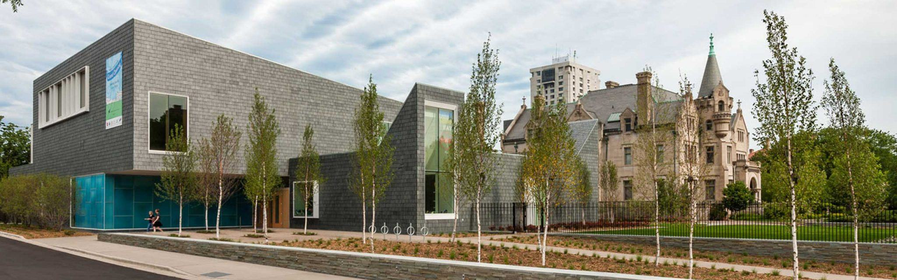
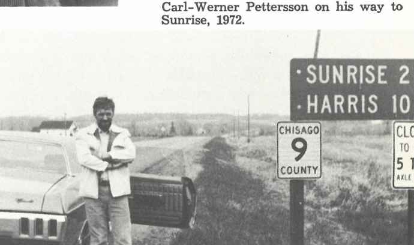
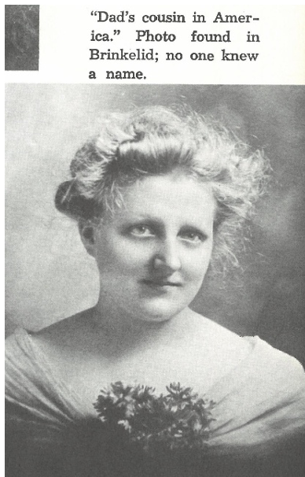
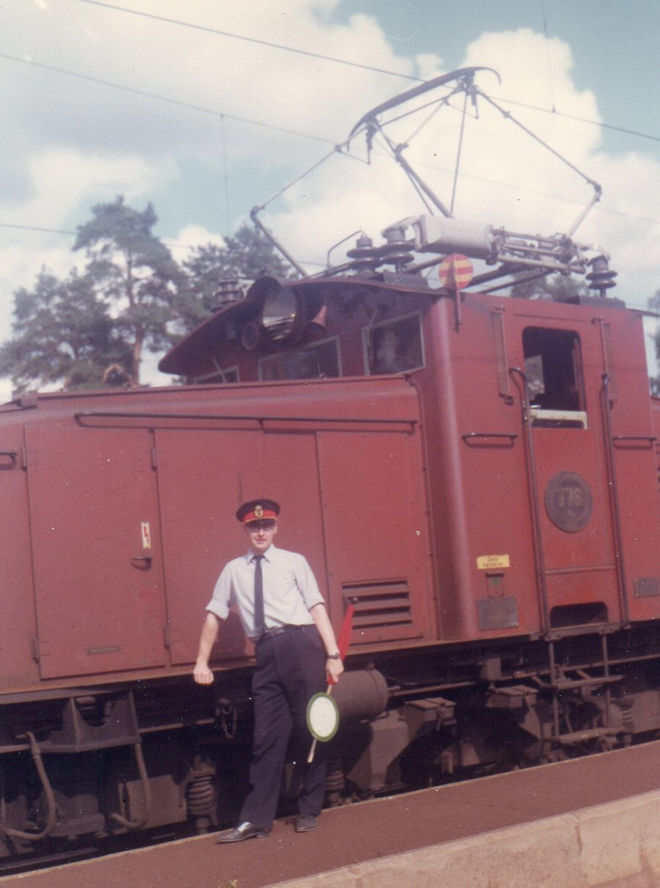

<html>
<head>
    <meta charset="UTF-8">
    <title>February 2026 Newsletter</title>
    <link rel="stylesheet" href="https://cdnjs.cloudflare.com/ajax/libs/font-awesome/6.0.0/css/all.min.css">
    <link rel="preconnect" href="https://fonts.googleapis.com">
    <link rel="preconnect" href="https://fonts.gstatic.com" crossorigin>
    <link href="https://fonts.googleapis.com/css2?family=DM+Sans:wght@400;500;700&family=Playfair+Display:wght@400;600;700&display=swap" rel="stylesheet">
    
</head>
<body>

    <button class="accessibility-toggle" onclick="toggleAccessibilityMenu()"><i class="fas fa-universal-access"></i> Accessibility</button>
    

        
Normal text

        
Large text

        
Larger text

        
Dyslexia-friendly

        
More spacing

        
Highlight links

        
Reset all

        
Close menu

    

    ✕ Back to newsletter
    
    

<header class="hero-header">
    
    <h1>Friends of the Karl Oskar House</h1>
    
Nya Duvemåla

    
Preserve, Share and Celebrate Swedish Immigration and Culture

    February 2026
</header>

    
    

<nav class="toc-container">
    
In This Issue

    

        <table class="toc-table">
            <thead>
                <tr>
                    <th>Article</th>
                    <th></th>
                </tr>
            </thead>
            <tbody>
                <tr>
                    <td><a href="#upcoming-events">Upcoming Events</a></td>
                    <td></td>
                </tr>
                <tr>
                    <td><a href="#annual-meeting">Annual Meeting</a></td>
                    <td></td>
                </tr>
                <tr>
                    <td><a href="#videos">Karl Oskar Hus (Chapter 6)</a></td>
                    <td></td>
                </tr>
                <tr>
                    <td><a href="#linn-family">The Emigration and the Linn Family (Chapter 2)</a></td>
                    <td></td>
                </tr>
                <tr>
                    <td><a href="#joke">Sven's Joke of the Month</a></td>
                    <td></td>
                </tr>
            </tbody>
        </table>
    

</nav>

<article id="upcoming-events" style="margin: 40px 0;">
    <h2 class="section-header">Upcoming Events</h2>
    

        

            

                
February 9, 2026 • 7pm CST

                
Pratstund i svenskbygderna

                
Vill du prata svenska så kan du delta i vår “Pratstund i svenskbygderna” under värdskap av Friends of the Karl Oskar House på Zoom den andra måndagen i månaden klockan 19 till 20 (CDT). Det är inget speciellt ämne vi talar om utan bara en trevlig pratstund vänner emellan. Du behöver inte kunna svenska flytande. Det här är närmast till för andra och tredje generation eller du behöver inte alls vara svensk men vill prata svenska.

                
↳ <a href="https://us02web.zoom.us/j/81524319160">Click here to join the Zoom meeting</a>

                
You can also join by copying and pasting the following URL into your browser: <a href="https://us02web.zoom.us/j/81524319160">https://us02web.zoom.us/j/81524319160</a>

                
Meeting ID: 815 2431 9160

                
Passcode: NWW2021

            

            

                
            

        

        

            

                
February 13, 2026 • 10:30-11:30am • Lindberg Stuga

                
February 27, 2026 • 10:30-11:30am • Classroom A

                
Swedish Conversation Group

                
Use or practice your Swedish skills in this fun conversation group led by Sven, a longtime ASI volunteer originally from Sweden. Check in at the front desk, purchase some fika from FIKA if you wish and enjoy a morning of conversation på svenska.  group in Classroom A, both on the lower level of the Turnblad Mansion. Free; no RSVP required.

                
Address: 2600 Park Ave, Minneapolis, MN

            

            

                
            

        

    

</article>

<article id="annual-meeting" style="margin: 40px 0;">
    <h2 class="section-header">Annual MeetingFriends of Karl Oskar House April 11 meeting to feature Swedish pilot’s video interview: <i>Finding my dad’s cousin in America in Sunrise, Minn.</i>
    </h2>
    

        

            
            
Carl-Werner Pettersson

        

        
All are invited to attend the Friends of the Karl Oskar House annual meeting at <b>9:30 a.m. Saturday, April 11</b>, in the <a href="https://maps.app.goo.gl/XV4wZV3SM6cS8gik7">Wild Cat Center at Chisago Lakes High School, 29400 Olinda Trail, Lindström</a>. The featured program will be a recently discovered 30-minute video interview with a Swedish pilot who came to Chisago Lakes in search of a cousin and found much more.

        
The gathering will begin with fika (coffee and treats), entertainment by the Nya Duvemåla Folkmusiklag, and a short meeting, all leading up to the video interview with the Swedish pilot and unofficial Chisago Lakes Area emissary, Carl Werner Pettersson (1933–2012). Sharing of stories, connections, and more FIKA will follow the video.

        
The name Carl Werner Pettersson is familiar to many long-time local residents. Pettersson was instrumental in promoting the Wilhelm Moberg’s emigrant stories and brought busloads of Swedish tourists to this area in search of links to family members who had emigrated here 100 years earlier.  
        The story of Pettersson’s first visit to Chisago Lakes in 1972 when he arrived armed only with a picture of his dad’s “cousin in America” in Sunrise, Minn. was published in the January 1974 issue of The Swedish Pioneer Historical Quarterly, Chicago, Ill.

        
That story tells of his yearning to learn more about relatives who had departed from Sweden and settled in Chisago County. Pettersson recalls arriving at the Mpls/St Paul airport planning to rent a Volvo or Saab and ending up uncomfortably driving a full-size Chevrolet up Interstate-35 and Highway 8. He describes driving straight through Lindström before realizing that the town was just a few blocks long.  After that first visit, he would return many times and bring many more Swedes with him.

                

            
            
Sally Barrot

        

        
Recently a video of local historian Sally Barott talking with Carl Werner at his homestead in Brinkelid, Sweden, has surfaced, and the Friends of The Karl Oskar House are eager to share it with the community. Pettersson recounts his experience finding many more relatives (Nordin, Norden, Magnuson, Nordlund, Tell, Videen, Mold, Nordgren, Shogren, Nordeen, Barott, Johnson and Andersson) than he ever imagined and having dinner with the Jim Turner family in Lindström.  
        Everyone with an interest in the area’s Swedish heritage is invited to attend the April 11 event.

        
Everyone with an interest in the area’s Swedish heritage is invited to attend the April 11 event.

        

    

</article>

<article id="videos" style="margin: 40px 0;">
    <h2 class="section-header">Karl Oskar Hus  • Chapter 6Compiled by Sven Sjöstedt</h2>
    

        <h3 style="color: var(--swedish-blue); margin-top: 0;">A selection of videos from the Karl Oskar House</h3>
        
Here is a collection of videos documenting events, music, and general information about Nya Duvemåla.

        
        

            <a href="https://www.youtube.com/watch?v=hGSglFVAayg" class="video-card" target="_blank">
                

                

                    The Karl Oskar House (Nya Duvemåla) in Lindström, Minnesota
                    Nov 6, 2021 • 3 min
                    General information about the house and location.
                

            </a>
            
            <a href="https://www.youtube.com/watch?v=Sbm2jnHBqJY" class="video-card" target="_blank">
                

                

                    Nya Duvemala - The Karl Oskar House in Lindström, MN
                    Jul 26, 2013 • 18 min
                    General overview and history of the site.
                

            </a>

            <a href="https://www.youtube.com/watch?v=OHC97MgtYGE" class="video-card" target="_blank">
                

                

                    Nordic Folk Music Jam under the Astrakhan Apple Tree
                    Sep 26, 2021 • 1 hr
                    Musical performance at the Karl Oskar House.
                

            </a>

            <a href="https://www.youtube.com/watch?v=zXcirOa1TRY" class="video-card" target="_blank">
                

                

                    Karl Oskar House Opener
                    May 30, 2021 • 40 min
                    Coverage of the season opener event.
                

            </a>

            <a href="https://archive.org/details/cltvmn-Karl_Oskar_Days_2024_House_Visit_Music" class="video-card" target="_blank">
                

                

                    Karl Oskar Days 2024 House Visit & Music
                    July 30, 2024 • 14 min
                    Highlights from the 2024 Karl Oskar Days celebration.
                

            </a>

            <a href="https://archive.org/details/cltvmn-Karl_Oskar_House_Kubb_Game" class="video-card" target="_blank">
                

                

                    Karl Oskar House Kubb Game
                    July 24, 2022 • 32 min
                    Kubb game with music.
                

            </a>
            
             <a href="https://archive.org/details/cltvmn-KOD_2022_Karl_Oskar_House_Swedish_Tour_Laulu_Aika_Music_HD" class="video-card" target="_blank">
                

                

                    Karl Oskar House Swedish Tour Laulu Aika Music
                     July 9, 2022 • 37 min
                    Tour and music performance by Laulu Aika.
                

            </a>

            <a href="https://www.youtube.com/watch?v=isN7IxIyyiM" class="video-card" target="_blank">
                

                

                    Twin Cities Nyckelharpalag
                    Aug 28, 2022 • 1 min
                    Short clip of Nyckelharpa performance.
                

            </a>
        

    

</article>

<article id="linn-family" style="margin: 40px 0;">
    <h2 class="section-header">The Emigration and the Linn Family • Chapter 2, continuedBy John Linn</h2>
    

        <h3 style="color: var(--swedish-blue); margin-top: 0;">Magnus Jonasson’s Extended Family in Småland</h3>
        
Maria Petersdotter, born 27 September 1804 (8) was one notable resident of Amundsgård. Her parents Peter Månsson and Maria Månsdotter were witnesses at Johan Jonasson’s christening, and it was clear that they were well acquainted with the brothers Johan and Magnus Jonasson. Maria had two older sisters, Lisa and Eva, and one younger brother, Johannes. Ancestors of Maria’s family date back to the early 1700s in Furuby parish and Maria was well connected to many families living in and around Västorp. Because of these connections, Gladwell would label Maria Petersdotter as a “Connector,” because it appears that she did just that—she connected people together.
 
        
Maria Petersdotter grew up and married Jonas Andersson, born in 1794 in Näsby Village, Dädesjö (9). His parents were Anders Jonasson (or Jonsson) and Catherina Jonsdotter. Jonas had two brothers, Nils and Petter Andersson, and one sister, Ingrid Andersdotter. Jonas had been married previously and had moved from Dädesjö to Tollstorp in Hovmentorp parish to live close to his wife’s family. After his first wife died prematurely, he quickly remarried Maria Petersdotter and they then moved to Linnehult in Hovemantorp parish where they farmed and raised nine children. Jonas Svensson, Magnus Jonasson’s father probably knew Jonas Andersson’s parents and maybe knew Jonas himself. Jonas Svensson came from the same small village in Dädesjö where Jonas Andersson was born. It appears that the marriage between Maria Petersdotter and Jonas Andersson was “arranged” by Jonas Svensson. This cast of characters from Västorp, Johan Jonnasson Salesman” and Maria Petersdotter “the Maven,” Magnus Jonasson “the “the Connector” changed their world. Through their combined activities they created a tipping point, one that encouraging thousands of Småland Swedes to leave Sweden for a better home in Minnesota in Chisago County.

        <h3 style="color: var(--swedish-blue);">References</h3>
        <ol style="font-size: 11pt; color: var(--text-muted);">
            <li>8. Kyrkoböcker, Född “228.1004.46200 [Kronoberg] Furuby, C:4, Births, Baptisms, 1780 - 1815, 0/79, Image 44 of 66”</li>
            <li>9. Kyrkoböcker, Född “820.22.1600 [Kronoberg] Dädesjö, C:3, Births, Marriages, Deaths, 1776 - 1810, 0/157, Image 16 of 150”</li>
        </ol>
    

</article>

<article id="joke" style="margin: 40px 0;">
    <h2 class="section-header">Joke of the MonthBy Sven Sjöstedt</h2>
    

        

            

                
80 % of the Swedish railroads are electrified.

                
So...do you know what the similarity is between the Swedish railroads and the Pope in Rome?

                
Both take their power from above!

            

            

                
                

            

        

    

</article>

<article style="margin: 40px 0;">
    <h2 class="section-header">Get Involved</h2>
    

        
Why join our organization? You get fellowship, information, education, entertainment. Knowing that you help promote a good cause and saving cultural immigration history.

        
Why are dues necessary? We are a not-for-profit organization and exist because of dues and gifts. All board members and workers are non-paid volunteers. Money is needed for maintaining facilities and hosting programs.

        
<b>Time to pay your dues for 2026.</b> To pay, direct checks to the treasurer at in-person events or by mail.

        

            

                <h3>Become a Member</h3>
                <ul style="margin: 0 0 0 20px; padding: 0;">
                    <li>Individual: $20 annually</li>
                    <li>Family: $30 annually</li>
                </ul>
                
Mail checks to: <strong>PO Box 12, Lindström, MN 55045</strong>

            

            

                <h3>Volunteer Opportunities</h3>
                
<strong>Currently needed:</strong>

                <ul style="margin: 0 0 0 20px; padding: 0;">
                    <li>Newsletter contributors</li>
                </ul>
            

        

    

</article>

<footer class="footer-section">
    <h2 style="text-align: center; margin-bottom: 15px;">Stay Connected</h2>
    

        Website: <a href="https://friendsofthekarloskarhouse.org">friendsofthekarloskarhouse.org</a> 
        Facebook: <a href="https://www.facebook.com/LindHistSoc">Friends of the Karl Oskar House</a>
    

    

        

            <strong>General Info</strong>
            Gary Noren 
            garynoren@gmail.com
        

        

            <strong>Newsletter</strong>
            Sven Sjöstedt 
            svendasvede@aol.com 
            Peter Grund 
            peter_grund@me.com
        

        

            <strong>Music Events</strong>
            Marilyn Wahlstrom 
            mjwahls@msn.com
        

    

</footer>

</body>
</html>