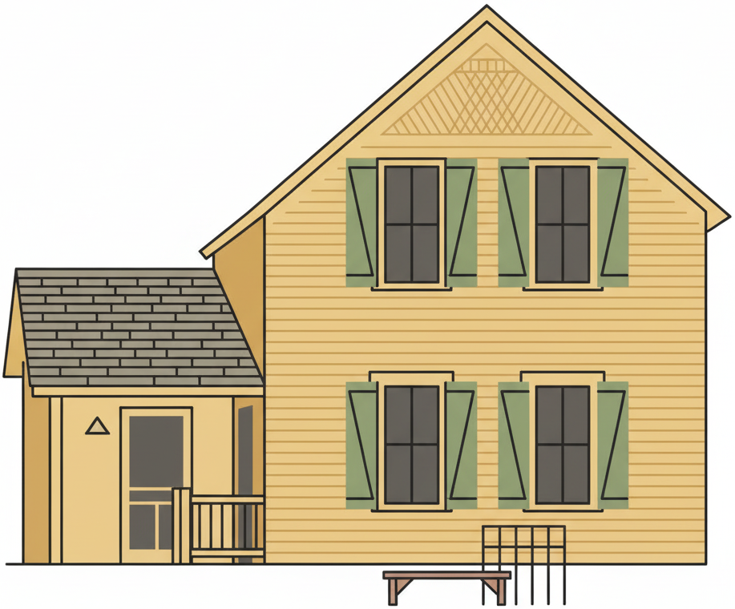
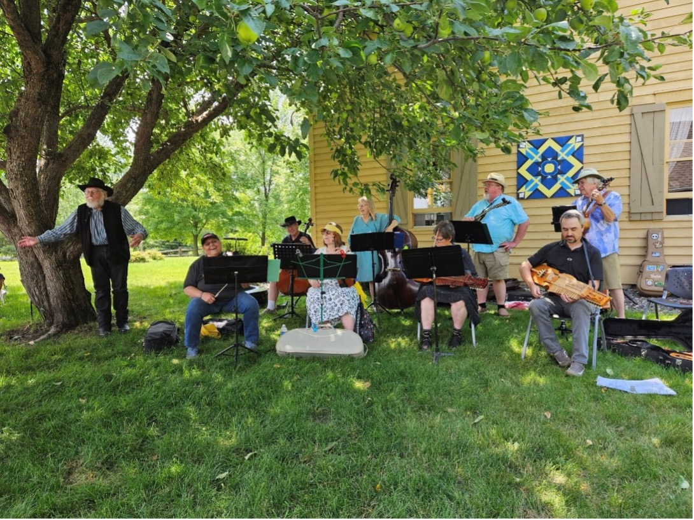
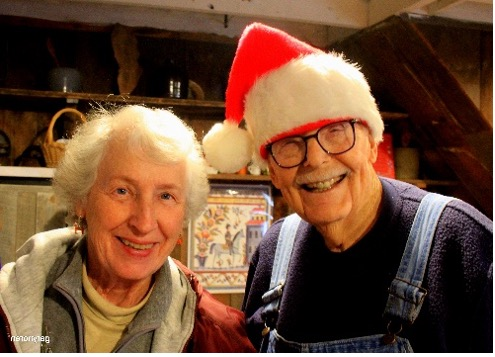
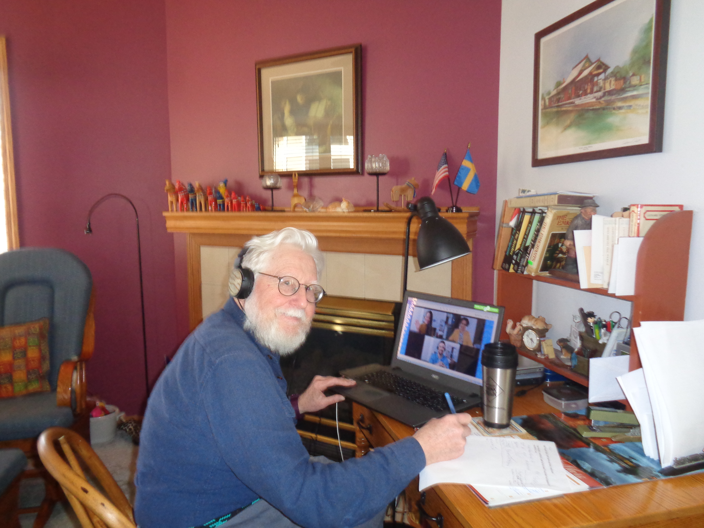
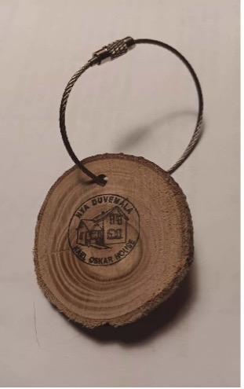
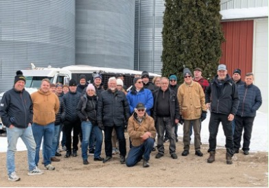
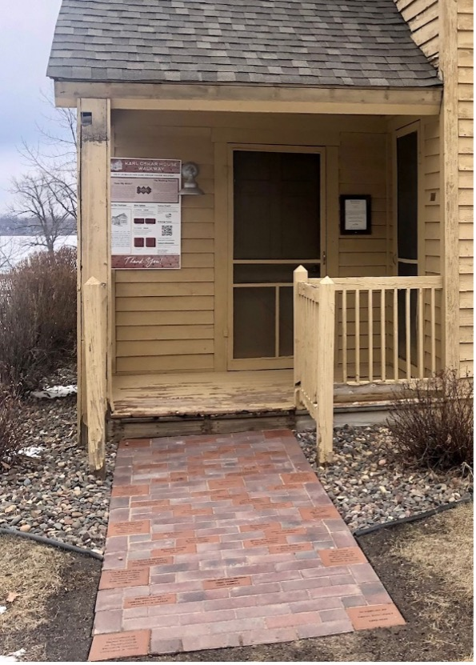
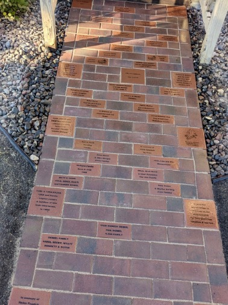

<html>
<head>
    <meta charset="UTF-8">
    <title>April 2026 Newsletter</title>
    <link rel="stylesheet" href="https://cdnjs.cloudflare.com/ajax/libs/font-awesome/6.0.0/css/all.min.css">
    <link rel="preconnect" href="https://fonts.googleapis.com">
    <link rel="preconnect" href="https://fonts.gstatic.com" crossorigin>
    <link href="https://fonts.googleapis.com/css2?family=DM+Sans:wght@400;500;700&family=Playfair+Display:wght@400;600;700&display=swap" rel="stylesheet">
    
</head>
<body>

    <button class="accessibility-toggle" onclick="toggleAccessibilityMenu()"><i class="fas fa-universal-access"></i> Accessibility</button>
    

        
Normal text

        
Large text

        
Larger text

        
Dyslexia-friendly

        
More spacing

        
Highlight links

        
Reset all

        
Close menu

    

    ✕ Back to newsletter
    
    

<header class="hero-header">
    
    <h1>Friends of the Karl Oskar House</h1>
    
Nya Duvemåla

    
Preserve, Share and Celebrate Swedish Immigration and Culture

    April 2026
</header>

    
    

<nav class="toc-container">
    
In This Issue

    

        <table class="toc-table">
            <thead>
                <tr>
                    <th>Article</th>
                    <th></th>
                </tr>
            </thead>
            <tbody>
                <tr>
                    <td><a href="#word-from-president">Word from the President</a></td>
                    <td></td>
                </tr>
                <tr>
                    <td><a href="#obituary">Arild Hagberg’s Obituary</a></td>
                    <td></td>
                </tr>
                <tr>
                    <td><a href="#upcoming-events">Upcoming Events</a></td>
                    <td></td>
                </tr>
                <tr>
                    <td><a href="#blog">Svensk/English Blog</a></td>
                    <td></td>
                </tr>
                <tr>
                    <td><a href="#karl-oskar-house">Karl Oskar House (Chapter 7)</a></td>
                    <td></td>
                </tr>
                <tr>
                    <td><a href="#linn-family">The Emigration and the Linn Family (Chapter 4)</a></td>
                    <td></td>
                </tr>
                <tr>
                    <td><a href="#farm-tour">Farm Tour</a></td>
                    <td></td>
                </tr>
                <tr>
                    <td><a href="#brick-paver">Brick Paver Project</a></td>
                    <td></td>
                </tr>
                <tr>
                    <td><a href="#joke">Sven’s Joke of the Month</a></td>
                    <td></td>
                </tr>
            </tbody>
        </table>
    

</nav>

<article id="word-from-president" style="margin: 40px 0;">
    <h2 class="section-header">Word from the President Gary Noren</h2>
    

        

            
            

        

        
It must be spring--Marty and I just finished making three and a half gallons of maple syrup yesterday, with plenty of help from our children. Still, the temperature is stubbornly hovering around 20 degrees this morning... and did I mention the wind?

        
My thoughts are with Betty Hagberg and her family this morning as we remember Arild and all he has done for our organization and for the community at large. Peace.

        
Spring also brings the return of annual meetings, and the Friends of the Karl Oskar House are already busy preparing for ours on April 11. (For details see <a href="#upcoming-events">upcoming events</a>).

        
Looking ahead, we have an exciting season planned at the Karl Oskar House. Marilyn Wahlstrom is finalizing a schedule of world-class Scandinavian musical entertainment, to be held every second and fourth Sunday afternoon from June through September. In addition, Craig and Boni Stockel will once again offer Kubb lessons and games throughout the summer--a favorite for participants of all ages.

        
Be sure to keep an eye on our website for updates and upcoming events: <a href="https://friendsofthekarloskarhouse.org/">friendsofthekarloskarhouse.org</a>

        
Gary Noren

        

    

</article>

<article id="obituary" style="margin: 40px 0;">
    <h2 class="section-header">Arild Hagberg's Obituary</h2>
    

        

            
        

        
Our member and friend Arild Hagberg, 87, died Thursday, March 5, 2026.

        
An avid supporter of the Friends of the Karl Oskar House, in Lindstrom, he served as its treasurer, a guide and volunteer groundskeeper.

        
He will be missed.

        
Arild's full obituary can be found <a href="https://www.grandstrandfh.com/obituaries/Arild-D-Hagberg?obId=47501044#/obituaryInfo">here</a>.

    

</article>

<article id="upcoming-events" style="margin: 40px 0;">
    <h2 class="section-header">Upcoming Events</h2>
    

        

            

                
April 13, 2026 • 7pm CST

                
Pratstund i svenskbygderna

                
Vill du prata svenska så kan du delta i vår "Pratstund i svenskbygderna" under värdskap av Friends of the Karl Oskar House på Zoom den andra måndagen i månaden klockan 19 till 20 (CDT). Det är inget speciellt ämne vi talar om utan bara en trevlig pratstund vänner emellan. Du behöver inte kunna svenska flytande. Det här är närmast till för andra och tredje generation eller du behöver inte alls vara svensk men vill prata svenska.

                
↳ <a href="https://us02web.zoom.us/j/81524319160">Click here to join the Zoom meeting</a>

                
You can also join by copying and pasting the following URL into your browser: <a href="https://us02web.zoom.us/j/81524319160">https://us02web.zoom.us/j/81524319160</a>

                
Meeting ID: 815 2431 9160

                
Passcode: NWW2021

            

            

                
            

        

        

            

                
April 10, 2026 • 10:30-11:30am • Lindberg Stuga

                
April 24, 2026 • 10:30-11:30am • Classroom A

                
Swedish Conversation Group at American Swedish Institute

            

            

                
            

        

        

            

                
Saturday, April 11, 2026

                
Friends of the Karl Oskar House Annual Meeting

                
Chisago Lakes Wildcat Center, 29400 Olinda Trail, Lindstrom, MN 55045.

                
Gather at 9:30 for FIKA and entertainment by the Nya Duvemala Folkmusiklag

                
10am: Brief annual meeting

                
Followed by a recently discovered video of Swedish Pilot Carl Werner Pettersson who brought many tourists to the Chisago Lakes Area. The entertaining video was recorded by local historian Sally Barott at his home in Brinkelid, Sweden as Carl Werner shared the story of his first adventure in 1972 seeking to find his American relatives and the city of Sunrise.

                
Sharing and connecting time to follow.

                
<strong>All are welcome!</strong>

            

            

                
            

        

    

</article>

<article id="blog" style="margin: 40px 0;">
    <h2 class="section-header">Svensk/English Blog</h2>
    

        
If you want to test your knowledge of Swedish, you can check out my blog. It is in both languages. It is at: Den Gamle Emigranten, <a href="https://dengamleemigranten.bloggplatsen.se/">https://dengamleemigranten.bloggplatsen.se/</a>

    

</article>

<article id="karl-oskar-house" style="margin: 40px 0;">
    <h2 class="section-header">Karl Oskar House • Chapter 7Compiled by Sven Sjöstedt</h2>
    

        <h3 style="color: var(--swedish-blue); margin-top: 0;">ASTRACHAN APPLE TREE</h3>
        
We have an Astrachan apple tree at New Duvemala. Why do we have it? Well, it plays a significant role in Vilhelm Moberg's book series "The Emigrants".

        

            
In the new country, Kristina often longed to go home to Duvemala in the old country. Her husband Karl Oskar saw her longing and wrote home to Sweden 'for apple seeds from an Astrachan apple tree in her parental home.' He planted the seeds by the gable of their new, splendid dwelling in New Duvemala, Minnesota.

            
The seeds sprouted into a plant that grew into a tree. When it bore fruit for the first time, Kristina was sick in her bed. 'Karl Oskar rose and went out; he walked over to the apple tree. From one of the lowest branches he took down a large and fine apple.' He placed the large apple on Kristina's blanket. 'Look here! Your Astrakhans are ripe!' Kristina could not bite into the apple; she only brushed it with her lips - but she recognized it: 'It tastes like our apples. Our apples back home!'

            
It is one of the most beautiful scenes in Moberg's novels. Novel suite, equally beautifully rendered in Jan Troell's film based on the novels. The apple falls from Kristina's hand, rolls down the blanket, and drops with a thud onto the floor. Kristina dies.

        

        
Astrachans are a group of apple varieties of medium-sized apples with soft and sweet flesh and a thin wax layer over the skin. The name comes from the city of Astrachan, but it is unclear where the apple varieties themselves originate. Among well-known astrachans are Gyllenkrok's astrachan, red astrachan, and white astrachan. Carl von Linne mentioned "astrachans apples" from Uppsala in 1748. Astrachan is an early apple variety, often ready for harvest in September, with a short shelf life, which corresponds well with the image of a "summer apple."

        
The astrachan apple tree in Vilhelm Moberg's The Emigrants symbolizes Kristina's homesickness and rootedness in Smaland. It is a red astrachan, probably of the Gyllenkrok's astrachan variety, which is planted with seeds from Duvemala in America. Despite botanical doubts about seed propagation, the tree stands as a bridge between the old and the new life.

        

            
            
As a memory from your visit at the Karl Oskar House you can buy this key ring. It is a slice of a trimmed branch of the Astrachan.

        

    

</article>

<article id="linn-family" style="margin: 40px 0;">
    <h2 class="section-header">The Emigration and the Linn Family • Chapter 4By John Linn</h2>
    

        <h3 style="color: var(--swedish-blue); margin-top: 0;">The Journey</h3>
        
Magnus Jonasson’s oldest son Olof writes in his book <em>O.M. Linnell: His Life’s Story — 1840-1930</em>: In the spring of 1852 my father, Magnus Jonason, and family set out from Karlshamn, Sweden for Gothenburg in a small sail boat. This boat was manned by only two men and a boy of fourteen. It took seven days to reach our destination. At Gothenburg we had to wait three weeks for a sailing ship, the Ambrosius, carrying a cargo of iron to New York. Twelve men comprised the crew. The journey was made in seven weeks and two days, reaching New York on August 3, 1852.19

        
When the Magnus Jonasson party arrived in New York in 1852, they had expected Johan Jonasson to meet them: He had written to Magnus and urged him to follow his example and promised to meet him in New York and help him to find suitable location. He added that his wife would be with him and that she was an American (Hon är Amerikanska)20. But Johan did not remain in New York nor meet them as planned. His wanderlust got the better of him. He made a little money in the California Gold Rush, and eventually returned to Sweden via Australia and Russia. He was very sick when he arrived back in Hovmantorp, and he died shortly thereafter at his younger brother Daniel’s home in Tollstorp. He brought no wife with him when he arrived. The Swedish clerical records note: "Died 30 November 1862—arrived sick in June this year from North America where he had been 18 years21."

        
The ship’s passenger list for the newly arrived brig Ambrosius lists their destination as Illinois, not Minnesota22. To get there they traveled to Dunkirk, New York probably via the Erie Canal, then by steamship across Lake Erie to Detroit, then by train to Chicago, by canal boat to LaSalle, Illinois and by wagon to Knoxville, Illinois. Knoxville is about 10 miles from the Janssonite utopian community of Bishop Hill and it is likely that the party passed through or near Bishop Hill to get to Knoxville. Olof continues:

        

            
At Knoxville, father was given some circulars describing the country around Chisago Lake in Minnesota. Land at that time was selling for about four dollars an acre in the vicinity of Knoxville and this was too high for the poor immigrants. Father decided it would be easier to form a colony where land could be had at a lower cost and where the danger of mixing up with other nationalities would not be so great. The wisdom of his decision was seen when the large immigration of hundreds of Swedish people began in the years 1853–54. Many of these families had been influenced by his letters to make the journey.

        

        
After deciding not to stay in Illinois, the journey began by river boat up the Mississippi. Magnus was a religious man, but seemed less motivated by religion and more motivated by economic opportunity and personal freedom. Surprisingly, the "danger" he foresaw in "mixing up with other nationalities" eventually became a blessing in Minnesota where Swedish culture mixed together with others in the "Great Melting Pot23" of America. The promise of cheap land drew the party of immigrants north, up the Mississippi river. They proceeded from Knoxville to a steamship port on the Mississippi. The party likely traveled the 45 miles to Rock Island, Illinois by horse and carriage. There they boarded a riverboat for the upriver trip. However they could have used the Galena & Chicago Union Railroad, which did run past the city of Knoxville in 1852, traveling from Galena, Illinois to Burlington, Iowa, a distance of 40 miles. But the mode of travel from Knoxville to the Mississippi was not mentioned. Olof writes:

        

            
After deciding not to stay in Illinois, the journey began by river boat up the Mississippi. The water was low and we were frequently aground on sand bars. The trip was accomplished after two weeks of tedious traveling. The immigrants were given quarters on the boiler deck, among the cattle and miscellaneous freight. However, to be among the cattle and swine was not nearly so offensive as to be subjected to the shameless treatment some of the party received from the crew. Two of the women were especially annoyed. One, a sister of mother, Sarah Helena, was a large woman and very strong, accustomed to the work of a large estate in Sweden. When one of the crew attempted to annoy her one day, she sent him reeling with a stiff blow on the ear (en "äkta Svensk" örfil). He did not forget his lesson and left her alone thereafter.

        

        
The Jonasson party finally arrived at St. Paul. As described in <em>A Good Life in a Good Land</em>: Mother’s memories of the trip and the early days included these recollections. At St. Paul the men left the women and children in camp while they went east near the Wisconsin border. There they found a good country where numberless lakes nestled between low hills and beautiful trees much like the home they had left in Sweden, except that the soil was better and not full of stones. Father bought land from M. Rosell on the southern side of Big Lake. For this and an incomplete log house he paid $100. By spring this house was completed by a roof and a lean-to 12x12. The land was named Lon O (Maple Island.) This land later became a peninsula when the marshland filled in. The place grandfather bought appears to be identical with the one described by Wilhelm Moberg in his books <em>Unto a Good Land</em> and <em>The Immigrants</em>.

        
And so Magnus Jonasson and his party of Swedish immigrants arrived at Chisago Lake. Shortly after arrival, Magnus wrote back to Sweden in a letter from Chisago Lake dated 26 October 185224:

        

            
I think you should get this by Christmas. Beloved parents and in-laws and relatives and acquaintance, God be with you and all of us.

        

        
In this long and rambling letter written in Swedish, Magnus becomes the master salesman for immigration to America, describing the economic abundance for all, the cheap and fertile land, the various technologies available to the farmer with money, the available husbands for the hardworking Swedish maids and the ease of employment for the industrious Swedish tradesmen and laborers.

        

            
My land is situated on a peninsula of the lake on the southern side and is a contiguous minimum of 100 acres, so that I consider it much better than all four sections of Kuppramåla. It is true that in the west it takes a lot of work to get started, but in the meantime there are advantages. The earth is much looser where the forest has been cut down. And you can grow a single plant by chopping the trees down the first year and then you can drive a harrow between the stumps since they are not bound so tightly with the stone. So I and all of us in the company have found much satisfaction and health, thank God, who has not failed us this day.

        

        
In this letter, Magnus appear to be a highly focused, driven individual, almost to a fault. He puts his economic situation in a very positive light, perhaps to the point of stretching the truth. After all, he was about to spend the first winter enclosed in a 12x12 cabin containing his wife and her sister, four children, Carl Linn, his carpenter’s shop and all their worldly goods. It was a cabin covered by a hastily built temporary roof that let cold wind and snow in through the cracks. It must have been a dismal winter spent away from all his friends in Sweden. Save for his immediate family, he was alone in the New World, and he wanted desperately to have his old friends there with him. His letter gets absorbed in his "sales pitch" and he almost completely ignores any news about his own family and their personal joys and sorrows. Magnus closes his letter:

        

            
Farmhand Carl Jonasson from Linnehult, who is also with me, has taken land which is what the poor here can do when they have little. Now he goes to the woods for 3 months so he can earn 60 dollars25. Let me know how things are in the Black Sweden26 with my parents who are too old to come but my in-laws in Vide would not have regretted if they had been here; but for mercy sake please help Lena Cajsa Falk to get here. Brother Anders Falk27, if you come I will find you better lands and I think it would be useful trip for you and your children; but ye do as you please.

            
Now I have shown you what I know of my situation. Both Lisa Stina Jonasdotter and Sara Lena Jonasdotter and the rest of us Swedes thrive here. This is a good place for maids if they wish to marry or serve. Här har ni adressen: Farmannen Magnus Jonasson, Cekagolek, Tälersfall, Mennessotta, Nord Amerika.

        

        <h3 style="color: var(--swedish-blue);">The Tipping Point: the First Wave of Smålanders</h3>
        
Magnus Jonasson’s letter got results. The tipping point was reached as the following years 1853-54 saw a huge influx of immigrants from Furuby, Hovmantorp, Dädesjö, and surrounding parishes in Kronoberg county. Although Magnus Jonasson’s letter was not directly addressed to her, Maria Petersdotter must have received a copy. She began disseminating his "sales pitch" to the people she knew in the surrounding communities in Småland. There are no direct records to substantiate this, so this argument is based on Maria Petersdotter’s relationships to the early immigrants of 1853-54. In America, the extended family of Smålanders that followed Magnus Jonasson was very large, very tight-knit and well connected through family relationships, particularly intermarriage. As in Sweden, many of the early marriages in America appear "arranged" in the sense that the parents of the wedded couples likely knew each other in "the old country." So Maria Petersdotter’s may well have been acquainted with her children’s future in-laws in Sweden before they immigrated.

        
Table 1: Emigrants from Småland 1853-54 provides an indication of the family relationships Maria Petersdotter brought to this family dynamic. The table lists some of the early immigrants to the Chisago Lake community and identifies the family relationship of each individual to Maria Petersdotter. She probably influenced many of these immigrants’ decisions to come to America. Although she remained in Sweden, Maria must have known most of these people. The evidence that Magnus Jonasson’s friend Maria Petersdotter had a hand in disseminating his sales pitch is quite convincing. Many unrelated immigrants came to Chisago County as well, and their connections to Magnus Jonasson and Maria Petersdotter are perhaps much more tenuous. Clearly the contents of Magnus Jonasson’s letter spread widely and rapidly amongst the struggling Swedes, and they jumped at the chance for a new life in a new land. We Swedish-Americans are the result of similar tipping-point stories that took place all over Sweden. Between 1846 and 1930, about 20 percent of the Swedish population.

    

</article>

<article id="farm-tour" style="margin: 40px 0;">
    <h2 class="section-header">Farm Tour</h2>
    

        

            
        

        
On March 17 a group of 22 from Saxen Tours navigated the snow banks to visit the Karl Oskar House, Karl Oskar Statue, enjoy lunch at Gustaf's on Main Street and visit the High Lawn and Spring Creek farms.

    

</article>

<article id="brick-paver" style="margin: 40px 0;">
    <h2 class="section-header">Brick Paver Project</h2>
    

        

            
        

        
The Friends of the Karl Oskar House have started a brick paver project at the front the door of the house.

        
Our goal is to continue the project all the way to the parking lot!

        
Please consider purchasing a brick to help complete the walkway! A 4x8 brick can have up to 3 lines of text and an 8x8 brick allows for 6 lines.

        
This is a great way to show your support, give a gift or to create a memorial for someone special. It’s also a great way to honor your family’s heritage!

        
To order, please visit <a href="https://thatsmybrick.com/karloskar">thatsmybrick.com/karloskar</a>

        

            
            
        

    

</article>

<article id="joke" style="margin: 40px 0;">
    <h2 class="section-header">Joke of the MonthBy Sven Sjöstedt</h2>
    

        

            

                
Det kan bli riktigt kallt i Minnesota. Olof som just kommit från Sverige sade till minnesotabon Ed: "I Sverige kan det bli så kallt på vintern att lågan på sterinljuset fryser och man kan inte blåsa ut den." "Det är väl ingenting", svarade Ed och fortsätter, "här i Minnesota är det så kallt ibland att orden fryser så fort de kommer ut ur munnen och man är tvungen att lägga dem i en stekpanna för att höra vad som sagts."

                

                
It can get really cold in Minnesota. Olof, who had just come from Sweden, said to the Minnesotan Ed: "In Sweden, it can get so cold in the winter that the flame on the candle freezes and you can’t blow it out." "That’s nothing," replied Ed, continuing, "here in Minnesota, it is sometimes so cold that words freeze as soon as they leave your mouth and you have to put them in a frying pan to hear what has been said."

            

            

                
                

            

        

    

</article>

<article style="margin: 40px 0;">
    <h2 class="section-header">Get Involved</h2>
    

        
Why join our organization? You get fellowship, information, education, entertainment. Knowing that you help promote a good cause and saving cultural immigration history.

        
Why are dues necessary? We are a not-for-profit organization and exist because of dues and gifts. All board members and workers are non-paid volunteers. Money is needed for maintaining facilities and hosting programs.

        
<b>Time to pay your dues for 2026.</b> To pay, direct checks to the treasurer at in-person events or by mail.

        

            

                <h3>Become a Member</h3>
                <ul style="margin: 0 0 0 20px; padding: 0;">
                    <li>Individual: $20 annually</li>
                    <li>Family: $30 annually</li>
                </ul>
                
Mail checks to: <strong>PO Box 12, Lindstrom, MN 55045</strong>

            

            

                <h3>Volunteer Opportunities</h3>
                
<strong>Currently needed:</strong>

                <ul style="margin: 0 0 0 20px; padding: 0;">
                    <li>Newsletter contributors</li>
                </ul>
            

        

    

</article>

<footer class="footer-section">
    <h2 style="text-align: center; margin-bottom: 15px;">Stay Connected</h2>
    

        Website: <a href="https://friendsofthekarloskarhouse.org">friendsofthekarloskarhouse.org</a> 
        Facebook: <a href="https://www.facebook.com/LindHistSoc">Friends of the Karl Oskar House</a>
    

    

        

            <strong>General Info</strong>
            Gary Noren 
            garynoren@gmail.com
        

        

            <strong>Newsletter</strong>
            Sven Sjöstedt 
            svendasvede@aol.com 
            Peter Grund 
            peter_grund@me.com
        

        

            <strong>Music Events</strong>
            Marilyn Wahlstrom 
            mjwahls@msn.com
        

    

</footer>

</body>
</html>