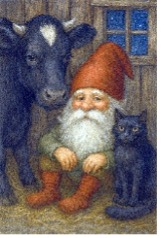
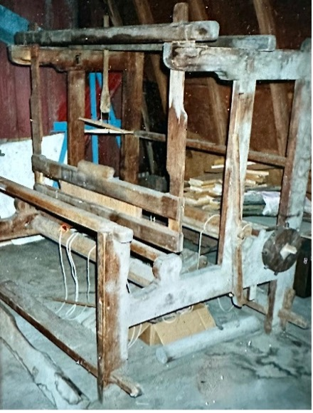
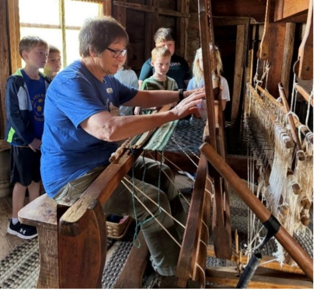
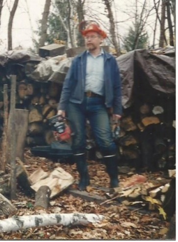
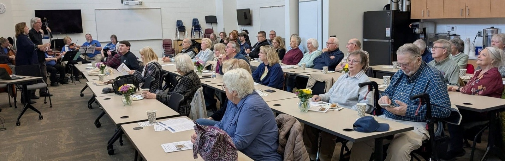
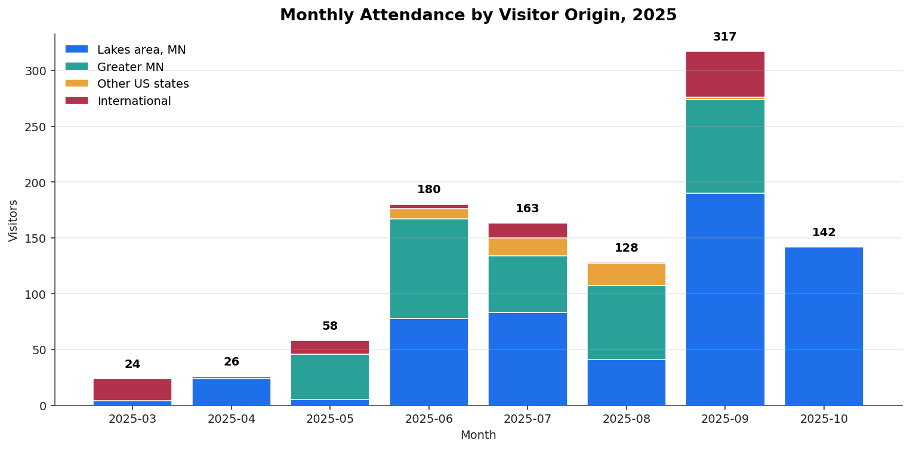
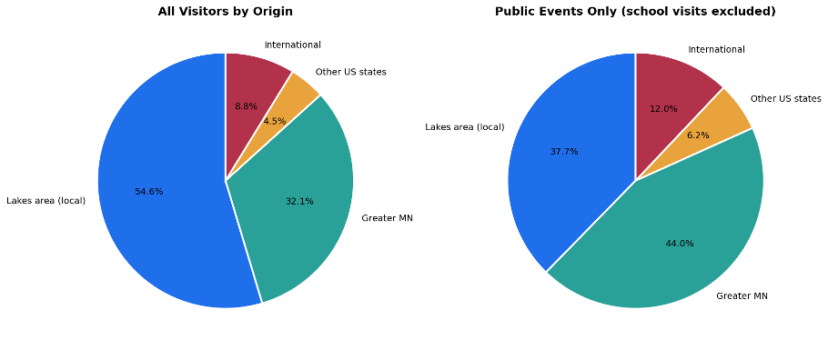

<html>
<head>
    <meta charset="UTF-8">
    <title>May 2026 Newsletter</title>
    <link rel="stylesheet" href="https://cdnjs.cloudflare.com/ajax/libs/font-awesome/6.0.0/css/all.min.css">
    <link rel="preconnect" href="https://fonts.googleapis.com">
    <link rel="preconnect" href="https://fonts.gstatic.com" crossorigin>
    <link href="https://fonts.googleapis.com/css2?family=DM+Sans:wght@400;500;700&family=Playfair+Display:wght@400;600;700&display=swap" rel="stylesheet">
    
</head>
<body>

    <button class="accessibility-toggle" onclick="toggleAccessibilityMenu()"><i class="fas fa-universal-access"></i> Accessibility</button>
    

        
Normal text

        
Large text

        
Larger text

        
Dyslexia-friendly

        
More spacing

        
Highlight links

        
Reset all

        
Close menu

    

    &#x2715; Back to newsletter
    
    

<!-- ════════════════════════════════════════════════════
     PAGE 1 — COVER
     ════════════════════════════════════════════════════ -->

    

        
May 2026

        

            <h1>Friends of the Karl Oskar House Newsletter</h1>
            
Preserve, Share and Celebrate Swedish Immigration and Culture

        

        

            
        

        

            

                
Nils Hasselmo Interview Discovered

                
See page 2 for details

            

            

                
Growing Up Swedish in Minnesota

                
Part 1 &bull; Eight Weeks of Summer School

            

        

        

            

                
Welcome!

                

                    
                    
Gary Noren, President Friends of the Karl Oskar House

                

                

                    
<!-- President's welcome message goes here. This section uses a two-column newspaper layout with the portrait floating to the right. -->

                

            

            

                
Upcoming Events

                

                    

                        
Swedish Conversation Group

                        
American Swedish Institute

                        
May 8: 10:30&ndash;11:30am &bull; Lindberg Stuga

                        
May 22: 10:30&ndash;11:30am &bull; Classroom A

                    

                    

                        
Pratstund i svenskbygderna

                        
Second Monday of each month &bull; 7&ndash;8pm CDT &bull; Zoom

                        
A friendly Swedish conversation hour hosted by the Friends of the Karl Oskar House &mdash; all levels welcome, including those with just a little Swedish. <strong>Check our website for the Zoom link.</strong>

                    

                    

                        
Nordic Folk Music Jam

                        
Under the Astrakan apple tree

                        
June 7 &bull; 1:30&ndash;3:30pm

                        
We open the season with a Nordic Folk Music Jam, led by Eric Platt and Tom Sullivan. Musicians and supporters welcome. Bring friends who play Nordic folk music.

                    

                

            

        

    

<!-- ════════════════════════════════════════════════════
     PAGE 2 — FEATURE ARTICLE
     ════════════════════════════════════════════════════ -->

    

        

            Friends of the Karl Oskar House Newsletter
            Page 2
        

        

            
        

        

            

                
Growing Up Swedish in Chisago

                
Part 1: Eight Weeks of Summer School

                
By Peter Grund

                

                    
District 14 schoolhouse in Chisago County stood half a mile from Emeroy Johnson&rsquo;s home. When he started school there in 1905 at age six, he heard English spoken for the first time. Until then, he had known only the <em>amerikasvenska</em> his parents and neighbors spoke.

                    
The public school term lasted eight months from mid-September to mid-May. Then came a single week of vacation. And then he walked right back into the same building for eight more weeks of Swedish school.

                    
This was the <em>svenskskola</em>, a summer parochial school run by the Chisago Lake Lutheran Church. Children between seven to thirteen attended. 1908, enrollment was 254 across eight district schools served by the congregation.

                    
<strong>A School as Old as the Congregation.</strong> The Chisago Lake congregation established its first one in May 1854. It was the same year the church was established. Eric Norelius taught the first three-month term. Five years later, the congregation hired Johannes Peterson, who became known as &ldquo;Skol-Johan.&rdquo; His salary was a mere $4 a month, eight bushels of rye and corn, and free board.

                    
When the Scandia Grove congregation organized in 1858, the members wrote into their founding minutes: &ldquo;Since we have been born and raised in the faith of the Evangelical Lutheran Church, we also, in this country, for our own good, want to stay by this church confession and give to our children&rsquo;s children that which we have received.&rdquo;

                    
Since Sunday schools alone were not adequate, there was a parochial summer term in Swedish. By 1885, two congregations ran 40 to 50 weeks of school; four ran 30 to 38 weeks; 19 ran 12 to 16 weeks; and 22 ran 8 to 11 weeks.

                    
Students started with the <em>ABC-boken</em>, an alphabet primer authorized by the Augustana Synod in 1890 and reprinted until 1919. In 1908, a newer reader called <em>F&ouml;rsta l&auml;seboken</em> appeared, with colored pictures and a word-based approach.

                    
The students studied Bible history too. The crown of the curriculum was Luther&rsquo;s Small Catechism, with its 307 questions and answers. Students were expected to memorize all of it before confirmation at age fourteen or fifteen.

                    
A more advanced reader, <em>F&ouml;rsamlingsskolans l&auml;sebok</em>, ran to 382 pages. It included biographies of Gustaf Vasa, Columbus, Washington, and Lincoln. Articles ranged from bees to whales, from electricity to Niagara Falls. Johnson called it &ldquo;more than a reader.&rdquo;

                

                
&hellip;Continued on page 3

            

            

                

                    
A Voice from 1960

                    
University of Minnesota &bull; KUOM Radio

                    
In this recently discovered recording, Professor Nils Hasselmo of the University of Minnesota&rsquo;s Department of Scandinavian Studies discusses his research on bilingualism in Chisago County. Hasselmo interviewed 40&ndash;50 residents of the Chisago Lakes region, focusing on Swedish immigrants, their descendants, and their language skills. He also surveyed 10% of area residents on their fluency in Swedish.

                    

                        

                            

                                <i class="fas fa-play" style="color: var(--swedish-blue); font-size: 16px; margin-left: 3px;"></i>
                            

                            

                                
Play Recording

                                
0:00

                                

                                    

                                

                            

                        

                        <audio preload="metadata">
                            <source src="/project_subpages/2026-05/hasselmo-1960.mp4" type="video/mp4">
                        </audio>
                    

                    
Conversation with Nils Hasselmo on Swedish Language Research in Chisago County, Minnesota (1960)

                    
                    
Nils Hasselmo

                

            

        

    

<!-- ════════════════════════════════════════════════════
     PAGE 3 — CONTINUED ARTICLES
     ════════════════════════════════════════════════════ -->

    

        

            Friends of the Karl Oskar House Newsletter
            Page 3
        

        
Continued from page 2&hellip; <strong style="color: var(--text-dark);">Growing Up Swedish in Chisago</strong>

        

            
A typical day ran from 9:00 a.m. to 4:00 p.m. Mornings opened with a hymn or two, then a chapter from the New Testament. Older pupils would read aloud a verse each. Next each class had a five- or ten-minute period twice or more per day with the teacher listening as students recited from memory. On hot summer afternoons, teachers sometimes moved school outside under the shade of a large elm near the schoolhouse.

            
<strong>The Teachers.</strong> Most Swedish school teachers were members of the local congregation. Many were experienced public school teachers during the winter. Some were college students from Gustavus Adolphus sent out to teach summer terms. Johnson remembered one Gustavus student, a young woman who had studied music there, as one of his best teachers. She could play the old reed organ, and the children learned songs from the <em>S&ouml;ndagsskolbok</em>.

            
Two years after his own confirmation, Johnson&rsquo;s pastor surprised him by asking him to teach. Among his thirty pupils were his two younger brothers and a seven-year-old sister. They caused him no trouble, he wrote, &ldquo;probably for fear of being reported at home.&rdquo; A few days after the term ended, a check for $35.00 arrived from the church treasurer.

            
<strong>The Schools Fade.</strong> In 1910, 151 Minnesota Conference congregations ran weekday schools enrolling 6,195 pupils. By 1920, only 88 congregations still had schools, with 3,056 pupils. At Chisago Lake, the shift to English started in 1914 when one boy was confirmed in English for the first time. Within ten years, Swedish had all but disappeared from the schools.

            
Conference minutes trace the arc. In 1883: &ldquo;The congregations more and more are aware of the importance of the parish school.&rdquo; But by 1914: &ldquo;Schools for Christian instruction seem to be losing the support and encouragement that they need.&rdquo; And in 1921: &ldquo;The interest in these schools was weakening more and more, and had disappeared in many congregations.&rdquo;

            
The 1922 publication of a bilingual Swedish-English catechism, printed in a single run of 2,000 copies, marked the end. After nearly seventy years, the summer Swedish schools gave way to a new generation, a new language, and a changed church.

        

        
<strong>Sources:</strong> Emeroy Johnson, &ldquo;Swedish Elementary Schools in Minnesota Lutheran Congregations,&rdquo; <em>Swedish Pioneer Historical Quarterly</em> 30 (1979); Thomas Wayne Shaffer, &ldquo;From Sacred Learning to Secular Education: Swedish Lutherans in Southern Chisago County, Minnesota, 1875&ndash;1922&rdquo; (EdD diss., University of St. Thomas, 1996). Photo: (711910). Swedish School, Chisago Lake District 8.

        

        

            <h3>The Emigration and the Linn Family &bull; Chapter 5: The Gnomes by the Graveyard</h3>
            
Excerpts from <em>A Man Called Glader</em> by Bodil Stefansson

            

                
                
The Tomtegubbar &mdash; small house-spirits of Swedish folklore

            

            

                
Many sources of income were required to support a large family with nine children. In wintertime when the eldest sons at Linnehult S&ouml;dreg&aring;rd became old enough, they would haul timber to the port towns of Blekinge. During the spring, they would drive at night when the ground was frozen rather than during the day when the ground thawed and the conditions worsened.

                
Many years later at Chisago Lake, Carl Linn told neighbor boy Arvid Carlsson about a strange experience that happened at the beginning of the 1850s, one night in Sm&aring;land in the old country:

                

                    
My brother and I were driving lumber from Linnehult in Hovmantorp parish to Karlshamn. We were driving at night. It took three days because we only had one horse. Many times when we drove past churches and graveyards my brother saw things that I could not see.

                    
Once when we drove past a graveyard the horse began to labor very heavily under the load. Then my brother came up to me and said: &ldquo;Kalle, be quiet&hellip; Say nothing! There are two small gnomes riding on my load, and the horse is pulling so hard he is working up a sweat.&rdquo; &ldquo;Just be quiet,&rdquo; I told him.

                    
Then we came to a Church and he said: &ldquo;Now they went away&hellip; now they left and went into the church.&rdquo; And then the lights were on in the Church! It must have been some kind of witchcraft&hellip; the gnomes left the load, went in to church and it was lit up&hellip; and there was no one in the church at that time &mdash; two o&rsquo;clock in the morning!

                

                
Carl and his brother Peter likely traveled together for safety. Travel in old Sweden was dangerous &mdash; boys from villages along the way sometimes attacked travelers, and fights could break out at a <em>g&auml;stgiveria</em>. They had to be tough. It was similar in new America, and the old ways were retained. Carl&rsquo;s granddaughter Myrtle remembered: &ldquo;Carl, John and Frank were brothers. They didn&rsquo;t write diaries or anything of the sort&hellip; They were a kind of rough crowd.&rdquo;

                
The gnomes were probably <em>Tomtegubbar</em>, small house-spirits portrayed as little old men, believed to protect houses, animals and farms &mdash; but vile if ignored or mistreated. Our portrayal of St. Nicholas evolved from the good side of these creatures.

            

        

    

<!-- ════════════════════════════════════════════════════
     PAGE 4 — KARL OSKAR HOUSE CHAPTER 8 (LOOM)
     ════════════════════════════════════════════════════ -->

    

        

            Friends of the Karl Oskar House Newsletter
            Page 4
        

        
Scandinavian Weaving &amp; the Four-Harness Loom

        
Karl Oskar House &bull; Chapter 8

        

            
Scandinavian weaving in Minnesota is a deeply rooted tradition brought by 19th-century Swedish, Norwegian, and Finnish immigrants. Settlers brought, or built, traditional Scandinavian looms to produce essential items like bedding, rugs, and clothing in rural communities.

            
The loom we have in the Karl Oskar House was found in the attic of the house. It is a Four Harness Loom, about 150 years old by now. It is still useable, and our member Gloria Peterson demonstrates how to use it for visiting school children.

            
A four-harness loom (also known as a 4-shaft loom) is a versatile, commonly used weaving machine containing four rectangular frames &mdash; harnesses or shafts &mdash; that lift and lower warp threads to create complex patterns. It allows for designs beyond simple plain weaves, such as twill, overshot, and herringbone.

        

        

            

                
                
Found in the attic of the Karl Oskar House

            

            

                
                
Gloria Peterson demonstrates how to use the loom

            

        

        

        

            <h3>The Chain Power Saw &bull; Joke of the Month, told by Sven Sj&ouml;stedt</h3>

            

                
            

            
Ole went to the hardware store to buy a new saw. The salesman said he should consider a chain power saw, and told him how much more wood he could cut with it than with a regular bow saw. Ole trusted the salesman and bought one.

            
A few days later Ole came back to return the new chain power saw. He said it was no good at all &mdash; he cut less wood with it. The salesman couldn&rsquo;t understand it, and suggested they go out to the wood pile behind the store to compare. It took 5 minutes with the bow saw. Then the sales rep took the chain power saw and started it up.

            
<em>Ole took a step back and burst out: &ldquo;What noise is that?!&rdquo;</em>

            

        

    

<!-- ════════════════════════════════════════════════════
     PAGE 5 — ANNUAL MEETING MINUTES
     ════════════════════════════════════════════════════ -->

    

        

            Friends of the Karl Oskar House Newsletter
            Page 5
        

        

            
        

        
Karl Oskar House Annual Meeting

        
April 11, 2026 &bull; Chisago Lakes High School Wildcat Community Center

        

            
The morning began with Fika at 9:30 am, with Swedish Folk Music by Nya Duvem&aring;la Folkmusiklag. At 10 am Gary Noren and Marty Harding led everyone in singing &ldquo;H&auml;lsa dem d&auml;rhemma,&rdquo; accompanied by the Karl Oskar Band.

            
President Gary Noren then welcomed everyone present and introduced current board members, and Peter Grund, who is helping with the newsletter. Gary presented the year in review with photos taken of activities at the Karl Oskar House and in the area during the last year.

            
Carla gave an introduction to a video that was played of Carl-Werner Pettersson, of Sweden, connecting him to relatives in the Chisago Lakes area. In the video he describes how he came with only a picture of a person and found several relatives.

            
The treasurer&rsquo;s report for 2025 was presented by Pam Deimel.

            
Summer highlights for 2026 were presented by Marilyn. Eleven music concerts will be performed between June 7 and September 27, including Midsommar. Kubb will be available to learn and to be played 5 times throughout the summer. Events will be listed in the Summer Brochure (currently at the printer), on Facebook, and on the website. There will also be reminders in the <em>Chisago County Press</em>.

            
Corliss talked about volunteer opportunities available, and training available for new volunteers. A Newsletter is published monthly by Sven Sj&ouml;stedt and Peter Grund. Copies are emailed to members, and mailed if no email addresses. This has been a great addition for the community to become familiar with the KOH.

            
A presentation regarding &ldquo;That&rsquo;s My Brick&rdquo; fundraiser was made by Peter O. It was explained what they are, and where they are located at the Karl Oskar House. They can be in honor or in memory of people. A brochure has been printed explaining the process, or you may order online at <a href="https://thatsmybrick.com/karloskar">thatsmybrick.com/karloskar</a>.

            
President Gary then thanked everyone for coming and for support as members of the organization. (Yearly dues &mdash; $20 individual, $30 family.) Time for more FIKA and conversation.

        

        
Submitted by Marilyn Wahlstr&ouml;m, Secretary

        

        <h3 style="font-family: 'Playfair Display', serif; font-size: 18pt; color: var(--text-dark); margin-bottom: 2px;">2025 Visitor Statistics</h3>
        
A look back at who visited the Karl Oskar House last year

        

            

                
                
Monthly visitor attendance across 2025

            

            

                
                
Where our visitors came from

            

        

    

<!-- ════════════════════════════════════════════════════
     PAGE 6 — BACK PAGE / COMMUNITY
     ════════════════════════════════════════════════════ -->

    

        

            Friends of the Karl Oskar House Newsletter
            Page 6
        

        

            <h3>Swedish/English Blog</h3>
            
If you'd like to test your knowledge of Swedish, you can check out Sven's blog. It is in both languages. You can visit <i>Den Gamle Emigranten</i> at <a href="https://dengamleemigranten.bloggplatsen.se/">dengamleemigranten.bloggplatsen.se</a>

        

        

        <h3 style="font-size: 15pt; color: var(--swedish-blue); margin-bottom: 8px;">Get Involved</h3>
        
Why join our organization? You get fellowship, information, education, and entertainment &mdash; knowing that you help promote a good cause and preserve cultural immigration history.

        

            

                <h3>Become a Member</h3>
                <ul>
                    <li>Individual: $20 annually</li>
                    <li>Family: $30 annually</li>
                </ul>
                
Mail checks to: <strong>PO Box 12, Lindstrom, MN 55045</strong>

            

            

                <h3>Volunteer Opportunities</h3>
                
<strong>Currently needed:</strong>

                <ul>
                    <li>Newsletter contributors</li>
                </ul>
            

        

        

            <h3>Stay Connected</h3>
            

                Website: <a href="https://friendsofthekarloskarhouse.org">friendsofthekarloskarhouse.org</a> &bull;
                Facebook: <a href="https://www.facebook.com/LindHistSoc">Friends of the Karl Oskar House</a>
            

            

                

                    <strong>General Info</strong>
                    Gary Noren 
                    garynoren@gmail.com
                

                

                    <strong>Newsletter</strong>
                    Sven Sj&ouml;stedt &bull; svendasvede@aol.com 
                    Peter Grund &bull; peter_grund@me.com
                

                

                    <strong>Music Events</strong>
                    Marilyn Wahlstrom 
                    mjwahls@msn.com
                

            

        

    

</body>
</html>
