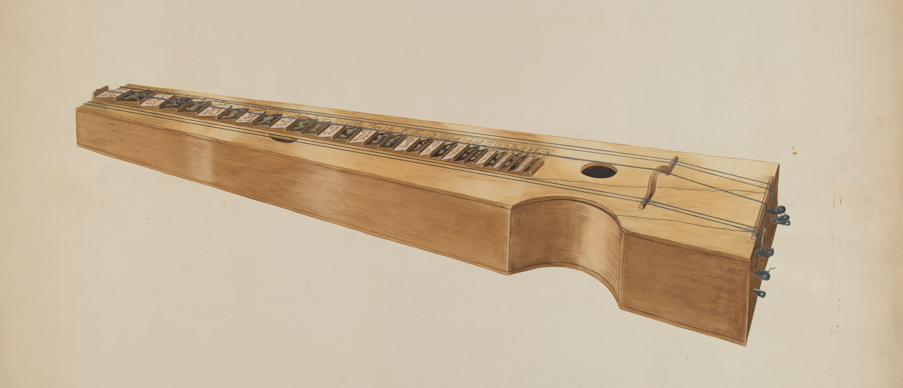
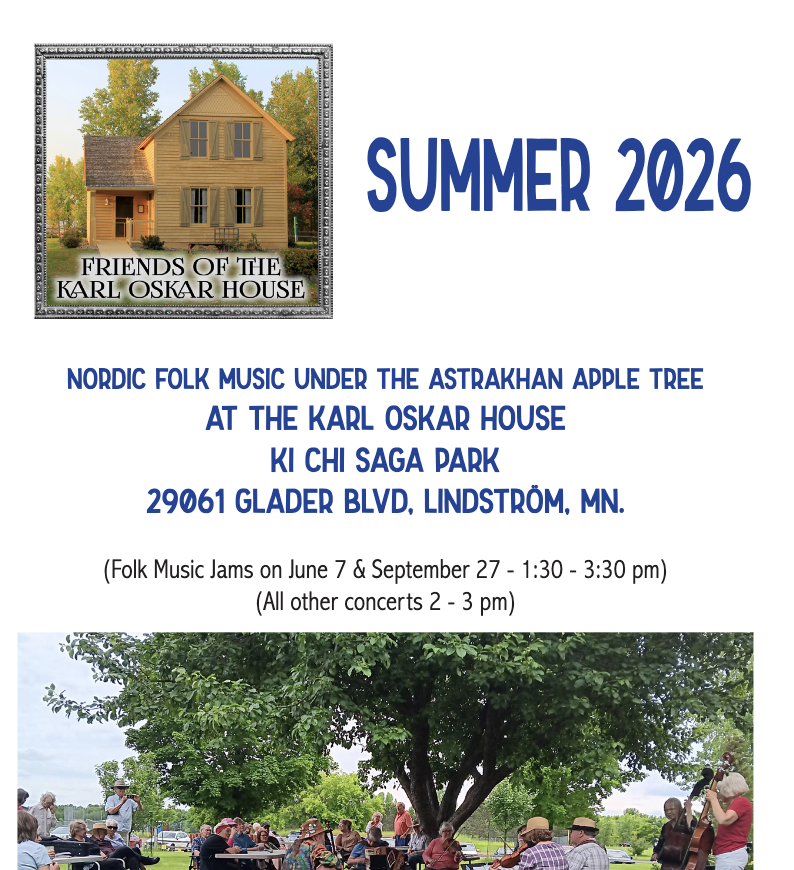
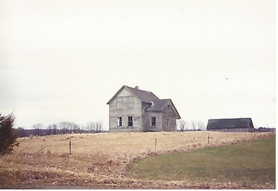
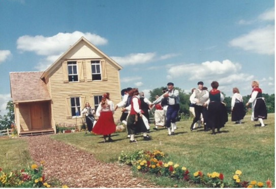
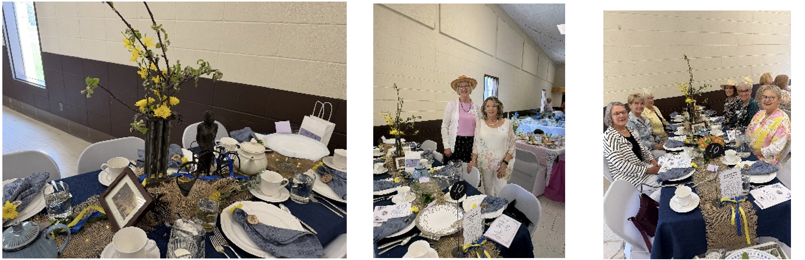

<html>
<head>
    <meta charset="UTF-8">
    <title>June 2026 Newsletter</title>
    <link rel="stylesheet" href="https://cdnjs.cloudflare.com/ajax/libs/font-awesome/6.0.0/css/all.min.css">
    <link rel="preconnect" href="https://fonts.googleapis.com">
    <link rel="preconnect" href="https://fonts.gstatic.com" crossorigin>
    <link href="https://fonts.googleapis.com/css2?family=DM+Sans:wght@400;500;700&family=Playfair+Display:wght@400;600;700&display=swap" rel="stylesheet">
    
</head>
<body>

    <button class="accessibility-toggle" onclick="toggleAccessibilityMenu()"><i class="fas fa-universal-access"></i> Accessibility</button>
    

        
Normal text

        
Large text

        
Larger text

        
Dyslexia-friendly

        
More spacing

        
Highlight links

        
Reset all

        
Close menu

    

    &#x2715; Back to newsletter
    
    

<!-- ════════════════════════════════════════════════════
     PAGE 1 — COVER
     ════════════════════════════════════════════════════ -->

    

        
June 2026

        

            <h1>Friends of the Karl Oskar House Newsletter</h1>
            
Preserve, Share and Celebrate Swedish Immigration and Culture

        

        

            
        

        

            

                
Walked 400 km to Buy a Cow

                
The Linn Family &bull; Page 3

            

            

                
Growing Up Swedish in Minnesota

                
Part 2 &bull; The Psalmodikon &bull; Page 2

            

        

        

            

                
Welcome!

                

                    

                        
                        
Gary Noren, President Friends of the Karl Oskar House

                    

                    
&ldquo;The Karl Oskar House will reopen for the 2026 season on June 7th.&rdquo; That&rsquo;s the first sentence in our lead article at the Friends of the Karl Oskar House website. It goes on to say that &ldquo;we open the season with a Nordic Folk Music Jam, led by Eric Platt and Tom Sullivan. Musicians and supporters are welcome. Bring friends who play Nordic folk music.&rdquo; See you there! And here is a link to the <a href="https://friendsofthekarloskarhouse.org/2026-music-brochure/">music series brochure</a> that Marilyn Wahlstrom painstakingly organizes for us every summer. Tusen tack, Marilyn!

                    
Speaking of volunteers, our Friends group relies on volunteers for everything we do. Corliss Vadner coordinates scheduling for those willing to serve as Sunday afternoon hosts during the summer months. She also offers training for anyone interested, helping volunteers become more familiar with the history of the house and the Moberg legacy. To learn more or sign up, contact her at churchlady12@aol.com or 952 454 3355.

                    
The warm weather arrived just in time for Memorial Day weekend and the start of our summer fun at the Karl Oskar House! We&rsquo;re hoping to expand the landscaping and plantings around the house this season. If you have landscaping experience and would be willing to lend a hand or offer guidance, we would greatly appreciate your help. Please email me at garynoren@gmail.com if you&rsquo;re interested.

                

            

            

                
Upcoming Events

                

                    

                        
Nordic Folk Music Jam

                        
Under the Astrakan apple tree

                        
June 7 &amp; September 27

                        
We continue the tradition of opening and closing the season with a Nordic Folk Music Jam, led by Eric Platt and Tom Sullivan. All are welcome &mdash; please bring fellow musicians who play Nordic folk music, and supporters.

                    

                    

                        
Pratstund i svenskbygderna

                        
June 8 &bull; Second Monday of each month &bull; 7&ndash;8pm CDT &bull; Zoom

                        
A friendly Swedish conversation hour hosted by the Friends of the Karl Oskar House &mdash; all levels welcome, including those with just a little Swedish. <strong>Check our website for the Zoom link.</strong>

                    

                

            

        

    

<!-- ════════════════════════════════════════════════════
     PAGE 2 — FEATURE ARTICLE
     ════════════════════════════════════════════════════ -->

    

        

            Friends of the Karl Oskar House Newsletter
            Page 2
        

        

            
        

        

            

                
Growing Up Swedish in Minnesota

                
Part 2: The Psalmodikon

                
By Peter Grund

                

                    
Sweden has been called a land of song. Its folk melodies number more than eighteen thousand. Its university choruses won international fame as early as 1867, when a hundred singers from Uppsala entered a contest in Paris. Jenny Lind and Christina Nilsson where a few who carried Swedish music to concert stages across Europe and America.

                    
The music that mattered most in early Chisago County came with farmers and farmhands. Their instruments were packed alongside hymnbooks, carried across the Atlantic. Their songs comforted lonely spirits and kept the memory of Sweden alive in the new and unfamiliar country.

                    
One of the oldest and best-known ballads, &ldquo;<em>Vi s&auml;lde v&aring;ra hemman</em>&rdquo; (&ldquo;We Sold Our Farms&rdquo;), was sung to an old religious melody. Its opening verse captures the ache of departure. It describes how the immigrants leave like birds at the end of summer, but unlike birds, they will never return. The immigrant ballad writers borrowed whatever tunes were at hand, be it Swedish folk songs, chorales, or even a portion of &ldquo;Yankee Doodle.

                    
When the earliest congregations gathered for worship in Minnesota, singing was difficult. A precentor led the hymns, but everyone sang in their own way. One early churchgoer described the scene: he sang according to Dillner&rsquo;s Psalmodikon, the precentor beside him sang a different tune, a woman by the door sang louder than everyone else and led a group of her neighbors in yet another direction, and a man on the other side had his own version going. &ldquo;Together this made a peculiar sound,&rdquo; the observer noted. &ldquo;It was anything but edifying.&rdquo;

                    
<strong>The Psalmodikon.</strong> This was the instrument that held pioneer church music together. It is a simple, single-stringed box instrument played with a bow. It used a numerical notation system developed by Johan Dillner. Dillner believed that if peasants in rural Sweden could learn his number system, they could teach themselves the chorales without needing a trained musician or an expensive organ.

                    
After one congregation practiced songs on three Sunday afternoons using the psalmodikon, their singing improved so much that Dillner concluded: &ldquo;Distribute the psalmodikon and the people will teach themselves.&rdquo; Pastors in Minnesota carried psalmodikons with them on their preaching rounds. Eric Norelius reported that the instruments were &ldquo;quite generally used&rdquo; in pioneer congregations. The St. Paul Swedish church used one as late as 1860.

                    
                

                
&hellip;Continued on page 3

            

            

                

                    
2026 Summer Music Series

                    
June 7 &ndash; September 27

                    
Eleven concerts will be performed under the Astrakan apple tree this summer, between June 7 and September 27 &mdash; including Midsommar. The season opens and closes with a Nordic Folk Music Jam led by Eric Platt and Tom Sullivan.

                    
Marilyn Wahlstrom organizes the lineup for us every summer. See the full schedule in the <a href="https://friendsofthekarloskarhouse.org/2026-music-brochure/"><strong>music series brochure</strong></a>.

                

                
            

        

    

<!-- ════════════════════════════════════════════════════
     PAGE 3 — CONTINUED ARTICLES
     ════════════════════════════════════════════════════ -->

    

        

            Friends of the Karl Oskar House Newsletter
            Page 3
        

        
Continued from page 2&hellip; <strong style="color: var(--text-dark);">Growing Up Swedish in Minnesota</strong>

        

            
Swedish hymnbooks were scarce in the early settlements. Peter Cassel, who led one of the first groups of Swedish settlers to Iowa in 1845, wrote back to Sweden asking his brother to send three copies of the small hymnbook, explaining that &ldquo;we have used the old copies so much that they are almost worn out.&rdquo;

            
The first Swedish hymnbook printed in America, <em>Femtio andeliga s&aring;nger</em> (Fifty Sacred Songs), appeared in 1856 in Galesburg, Illinois. It contained only words, no music. When notation was added to some of its songs in an early Swedish-American newspaper, it was printed in Dillner&rsquo;s numeral system for the psalmodikon &mdash. This may have been one of the first music published by Swedish Americans.

            
The book that became essential to Swedish-American sacred music was the <em>Hemlandss&aring;nger</em> (Songs of the Homeland), which was first published around 1860. Even in its 1892 form, about ninety percent of the songs came from Sweden. Hymn writer Lina Sandell contributed 44 texts, and Oscar Ahnfelt, the popular revival singer, 63 texts.

            
A people who had memorized fifty to eighty psalm verses during confirmation preparation did not stop singing when they left church. One Swedish-American household sang chorales from the psalmbook at morning devotions and from <em>Hemlandss&aring;nger</em> in the evenings. During the Civil War, a Swedish-American officer wrote to his wife describing a scene from camp: &ldquo;There they stood tonight out on the snow in two ranks, the whole company with bare heads, and perfectly still.&rdquo; Then they all sang with one voice a Swedish evening hymn. Such singing, wrote another Swede, &ldquo;did more good than many sermons.&rdquo;

            
The Swedish immigrants created little original music that outlived their generation. Their contributions lay elsewhere, like in editing and arranging, in translating texts, in keeping Swedish hymns and anthems alive in America. When the language changed, the music changed too. But even as late as 1920, more Swedish than English hymnals rolled off the presses of the Augustana Book Concern.

        

        

        

            <h3>The Emigration and the Linn Family &bull; Chapter 6: Walked 400 Kilometers to Buy a Cow</h3>
            
Excerpts from <em>A Man Called Glader</em> by Bodil Stefansson

            

                
Carl Jonasson from Linnehult S&ouml;dreg&aring;rd in Hovmantorp parish was among the seventeen in the first group of emigrants in 1852. He was born in 1825 to Jonas Andersson and Maria Petersdotter. In America, Carl took the surname Linn after his birthplace.

                
By Chisago Lake, Carl established the farm he would own his whole life. He was the first among the settlers to have a cow &mdash; and he had to walk 40 Swedish miles (400 kilometers) to the market in Galena, Illinois, to buy it. As proof of how little money there was at the time, the wages he earned for a whole summer&rsquo;s hay-making came to only $5. Game, at least, was plentiful: Linn shot a hundred deer in a short time, then stopped counting them.

                
In 1854, Carl Linn married Lena Kajsa Jonasdotter Falk, who had come from Hovmantorp in 1853 together with Carl&rsquo;s siblings Peter, Johan, Ingrid, Johanna, and Lena. Frans arrived in 1870 and Kajsa in 1899; only one of Carl&rsquo;s siblings stayed behind in Sweden. These immigrants helped one another get established in the new country, and Carl finished a log cabin in 1853.

                
They threw themselves into building up the country. Free homesteads in Dakota drew some; the fertile Yakima Valley &mdash; where some of the finest apples in the United States are grown &mdash; and the promise of the West drew others. These descendants of Jonas Andersson and Maria Petersdotter are Americans in their interests and their loyalty to the country, and all have become an ornament to their ancestors.

            

        

        

            
            

                
Buy a Brick for the Walkway

                

                    
The Friends have begun a brick paver walkway at the front door, and our goal is to extend it all the way to the parking lot. A 4&times;8 brick holds up to three lines of text; an 8&times;8 brick holds up to six.

                    
It&rsquo;s a wonderful way to show your support, give a gift, create a memorial, or honor your family&rsquo;s heritage. Order online at <a href="https://thatsmybrick.com/karloskar">thatsmybrick.com/karloskar</a>.

                

            

        

    

<!-- ════════════════════════════════════════════════════
     PAGE 4 — KARL OSKAR HOUSE CHAPTER 8 (LOOM)
     ════════════════════════════════════════════════════ -->

    

        

            Friends of the Karl Oskar House Newsletter
            Page 4
        

        
Why Are We Here?

        
Karl Oskar House &bull; Chapter 9: Background to the Karl Oskar House

        

            
The four-volume masterpiece on Swedish emigration by the author Vilhelm Moberg consists of <em>The Emigrants</em> (<em>Utvandrarna</em>, 1949), <em>Unto a Good Land</em> (<em>Invandrarna</em>, &lsquo;The Immigrants,&rsquo; 1952), <em>The Settlers</em> (<em>Nybyggarna</em>, 1956), and <em>The Last Letter Home</em> (<em>Sista brevet till Sverige</em>, &lsquo;The Last Letter to Sweden,&rsquo; 1959). The Swedish version runs to 1,780 pages. The books have been translated into about 30 languages and have been the source for two feature films and a musical. (The Chisago County Historical Society carries the English editions.)

            
Vilhelm Moberg visited Lindstr&ouml;m and the surrounding Chisago Lakes area in the summer of 1948 to research the books. He spent months traveling the area by bicycle &mdash; studying its history, visiting local sites such as Glader Cemetery, and interviewing residents. On his way to Glader Cemetery he saw the Linn family farmhouse. The main characters in the books are the fictional Karl Oskar and Kristina Nilsson, and when Moberg saw the house he is said to have blurted out: &ldquo;In that house Karl Oskar shall die!&rdquo;

            
The Swedish immigrant Carl Linn built that house in 1860. Its last owners donated it to the Historical Society in 1995. Since then it has served as an educational and historical interpretive site, hosting more than a thousand visitors each year from across the world, as well as local school field trips. The house and grounds are maintained by the nonprofit organization &ldquo;Friends of the Karl Oskar House.&rdquo; The site is called Nya Duvem&aring;la, a reference to Kristina&rsquo;s fictional home in Sweden.

        

        

            

                
                
The Linn family farmhouse before its restoration

            

            

                
                
Nya Duvem&aring;la today, with Swedish folk dancers on the grounds

            

        

        

        

            <h3>The Deep-Sea Diver &bull; Joke of the Month, told by Sven Sj&ouml;stedt</h3>

            

                
            

            
Ole had just arrived in New York after immigrating from Sm&aring;land, Sweden. Like any good Sm&aring;l&auml;nning, he was thrifty. While looking for work, he sat down to rest a moment on a bench at the harbor. As he sat there, a deep-sea diver emerged from the water and began climbing up onto the quay. Ole stiffened, suddenly furious with himself.

            
<em>&ldquo;How silly of me,&rdquo; he said out loud. &ldquo;Just think how much money I would have saved if I had walked over from Sweden too!&rdquo;</em>

            

        

    

<!-- ════════════════════════════════════════════════════
     PAGE 5 — SPRING TEA + BACK PAGE / COMMUNITY
     ════════════════════════════════════════════════════ -->

    

        

            Friends of the Karl Oskar House Newsletter
            Page 5
        

        

            
        

        
Honoring the Early Settlers of Chisago County

        
Chisago County Historical Society Spring Tea

        
By Peggy Kamish-Eral

        

            
The Karl Oskar House&rsquo;s rustic-themed table at the Chisago County Historical Society Spring Tea featured a photograph of early settlers, a statue of Vilhelm Moberg, and an antique candle mold decorated with apple blossoms from the Karl Oskar House&rsquo;s Astrachan tree. The napkin holders were key rings made from the wood of that same tree.

            
The fundraising event raised approximately $5,000 for the Chisago County Historical Society. Co-hostesses for the Karl Oskar House table were Bonnie Anderson and Peggy Kamish-Eral.

        

        

        

            <h3>Swedish/English Blog</h3>
            
If you'd like to test your knowledge of Swedish, you can check out Sven's blog. It is in both languages. You can visit <i>Den Gamle Emigranten</i> at <a href="https://dengamleemigranten.bloggplatsen.se/">dengamleemigranten.bloggplatsen.se</a>

        

        

        <h3 style="font-size: 15pt; color: var(--swedish-blue); margin-bottom: 8px;">Get Involved</h3>
        
Why join our organization? You get fellowship, information, education, and entertainment &mdash; knowing that you help promote a good cause and preserve cultural immigration history.

        

            

                <h3>Become a Member</h3>
                <ul>
                    <li>Individual: $20 annually</li>
                    <li>Family: $30 annually</li>
                </ul>
                
Mail checks to: <strong>PO Box 12, Lindstrom, MN 55045</strong>

            

            

                <h3>Volunteer Opportunities</h3>
                
<strong>Currently needed:</strong>

                <ul>
                    <li>Newsletter contributors</li>
                </ul>
            

        

        

            <h3>Stay Connected</h3>
            

                Website: <a href="https://friendsofthekarloskarhouse.org">friendsofthekarloskarhouse.org</a> &bull;
                Facebook: <a href="https://www.facebook.com/LindHistSoc">Friends of the Karl Oskar House</a>
            

            

                

                    <strong>General Info</strong>
                    Gary Noren 
                    garynoren@gmail.com
                

                

                    <strong>Newsletter</strong>
                    Sven Sj&ouml;stedt &bull; svendasvede@aol.com 
                    Peter Grund &bull; peter_grund@me.com
                

                

                    <strong>Music Events</strong>
                    Marilyn Wahlstrom 
                    mjwahls@msn.com
                

            

        

    

</body>
</html>
