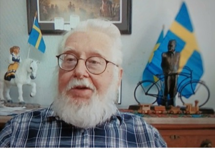
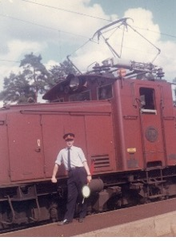
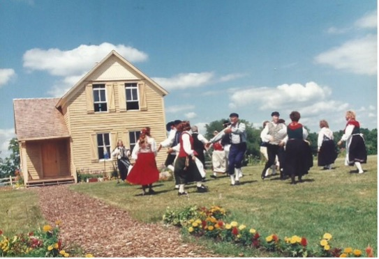
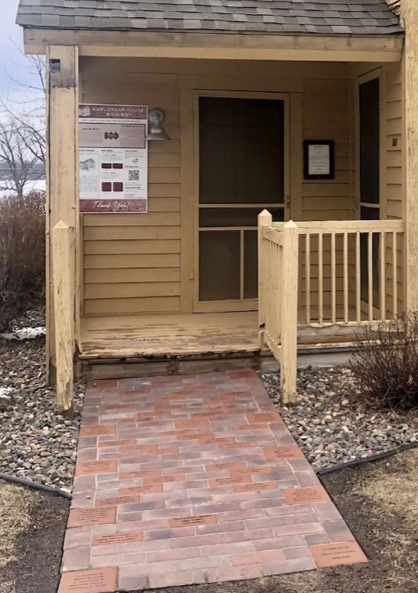
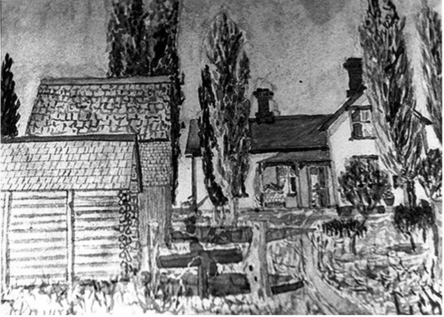
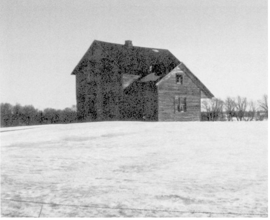
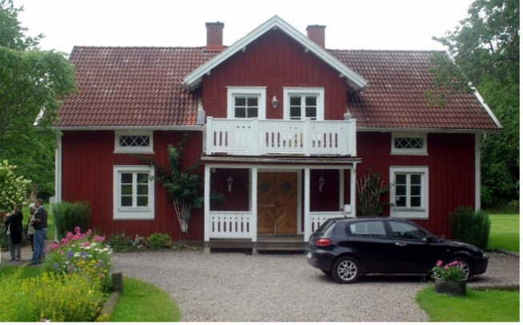
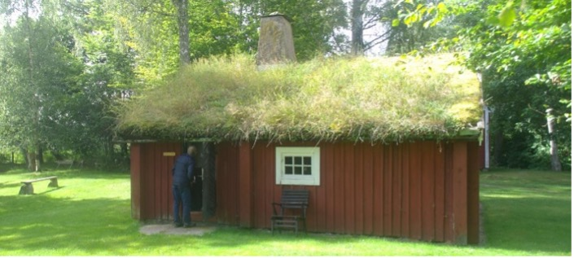

<html>
<head>
    <meta charset="UTF-8">
    <title>July 2026 Newsletter</title>
    <link rel="stylesheet" href="https://cdnjs.cloudflare.com/ajax/libs/font-awesome/6.0.0/css/all.min.css">
    <link rel="preconnect" href="https://fonts.googleapis.com">
    <link rel="preconnect" href="https://fonts.gstatic.com" crossorigin>
    <link href="https://fonts.googleapis.com/css2?family=DM+Sans:wght@400;500;700&family=Playfair+Display:wght@400;600;700&display=swap" rel="stylesheet">
    
</head>
<body>

    <button class="accessibility-toggle" onclick="toggleAccessibilityMenu()"><i class="fas fa-universal-access"></i> Accessibility</button>
    

        
Normal text

        
Large text

        
Larger text

        
Dyslexia-friendly

        
More spacing

        
Highlight links

        
Reset all

        
Close menu

    

    &#x2715; Back to newsletter
    
    

<!-- ════════════════════════════════════════════════════
     PAGE 1 — COVER
     ════════════════════════════════════════════════════ -->

    

        
July 2026

        

            <h1>Friends of the Karl Oskar House Newsletter</h1>
            
Preserve, Share and Celebrate Swedish Immigration and Culture

        

        

            
        

        

            

                
New! The Profile of the Month

                
Meet Sven Sj&ouml;stedt &bull; Page 2

            

            

                
The Karl Oskar Houses

                
The Linn Family, Chapter 7 &bull; Page 4

            

        

        

            

                
Welcome!

                

                    

                        
                        
Gary Noren, President Friends of the Karl Oskar House

                    

                    
June was a wonderful time for Midsommar festivals in our area. We celebrated with three Majst&aring;ng dances in Lindstr&ouml;m on June 20th and another dance around the Maypole at the Karl Oskar House on June 28th. The first three dances were led by the Lindstr&ouml;m Ambassadors, and the Karl Oskar House dance by Chris Ruser, accompanied by her husband Karl on the accordion.

                    
While I have enjoyed participating in Midsommar events in Sweden, I recently learned more about the history behind the celebration through an interesting New York Times article by Ingrid K. Williams entitled &ldquo;Party Like a Swede.&rdquo; I wanted to share an excerpt with you:

                    
Midsummer is a national holiday in Sweden celebrating the return of light after the long, dark Nordic winter. The custom of dancing around a Majst&aring;ng, or Maypole, decorated with greenery and flowers began in the late Middle Ages as an agrarian ritual imported from Germany to ensure a fruitful harvest. Many pagan superstitions were, and still are, associated with Midsummer Eve, including the belief that sleeping with seven different types of flowers &mdash; picked in complete silence! &mdash; under your pillow will conjure dreams of your future beloved.

                    
Looking ahead to 2027, Midsommar falls on a Sunday. We plan to host a single &ldquo;Dancing around the Majst&aring;ng&rdquo; event for the Lindstr&ouml;m area, and that event will be at the Karl Oskar House. I hope to see you all there!

                

            

            

                
Upcoming Events

                
All events take place at the Karl Oskar House.

                

                    

                        
Music by Johanna Solem and Eric Platt

                        
July 11 &bull; 2&ndash;3 pm

                    

                    

                        
Music by Nya Duvem&aring;la Folkmusiklag

                        
July 12 &bull; 2&ndash;3 pm

                    

                    

                        
Kubb Game

                        
July 19 &bull; 1&ndash;2:30 pm

                    

                    

                        
Music by Tom Sullivan

                        
July 26 &bull; 2&ndash;3 pm

                        
See the full summer schedule in the <a href="https://friendsofthekarloskarhouse.org/2026-music-brochure/">music series brochure</a>.

                    

                

            

        

    

<!-- ════════════════════════════════════════════════════
     PAGE 2 — PROFILE OF THE MONTH + JOKE
     ════════════════════════════════════════════════════ -->

    

        

            Friends of the Karl Oskar House Newsletter
            Page 2
        

        
The Profile of the Month

        
Meet Sven Sj&ouml;stedt, Communications Coordinator

        

            

                

                    
<strong style="color: var(--swedish-blue);">Name:</strong> Sven O. Sj&ouml;stedt.

                    
<strong style="color: var(--swedish-blue);">Position in our organization:</strong> Communications Coordinator.

                    
<strong style="color: var(--swedish-blue);">Tell us a little about yourself:</strong> Born 1945. Grew up in Sweden. Worked at the railroad. Married my first wife, Chris, in 1974. Emigrated with her to the US in 1983. Settled in Minnesota. Worked for Dayton&rsquo;s and then Target HQ until retirement in 2010. Always been active in Swedish America &mdash; volunteer at the American Swedish Institute, board member at the Friends of the Karl Oskar House, and so on. Chris died too early, in 2016. I met Marilyn at the Karl Oskar House in 2019. We married in 2024. And that is it.

                    
<strong style="color: var(--swedish-blue);">Why are you interested in being part of the Friends of the Karl Oskar House?</strong> My greatest interest since I came to the USA is Swedish immigrant culture, and this is the perfect place for me.

                    
<strong style="color: var(--swedish-blue);">Favorite activity at the Friends of the Karl Oskar House:</strong> The Sunday folk music program.

                    
<strong style="color: var(--swedish-blue);">Hobbies:</strong> Railroading, and Swedish immigration culture in Minnesota.

                    
<strong style="color: var(--swedish-blue);">Favorite movie:</strong> <em>The Emigrants</em>, the 1971 version by Jan Troell.

                    
<strong style="color: var(--swedish-blue);">Favorite music:</strong> Any Swedish folk music tune.

                    
<strong style="color: var(--swedish-blue);">Favorite sport:</strong> Bandy.

                    
<strong style="color: var(--swedish-blue);">Any last comment?</strong> The motto I live by: &ldquo;Make the rest of your life the best of your life.&rdquo;

                

            

            

                
                
Sven O. Sj&ouml;stedt

                

                    
A New Feature

                    
With this issue we start a new feature: we are going to introduce one of our members in each issue. We begin with Sven Sj&ouml;stedt.

                

            

        

        

            

            

                <h3>The Power from Above &bull; Joke of the Month, told by Sven Sj&ouml;stedt</h3>

                

                    
                    
From Sven&rsquo;s railroad days in Sweden

                

                
As you know, I worked for the railroad in Sweden before immigrating to the US. About 80 percent of the Swedish railway net is electrified. So &mdash; do you know what the similarity is between the Pope in Rome and the Swedish railways?

                
<em>&ldquo;They both take the power from above!&rdquo;</em>

                

            

        

    

<!-- ════════════════════════════════════════════════════
     PAGE 3 — KARL OSKAR HOUSE CHAPTER 10 (DUVEMÅLA)
     ════════════════════════════════════════════════════ -->

    

        

            Friends of the Karl Oskar House Newsletter
            Page 3
        

        

            
            
Nya Duvem&aring;la &mdash; the Karl Oskar House in Ki-Chi-Saga County Park, Lindstr&ouml;m, Minnesota

        

        
What Is Duvem&aring;la?

        
Karl Oskar House &bull; Chapter 10

        
Facts about Duvem&aring;la, gathered from the internet

        

            
Duvem&aring;la is a real hamlet in Sm&aring;land, Sweden, famous as the fictional home of Kristina, the protagonist of Vilhelm Moberg&rsquo;s classic <em>Emigrants</em> series. It serves as a symbol of Swedish heritage, inspiring a famous musical and a preserved pioneer home in the US. Duvem&aring;la can be understood across three main contexts.

            
<strong>1. The real hamlet &amp; museum.</strong> Located in Emmaboda Municipality, Duvem&aring;la is a small rural hamlet where the grandmother of Swedish author Vilhelm Moberg lived. Because Moberg spent time there, it inspired the setting for his famous 1940s&ndash;1950s novels. Today, the Rundqvistag&aring;rden farm in Duvem&aring;la operates as the <a href="https://www.guidebook-sweden.com/en/guidebook/destination/duvemala-local-museum-emmaboda">Duvem&aring;la Local Museum</a>, dedicated to the Swedish emigrant movement.

            
<strong>2. The musical.</strong> <em>Kristina fr&aring;n Duvem&aring;la</em> (<em>Kristina from Duvem&aring;la</em>) is a sweeping Swedish musical composed by former ABBA members Benny Andersson and Bj&ouml;rn Ulvaeus. Premiering in 1995, the musical closely follows Moberg&rsquo;s epic novels about a poor Swedish farming family who emigrate from Sm&aring;land to Minnesota in the mid-19th century to escape famine and religious persecution.

            
<strong>3. Nya Duvem&aring;la &mdash; the Karl Oskar House in Minnesota.</strong> In the Chisago Lakes area of Minnesota &mdash; where the real-life and fictional immigrants settled &mdash; there is a restored 19th-century Swedish immigrant house named <em>Nya Duvem&aring;la</em> (New Duvem&aring;la). Maintained by the <a href="https://friendsofthekarloskarhouse.org/history/">Friends of the Karl Oskar House</a>, this historic home sits in Ki-Chi-Saga County Park in Lindstr&ouml;m, Minnesota, and serves as a living tribute to the region&rsquo;s Swedish pioneers.

        

        

            

                
                
The brick paver walkway at the front door of Nya Duvem&aring;la &mdash; each engraved brick tells a story

            

        

        

            
            

                
Buy a Brick for the Walkway

                

                    
The Friends have begun a brick paver walkway at the front door, and our goal is to extend it all the way to the parking lot. A 4&times;8 brick holds up to three lines of text; an 8&times;8 brick holds up to six.

                    
It&rsquo;s a wonderful way to show your support, give a gift, create a memorial, or honor your family&rsquo;s heritage. Order online at <a href="https://thatsmybrick.com/karloskar">thatsmybrick.com/karloskar</a>.

                

            

        

    

<!-- ════════════════════════════════════════════════════
     PAGE 4 — THE EMIGRATION AND THE LINN FAMILY, CHAPTER 7
     ════════════════════════════════════════════════════ -->

    

        

            Friends of the Karl Oskar House Newsletter
            Page 4
        

        

            
            
The Linn farm in a painting by an unknown artist, ca. 1880s. Note the kitchen-dining addition with its porch on the left side of the house &mdash; and the log outbuilding at the far  left. From Duane Lunemann&rsquo;s photo collection.
 
        

        
The Karl Oskar Houses

        
The Emigration and the Linn Family &bull; Chapter 7

        
By John Linn

        

            
The Karl Oskar House at Chisago Lake was dedicated to honor and preserve the legacy of Swedish immigration &mdash; and particularly to recognize the many Sm&aring;landers at Chisago Lake who came from Moberg-Land. Algutsboda is Center City&rsquo;s Swedish sister city. Moberg visited Chisago Lake in 1948, riding his bicycle throughout the area and talking to the residents. One day, Moberg rode by a dilapidated but classic Swedish farmhouse and uttered: &ldquo;In that house Karl Oskar will live and die.&rdquo;

            
The house, built around 1862, was originally the family home of Carl Linn, and Carl is truly honored as the original builder of the now &ldquo;Karl Oskar House.&rdquo; But Carl lived his life in many houses &mdash; some in Sweden and some at Chisago Lake. Carl built his first house, a small log cabin, on land he purchased at Linn Lake. This sufficed for the first few years, but when Carl married, he started building a new, larger house.

            
One story goes: at first, the house was approximately the size of the modern-day Karl Oskar House. But this house did not have a &ldquo;farm family&rdquo; kitchen &mdash; the original cabin, perhaps improved and expanded, was still used as the kitchen. A full kitchen-dining area was later added on the left side of the house. This addition is evident in a photo of a painting by an unknown artist from around the 1880s, shown above. The addition included an inviting porch augmenting the entrance door. Much later, after Carl died, this kitchen-dining area caught fire and was demolished rather than repaired.

            
But did you notice another house? In the painting, the outbuilding at the extreme left appears to be a log cabin. A similar building appears, in a different place, in the background of another photo (see page 5). It was perhaps being used as a smokehouse. This is possibly what remains of Carl Linn&rsquo;s original home, built shortly after he arrived from Sweden in 1852. He housed many new immigrant arrivals in a tiny cabin like that &mdash; including his many siblings &mdash; until they were able to arrange housing for themselves.

            
In Sweden at the time of his emigration, Carl Linn lived in Linnehult in Hovmantorp parish. Magnus Jonasson was the leader of the party of emigrants and Carl&rsquo;s soon-to-be brother-in-law. Magnus was born in Furuby parish, north of Hovmantorp, and lived next door to Carl&rsquo;s mother, Maria Petersdotter. But in 1838 Magnus moved to a farm in Linneryd parish, about a mile from &Aring;kerby junction, where the party gathered for their momentous journey.

            
For the trip, Carl&rsquo;s younger brother Johan drove Carl by wagon from their home in Linnehult to Magnus&rsquo; farm. This was the first and only time Johan ever met his future wife, Maria Magnusdotter, in Sweden. The trip to Linneryd thus started from Carl&rsquo;s home in Linnehult, where he had lived most of his life in his homeland. That house still exists today, modernized but retaining the historic architecture.

            
Before moving to Linnehult in 1833, Carl&rsquo;s parents, Jonas Andersson and Maria Petersdotter, had moved in 1824 into a small house in Klintalycke. Carl and his twin sister, as well as a younger sister and a younger brother, were born there &mdash; so this small house was yet another house Carl lived in. In the 1960s, the house was renovated and moved to the Heritage Park in Hovmantorp, in a manner very similar to the origin of the Karl Oskar House.

            
In Sweden, a house was a symbol of success &mdash; a tradition the Swedish immigrants brought with them to America as well. Carl Linn ultimately made his fortunes at Chisago Lake and was dutifully satisfied with his achievements.

        

        
John Linn, Richardson, Texas &bull; May 28, 2026

    

<!-- ════════════════════════════════════════════════════
     PAGE 5 — THE HOUSES IN PICTURES + BACK PAGE
     ════════════════════════════════════════════════════ -->

    

        

            Friends of the Karl Oskar House Newsletter
            Page 5
        

        
The Houses of Carl Linn

        
The photographs to Chapter 7 &bull; story on page 4

        

            

                
                
The Linn farmhouse in an early photograph &mdash; look for the log building in the background. From Duane Lunemann&rsquo;s photo collection.

            

            

                
                
Carl Linn&rsquo;s home in Linnehult, Hovmantorp parish, as it stands today &mdash; modernized but retaining the historic architecture. From John Linn&rsquo;s photo collection.

            

            

                
                
The small house from Klintalycke where Carl was born, moved in the 1960s to the Heritage Park in Hovmantorp. From John Linn&rsquo;s photo collection.

            

        

        

        

            <h3>Swedish/English Blog</h3>
            
If you'd like to test your knowledge of Swedish, you can check out Sven's blog. It is in both languages. You can visit <i>Den Gamle Emigranten</i> at <a href="https://dengamleemigranten.bloggplatsen.se/">dengamleemigranten.bloggplatsen.se</a>

        

        

        <h3 style="font-size: 15pt; color: var(--swedish-blue); margin-bottom: 8px;">Get Involved</h3>
        
Why join our organization? You get fellowship, information, education, and entertainment &mdash; knowing that you help promote a good cause and preserve cultural immigration history.

        

            

                <h3>Become a Member</h3>
                <ul>
                    <li>Individual: $20 annually</li>
                    <li>Family: $30 annually</li>
                </ul>
                
Mail checks to: <strong>PO Box 12, Lindstrom, MN 55045</strong>

            

            

                <h3>Volunteer Opportunities</h3>
                
<strong>Currently needed:</strong>

                <ul>
                    <li>Newsletter contributors</li>
                </ul>
            

        

        

            <h3>Stay Connected</h3>
            

                Website: <a href="https://friendsofthekarloskarhouse.org">friendsofthekarloskarhouse.org</a> &bull;
                Facebook: <a href="https://www.facebook.com/LindHistSoc">Friends of the Karl Oskar House</a>
            

            

                

                    <strong>General Info</strong>
                    Gary Noren 
                    garynoren@gmail.com
                

                

                    <strong>Newsletter</strong>
                    Sven Sj&ouml;stedt &bull; svendasvede@aol.com 
                    Peter Grund &bull; peter_grund@me.com
                

                

                    <strong>Music Events</strong>
                    Marilyn Wahlstrom 
                    mjwahls@msn.com
                

            

        

    

</body>
</html>
