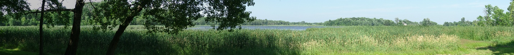
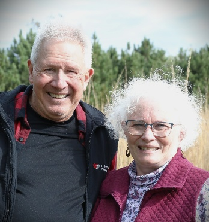
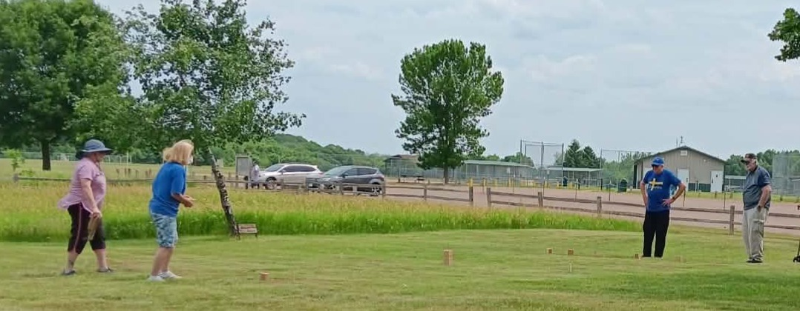
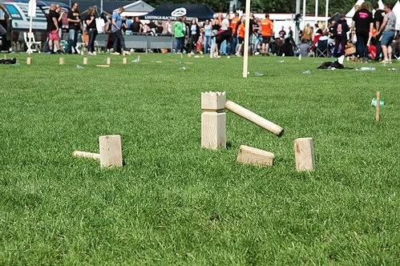
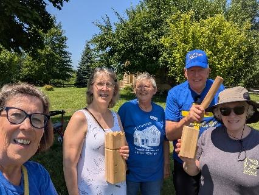
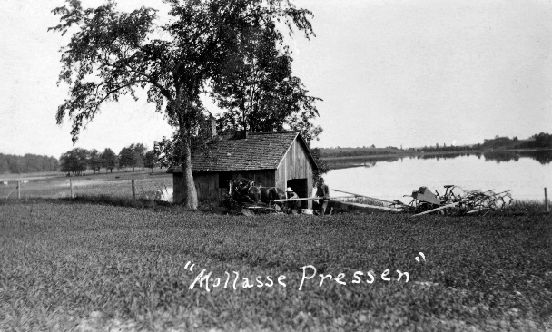
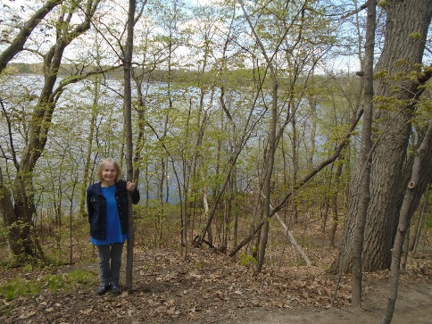
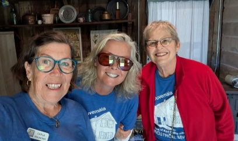
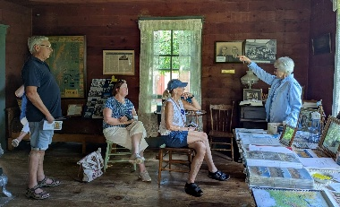
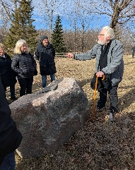

<html>
<head>
    <meta charset="UTF-8">
    <title>August 2026 Newsletter</title>
    <link rel="stylesheet" href="https://cdnjs.cloudflare.com/ajax/libs/font-awesome/6.0.0/css/all.min.css">
    <link rel="preconnect" href="https://fonts.googleapis.com">
    <link rel="preconnect" href="https://fonts.gstatic.com" crossorigin>
    <link href="https://fonts.googleapis.com/css2?family=DM+Sans:wght@400;500;700&family=Playfair+Display:wght@400;600;700&display=swap" rel="stylesheet">
    
</head>
<body>

    <button class="accessibility-toggle" onclick="toggleAccessibilityMenu()"><i class="fas fa-universal-access"></i> Accessibility</button>
    

        
Normal text

        
Large text

        
Larger text

        
Dyslexia-friendly

        
More spacing

        
Highlight links

        
Reset all

        
Close menu

    

    &#x2715; Back to newsletter
    
    

<!-- ════════════════════════════════════════════════════
     PAGE 1 — COVER
     ════════════════════════════════════════════════════ -->

    

        
August 2026

        

            <h1>Friends of the Karl Oskar House Newsletter</h1>
            
Preserve, Share and Celebrate Swedish Immigration and Culture

        

        

            
        

        

            

                
What Is Kubb?

                
The Swedish lawn game at the House &bull; Page 3

            

            

                
A Very, Very Long History of Linn Lake

                
The Linn Family, Chapter 8 &bull; Page 4

            

        

        

            

                
Welcome!

                

                    

                        
                        
Gary Noren, President Friends of the Karl Oskar House

                    

                    
Our summer music program is progressing nicely this year, and attendance has been good in spite of some very hot and humid weather. I think it&rsquo;s the breezes coming off the lake and the magic of that Astrachan apple tree that keeps people comfortable. &#x1F642;

                    
We are pleased to announce that we have two new board members joining us in 2027: <strong>Chris Ruser</strong>, who currently serves as our webmaster and Midsommar song and dance leader every June, and <strong>Robin Ekstrom Kling</strong>, a 3rd-generation Swedish American and volunteer at the American Swedish Institute. They will be replacing Carla Norelius and Gary Noren, as they depart the board (as required by our bylaws) after each serving nine years!

                    
We are still looking for a few more volunteers for hosting at the Karl Oskar House, specifically on August 9th. Please call Corliss at 952-454-3355 if you can help. Thank you.

                

                

                    
                    
Linn Lake today &mdash; read &ldquo;A Very, Very Long History of Linn Lake&rdquo; on page 4

                

            

            

                
Upcoming Events

                
All events take place at the Karl Oskar House.

                

                    

                        
Swedish Lawn Game Kubb

                        
August 2 &bull; 1&ndash;2:30 pm

                    

                    

                        
Music by Lauluaika

                        
August 9 &bull; 2&ndash;3 pm

                    

                    

                        
Swedish Lawn Game Kubb

                        
August 16 &bull; 1&ndash;2:30 pm

                    

                    

                        
American Swedish Male Chorus

                        
August 23 &bull; 2&ndash;3 pm

                    

                    

                        
Music by Twin Cities Nyckelharpalag

                        
August 30 &bull; 2&ndash;3 pm

                        
See the full summer schedule in the <a href="https://friendsofthekarloskarhouse.org/2026-music-brochure/">music series brochure</a>.

                    

                

            

        

    

<!-- ════════════════════════════════════════════════════
     PAGE 2 — PROFILE OF THE MONTH + JOKE
     ════════════════════════════════════════════════════ -->

    

        

            Friends of the Karl Oskar House Newsletter
            Page 2
        

        
The Profile of the Month

        
Meet Craig Stockel, Kubb Co-Instructor

        

            

                

                    
<strong style="color: var(--swedish-blue);">Name:</strong> Craig Stockel.

                    
<strong style="color: var(--swedish-blue);">Position in our organization:</strong> Occasional Kubb co-instructor.

                    
<strong style="color: var(--swedish-blue);">Tell us a little about yourself:</strong> I was born and raised in northern Illinois. I hold a BS in Journalism, and a certificate and MA in Healthcare Administration. I have lived in Lindstr&ouml;m for 27 years, on Elm Street. I am currently a line cook at Point Pleasant Heights, an independent senior living facility in Chisago City.

                    
<strong style="color: var(--swedish-blue);">Why are you interested in being part of the Friends of the Karl Oskar House?</strong> I am glad to serve as a volunteer to share our basic knowledge of Kubb, an outdoor game with Swedish roots in Gotland, Sweden, some 1,000 years ago. I do this with my bride of 25 years, Boni. It&rsquo;s a great way we can &ldquo;give back&rdquo; to the community together. Additionally, I have Swedish roots in Boxholm and Bolln&auml;s, where my grandparents were born.

                    
<strong style="color: var(--swedish-blue);">Favorite activity at the Friends of the Karl Oskar House:</strong> Kubb, of course! But a bonus is the music on which I grew up, at home and at Midsommar events annually.

                    
<strong style="color: var(--swedish-blue);">Hobbies:</strong> I am a soccer referee and instructor/mentor, photographer and avid cyclist. I am also a &ldquo;foodie.&rdquo;

                    
<strong style="color: var(--swedish-blue);">Favorite movie:</strong> <em>It&rsquo;s a Wonderful Life</em> and <em>Miracle on 34th Street</em> are tied as my favorite movies.

                    
<strong style="color: var(--swedish-blue);">Favorite sport:</strong> None really &mdash; no time with the daily and weekly activities.

                

            

            

                
                
Craig Stockel with his wife Boni, his Kubb co-instructor of 25 years

                

                    
The Profile of the Month

                    
In each issue we introduce one of our members. This month: Craig Stockel, who teaches Kubb at the House with his wife Boni.

                

                

                    
Swedish/English Blog

                    
Test your knowledge of Swedish with Sven&rsquo;s bilingual blog, <em>Den Gamle Emigranten</em>: <a href="https://dengamleemigranten.bloggplatsen.se/">dengamleemigranten.bloggplatsen.se</a>

                

            

        

        

            

            

                <h3>A Good Reference &bull; Joke of the Month, told by Sven Sj&ouml;stedt</h3>

                
Ole was looking for a new job. He told Lars that his late boss gave him a real good reference. &ldquo;Really?&rdquo; Lars said. &ldquo;Yes,&rdquo; Ole replied, &ldquo;he wrote:

                
&ldquo;If you can get Ole to work for you, you&rsquo;ll be lucky!&rdquo;

            

        

    

<!-- ════════════════════════════════════════════════════
     PAGE 3 — KARL OSKAR HOUSE CHAPTER 11 (KUBB)
     ════════════════════════════════════════════════════ -->

    

        

            Friends of the Karl Oskar House Newsletter
            Page 3
        

        

            
            
A game of Kubb underway on the lawn at Ki-Chi-Saga County Park &mdash; join in on August 2 and August 16 at 1 pm

        

        
What Is Kubb?

        
Karl Oskar House &bull; Chapter 11: Activities at the House

        

            
One of the activities at the Karl Oskar House is playing Kubb. Kubb is a Swedish lawn game made of wood &mdash; with roots suggested in Gotland, Sweden, more than 1,000 years ago &mdash; using batons (<em>kastpinnar</em>) thrown to knock down wooden kubbs or blocks (<em>vedkubbar</em>) on an opponent&rsquo;s side of the field. Ultimately, the goal is to be able to knock down the king after knocking down all the kubbs on that opposite side. Games can last a very short time (an inadvertent knocking down of the king &mdash; much like getting the 8-ball in prematurely in a game of pool) to perhaps as long as two hours. While its roots claim to be more than 1,000 years old, it was reportedly invented by Alton Kuse in the early 1900s.

            
Kubb is a game of strategy, coupled with a bit of a sharp eye and good hand coordination, and has been likened to a combination of bowling and horseshoes, but with a bit of chess built in. Best played on grass, the &ldquo;pitch&rdquo; or Kubb field is approximately 24 by 16 feet, with kubbs initially lined up on either end and the king in the center of the pitch. Two teams play the game, consisting of as few as one and as many as six individuals, who alternate throws to achieve the right to attempt to knock the king down for the win.

            
Each year, several hundred individuals participate in competition in Eau Claire, Wisconsin, and then many more vie for the prize at Gotland in late July and early August. Several individuals from the Chisago Lakes area have attended, competed, and won in the events at both locations.

            
Kubb sets are readily available in game stores or through online sources, mostly made out of pine (regulation for the game). The game can be played by individuals of all ages, though when children play, the length of the pitch is usually adjusted. Want to see it in action? <a href="https://www.youtube.com/watch?v=ZisjpAlarhM">Watch a game of Kubb on YouTube</a>.

        

        

            

                
                
The wooden pieces: <em>vedkubbar</em>, <em>kastpinnar</em>, and the king in the center of the pitch

            

            

                
                
Kubb players at Nya Duvem&aring;la, pieces in hand

            

        

        

            
            

                
Buy a Brick for the Walkway

                

                    
The Friends have begun a brick paver walkway at the front door, and our goal is to extend it all the way to the parking lot. A 4&times;8 brick holds up to three lines of text; an 8&times;8 brick holds up to six.

                    
It&rsquo;s a wonderful way to show your support, give a gift, create a memorial, or honor your family&rsquo;s heritage. Order online at <a href="https://thatsmybrick.com/karloskar">thatsmybrick.com/karloskar</a>.

                

            

        

    

<!-- ════════════════════════════════════════════════════
     PAGE 4 — THE EMIGRATION AND THE LINN FAMILY, CHAPTER 8
     ════════════════════════════════════════════════════ -->

    

        

            Friends of the Karl Oskar House Newsletter
            Page 4
        

        

            
            
Linn Lake today &mdash; notice the cattails all around the lake next to the shore

        

        
A Very, Very Long History of Linn Lake

        
The Emigration and the Linn Family &bull; Chapter 8

        
By John Linn

        

            
When I was a young 9-year-old, my parents, my brother and I made a trip far east to pick up a new car in Detroit. To me, &ldquo;far east&rdquo; meant anything east of Spokane, so it was pretty exciting. On the way back, we stopped at my grandfather&rsquo;s birthplace on Linn Lake. We visited the Moberg family home. They were descendants of Peter Linn &mdash; and not related to that other Moberg guy. I was pretty amazed by how beautiful and serene it was on a lake named for me. And I met a bunch of relatives I never knew.

            
I learned later that the lake actually was named after the three Linn brothers &mdash; Carl, Peter and John &mdash; who all bought land around the lake in 1853&ndash;54. Before then, the Ojibwa considered it part of their all-connected Ki-Chi-Saga, meaning &ldquo;fair and lovely waters.&rdquo;

            
Linn Lake was indeed connected to South Center Lake at one time. When the lake levels were high, a small ditch or swamp connected the two lakes. There are family stories of rowing a boat from Linn Lake all the way to the church in Center City. If you fill the lake with water to about 920 feet above sea level, there will be a small connecting &ldquo;creek&rdquo; between the lakes that is large enough to row a boat. Nowadays modern drainage keeps the lakes about 30 feet lower. But in the mid-1800s, the lake could be even higher. With these high water levels, Sunset Point becomes L&ouml;nn&ouml; &mdash; Magnus Jonasson&rsquo;s original island home.

            
Minnesota, The Land of 10,000 Lakes, actually has 21,871 lakes, by one metric. But who&rsquo;s counting! How did they get so many? Geologists believe the lakes resulted from the retreat of the Wisconsin glacier about 10,000 years ago. The glacier was two miles thick and compressed the ground under all that weight. Additionally, any water in the compressed soil and rock below was frozen, and thus expanded, not compressed. It shrunk when it thawed. As the glacier retreated, the ice melted, leaving pockets and sinkholes that retained water. So at one time, Linn Lake was just a big block of ice, and the land rebounded around it as it melted.

            
What is the future of Linn Lake? Since it was formed, the lake has been filling up with silt and organic plant matter. If you look at the panorama of the lake at the top of this article, you see cattails all around the lake next to the shore. In 1955, when I first saw the lake, it had virtually no cattails. Cattails grow in shallow water in the silt that collects in the lake. Eventually, the lake will fill up completely and become rich farmland &mdash; in maybe another thousand years. Until then, enjoy the lake with my name.

        

        

            

                
                
Linn Lake around 1900 &mdash; the handwritten label reads &ldquo;Mollasse Pressen,&rdquo; the molasses press

            

            

                
                
Marilyn Wahlstr&ouml;m, great-granddaughter of Carl Linn, at Linn Lake in 2022

            

        

    

<!-- ════════════════════════════════════════════════════
     PAGE 5 — BECOMING A WELCOME HOST + BACK PAGE
     ════════════════════════════════════════════════════ -->

    

        

            Friends of the Karl Oskar House Newsletter
            Page 5
        

        
Becoming a Welcome Host

        
Sharing the stories of Karl Oskar &mdash; and hearing the visitors&rsquo; own

        
By Corliss Vadner

        

            
In 2010, my son was playing softball with the church team at Ki-Chi-Saga Park when curiosity brought me across the parking lot to a little pioneer house with a sign that said &ldquo;Karl Oskar House.&rdquo; Hmmm&hellip; Who was Karl Oskar? When did he live here? Our family lived in Forest Lake, so I knew very little about Karl Oskar Days or why Karl Oskar had a house built in his honor.

            
In 2019, we had just relocated to Chisago City when I saw an advertisement on Facebook for this Karl Oskar House. Once I visited the House and talked with some volunteers, it did not take me long to get hooked on Moberg&rsquo;s stories of Karl Oskar and Kristina, and the role this community played in Moberg&rsquo;s Emigrant Saga, as well as how the Linn family home was restored as a community project. The more information I learned, the more I wanted to share it with others &mdash; and the best way to do that was to be a Welcome Host.

            
My motive for joining the Friends of the Karl Oskar House and serving as a volunteer was <strong>sharing</strong> the stories of Karl Oskar and the Linn family. But I quickly found that the greatest reward is actually <strong>hearing</strong> the stories of the visitors that come to the House! Some visitors are local but have come for the first time. Others come from the Twin Cities on their way to their cabin in Wisconsin. Many, many others are native Scandinavians who have traveled either solo or with a group to visit this &ldquo;real life&rdquo; version of Nya Duvem&aring;la. Since most Scandinavians are familiar with Moberg&rsquo;s books, sometimes they share their impressions of the author and his story that I never noticed.

            
Every summer, there are about 18 Sundays the KO House is open to visitors, and on more than half of those Sundays we provide music for our guests to enjoy. These events would not take place without Welcome Hosts! It&rsquo;s our goal to have 3 volunteers available to give tours and serve refreshments to our guests. At present, we have about 20 great volunteers to cover these dates, and they do a fantastic job. But we can use more help!

            
If you have an interest in the KO House and love to meet people, we would love to hear from you. The commitment is minimal &mdash; most of our volunteers only host 2&ndash;3 Sundays, 12:30&ndash;4:00 pm, per season. We will provide instruction and match you up with a seasoned volunteer that can help you become part of our Welcome team. And if you are already a volunteer and have not signed up for September dates, please call Corliss at 952-454-3355 to choose a Sunday that works for your schedule.

        

        

            

                
            

            

                
            

            

                
            

        

        
A Welcome Host&rsquo;s summer: greeting visitors, giving tours inside the house, and sharing stories on the grounds

        

            

                <h3>Become a Member</h3>
                <ul>
                    <li>Individual: $20 annually</li>
                    <li>Family: $30 annually</li>
                </ul>
                
Mail checks to: <strong>PO Box 12, Lindstrom, MN 55045</strong>

            

            

                <h3>Volunteer Opportunities</h3>
                
<strong>Currently needed:</strong>

                <ul>
                    <li>Welcome Hosts &mdash; especially August 9</li>
                    <li>Newsletter contributors</li>
                </ul>
                
No host is needed on September 20 &mdash; the house is closed that day while the Friends host a table at the Apple Fest in Almelund.

            

        

        

            <h3>Stay Connected</h3>
            
<strong style="color: var(--swedish-yellow);">Board members:</strong> Gary Noren (President), Pam Deimel (Treasurer), Marilyn Wahlstr&ouml;m (Secretary), Charles Gramling, Peter Osterberg, Becky Dudley, Bonnie Anderson, Carla Norelius, Peggy Kamish-Eral, Corliss Vadner, Peter Lindberg, Sven Sj&ouml;stedt

            

                Website: <a href="https://friendsofthekarloskarhouse.org">friendsofthekarloskarhouse.org</a> &bull;
                Facebook: <a href="https://www.facebook.com/LindHistSoc">Friends of the Karl Oskar House</a>
            

            

                

                    <strong>General Info</strong>
                    Gary Noren 
                    garynoren@gmail.com
                

                

                    <strong>Newsletter</strong>
                    Sven Sj&ouml;stedt &bull; svendasvede@aol.com 
                    Peter Grund &bull; peter_grund@me.com
                

                

                    <strong>Music Events</strong>
                    Marilyn Wahlstrom 
                    mjwahls@msn.com
                

            

        

    

</body>
</html>
