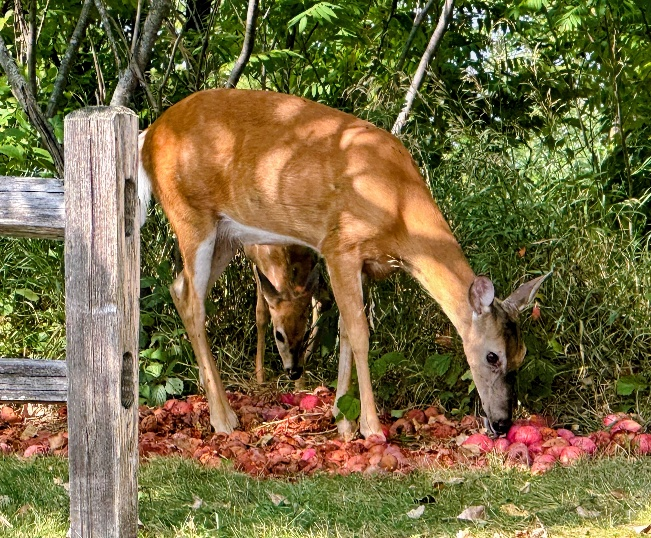
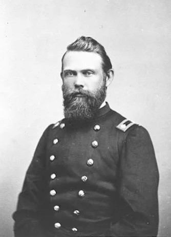

<html>
<head>
    <meta charset="UTF-8">
    <title>September 2026 Newsletter</title>
    <link rel="stylesheet" href="https://cdnjs.cloudflare.com/ajax/libs/font-awesome/6.0.0/css/all.min.css">
    <link rel="preconnect" href="https://fonts.googleapis.com">
    <link rel="preconnect" href="https://fonts.gstatic.com" crossorigin>
    <link href="https://fonts.googleapis.com/css2?family=DM+Sans:wght@400;500;700&family=Playfair+Display:wght@400;600;700&display=swap" rel="stylesheet">
    
</head>
<body>

    <button class="accessibility-toggle" onclick="toggleAccessibilityMenu()"><i class="fas fa-universal-access"></i> Accessibility</button>
    

        
Normal text

        
Large text

        
Larger text

        
Dyslexia-friendly

        
More spacing

        
Highlight links

        
Reset all

        
Close menu

    

    &#x2715; Back to newsletter
    
    

<!-- ════════════════════════════════════════════════════
     PAGE 1 — COVER
     ════════════════════════════════════════════════════ -->

    

        
September 2026

        

            <h1>Friends of the Karl Oskar House Newsletter</h1>
            
Preserve, Share and Celebrate Swedish Immigration and Culture

        

        

            
        

        

            

                
The Profile of the Month

                
Meet Carla Norelius, past president &bull; Page 2

            

            

                
Hans Mattson, Magnus Jonasson &amp; Vilhelm Moberg

                
The Linn Family, Chapter 9 &bull; Page 4

            

        

        

            

                
Welcome!

                

                    

                        
                        
Gary Noren, President Friends of the Karl Oskar House

                    

                    
It takes a village to clean up all of the Astrachan apples that fall on the ground at the Karl Oskar House each summer. This year, we were fortunate to have some extra help from Mama and her fawn.

                    
Sven Sj&ouml;stedt, our Friends Communications Coordinator, set up a meeting with <strong>Todd Mahon</strong>, History Services Manager at the Minnesota Historical Society (MHS), to see what we could learn from each other. Marilyn Wahlstr&ouml;m, Sven, Todd and I met at the Karl Oskar House on July 31st. We gave Todd a tour and had a lengthy discussion about our Friends group and how MHS might be able to assist us. Todd&rsquo;s helpful comments are enumerated on <strong>page 3</strong>. Our Friends Board will discuss these ideas at our board meeting on September 9th. If any readers are interested in pursuing any of Todd&rsquo;s suggestions, please contact one of our board members or email me at <a href="mailto:garynoren@gmail.com">garynoren@gmail.com</a>.

                

                

                    
                    
Extra help with the apple cleanup: Mama and her fawn among the fallen Astrachans

                

            

            

                
Upcoming Events

                
Sundays at the Karl Oskar House; open for tours, with fika available.

                

                    

                        
House Open for Tours &amp; Fika

                        
September 6 &bull; 1&ndash;4 pm

                    

                    

                        
Music by Twin Cities Hardangerfelelag

                        
September 13 &bull; 2&ndash;3 pm

                        
House open for tours and fika, 1&ndash;4 pm.

                    

                    

                        
Apple Fest in Almelund

                        
September 20

                        
The house is closed this Sunday but we will have a table at the Apple Fest in Almelund. Come and see us and enjoy all of the apple treats!

                    

                    

                        
Nordic Folk Music Jam

                        
September 27 &bull; 1:30&ndash;3:30 pm

                        
House open 1&ndash;4 pm. All are welcome, please bring fellow musicians and supporters.

                    

                

            

        

    

<!-- ════════════════════════════════════════════════════
     PAGE 2 — PROFILE OF THE MONTH + JOKE
     ════════════════════════════════════════════════════ -->

    

        

            Friends of the Karl Oskar House Newsletter
            Page 2
        

        
The Profile of the Month

        
Meet Carla Norelius, Past President and Volunteer

        

            

                

                    
<strong style="color: var(--swedish-blue);">Name:</strong> Carla Norelius.

                    
<strong style="color: var(--swedish-blue);">Position in our organization:</strong> Past president and volunteer.

                    
<strong style="color: var(--swedish-blue);">Tell us a little about yourself:</strong> I&rsquo;ve lived in the same 14-mile radius of Chisago County my entire life &mdash; in Lindstr&ouml;m for 56 years. I&rsquo;m retired from Fairview Health Services after 44 years. My husband Neil and I enjoy living on South Lindstrom Lake, where there is people and wildlife activity every day. Between us we have 4 sons, 5 grandchildren and 2 greats!

                    
<strong style="color: var(--swedish-blue);">Why are you interested in being part of the Friends of the Karl Oskar House?</strong> My first interest came after the Lindstr&ouml;m Centennial in 1994. I have always been amazed at the hardworking group of volunteers who took on the project of moving the house, restoring it and creating the site we have today. I remember visiting with my friend Sherwin Johnson, who was leading the group, and talking about how I wanted to volunteer when I retired. It is important that we honor our predecessors and continue teaching the story of our area and its first settlers.

                    
<strong style="color: var(--swedish-blue);">Favorite activity at the Friends of the Karl Oskar House:</strong> Making connections with our Swedish visitors. We have created many long-term relationships with the Algutsboda Homestead Museum, Saxen Tours (Crister and Maria), Ewa Rydaker, the Solheims from Norway, and more. I also enjoy the 2nd-grade tours, our Sunday music groups, the God Jul gathering, and the camaraderie we have working on cleanup and projects together.

                    
<strong style="color: var(--swedish-blue);">Hobbies:</strong> Taking people pictures, reading, thrifting and recycle sewing.

                    
<strong style="color: var(--swedish-blue);">Favorite movie:</strong> <em>Sweet Land</em> &mdash; a love story about a mail-order bride coming to Minnesota to make a life with a Norwegian farmer.

                    
<strong style="color: var(--swedish-blue);">Favorite music:</strong> Still the Beach Boys &mdash; and most types of music, from classical to the Highwaymen.

                    
<strong style="color: var(--swedish-blue);">Favorite sport:</strong> Walking and yoga.

                    
<strong style="color: var(--swedish-blue);">Any last comment?</strong> I always say we have three stories to tell at the Karl Oskar House: the fictional story of Karl Oskar and Kristina, the Linn family, and the stories that we and our visitors bring about our own and their histories. It&rsquo;s important to keep sharing the stories.

                

            

            

                
                
Carla Norelius beside Karl Oskar and Kristina

                

                    
The Profile of the Month

                    
In each issue we introduce one of our members. This month: Carla Norelius, past president and lifelong Chisago County resident.

                

                

                    
Swedish/English Blog

                    
Test your knowledge of Swedish with Sven&rsquo;s bilingual blog, <em>Den Gamle Emigranten</em>: <a href="https://dengamleemigranten.bloggplatsen.se/">dengamleemigranten.bloggplatsen.se</a>

                

            

        

        

            

            

                <h3>Joke of the Month &bull; told by Sven Sj&ouml;stedt</h3>

                
I had my birthday in August; and talking about birthdays: Ole went to the doctor, and at check-in the nurse asked him when his birthday was. &ldquo;August 14,&rdquo; Ole answered. &ldquo;What year?&rdquo; the nurse asked, and Ole answered:

                
Every year.

            

        

    

<!-- ════════════════════════════════════════════════════
     PAGE 3 — LEARNING FROM THE MINNESOTA HISTORICAL SOCIETY
     ════════════════════════════════════════════════════ -->

    

        

            Friends of the Karl Oskar House Newsletter
            Page 3
        

        
Learning from the Minnesota Historical Society

        
Word from the President, continued from page 1

        
By Gary Noren

        
When Todd Mahon, History Services Manager at the Minnesota Historical Society, visited the Karl Oskar House on July 31st, he followed up with six helpful suggestions for our Friends group &mdash; presented here in his own words. Our Friends Board will discuss these ideas at our board meeting on September 9th.

        

            <ol class="mhs-list">
                <li>We talked a bit about the house&rsquo;s eligibility to be listed on the National Register of Historic Places (NRHP). While it being moved can hinder that, it is not an absolute barrier. I suggest reaching out to Ginny Way with the <a href="https://mn.gov/admin/shpo/">State Historic Preservation Office</a> (SHPO) and asking her if the building has ever been determined <em>eligible</em> for the NRHP. I would also ask her for guidance on evaluating it for the NRHP. Having it listed would make it eligible for preservation-focused grants with our grant program.</li>
                <li>The organization <a href="https://www.northernbedrockcorps.org/">Northern Bedrock Historic Preservation Corps</a> trains young adults in preservation skills and techniques. They look for older buildings that they can bring the corps members to learn techniques under the instruction of preservation experts. Gammelg&aring;rden has been working with them for a couple of years. They may be a resource for your house, even if it is not on the NRHP.</li>
                <li>We talked about a Collections Management Policy, and I mentioned I would share a document that covers the American Alliance of Museums&rsquo; Five Core Documents.</li>
                <li>Minnesota Statute 138.053 provides a legal pathway for local units of government to provide financial support if an organization is &ldquo;affiliated with and approved by&rdquo; the Minnesota Historical Society. To be clear, you are not required in any way to meet this criterion to operate as a museum, receive grants, or work with Local History Services. It is only if you are getting funding from a unit of local government, such as the City of Lindstr&ouml;m.</li>
                <li>The <a href="https://www.mnhs.org/preservation/partnership">Heritage Partnership Program</a> is a grant program for developing and fostering partnerships between eligible organizations. The conversation centered around other Scandinavian cultural history organizations and partnering on any number of things. The example we talked about was planning for shared bus tours.</li>
                <li>Here are some ways to get more connected to the network of museums and history organizations across the state. The <a href="https://www.mnhistoryalliance.org/">Minnesota Alliance of Local History Museums</a> puts on a great conference in April; it will be in St. Cloud in 2027. Consider joining the Facebook group <a href="https://www.facebook.com/groups/ALLMNHS">All Minnesota Historical Societies</a> &mdash; even if you aren&rsquo;t actively posting, seeing what others are sharing and asking about is very enlightening. And if you don&rsquo;t subscribe to the <a href="https://www.mnhs.org/local-history-news">Local History News newsletter</a> from our office, consider that too. It comes out weekly and shares grant opportunities, trainings, and more.</li>
            </ol>
        

        

            
Interested in pursuing one of these ideas?

            Contact one of our board members, or email Gary Noren at <a href="mailto:garynoren@gmail.com">garynoren@gmail.com</a>.
        

        

            
            

                
Buy a Brick for the Walkway

                

                    
The Friends have begun a brick paver walkway at the front door, and our goal is to extend it all the way to the parking lot. A 4&times;8 brick holds up to three lines of text; an 8&times;8 brick holds up to six.

                    
It&rsquo;s a wonderful way to show your support, give a gift, create a memorial, or honor your family&rsquo;s heritage. Order online at <a href="https://thatsmybrick.com/karloskar">thatsmybrick.com/karloskar</a>.

                

            

        

    

<!-- ════════════════════════════════════════════════════
     PAGE 4 — THE EMIGRATION AND THE LINN FAMILY, CHAPTER 9 + BACK PAGE
     ════════════════════════════════════════════════════ -->

    

        

            Friends of the Karl Oskar House Newsletter
            Page 4
        

        
Hans Mattson, Magnus Jonasson &amp; Vilhelm Moberg

        
The Emigration and the Linn Family &bull; Chapter 9

        
By John Linn

        

            
Hans Mattson was a pivotal figure in Minnesota&rsquo;s early history, known for his roles as a Civil War colonel, Secretary of State, and immigration booster. He was born in &Ouml;nnestad, Sweden, on December 23, 1832, and immigrated to Boston in 1851. He eventually founded the settlement of Vasa in Goodhue County in 1853.

            
It is a little-known fact, but his arrival in Minnesota is due in part to Magnus Jonasson. Magnus arrived with his party of immigrants in New York on August 5, 1852. Aboard the good ship <em>Ambrosius</em> were two other Swedish immigrants to America: Matts Hansson and his son Lars Mattsson &mdash; Hans Mattson&rsquo;s father and brother, traveling on the same ship. The passenger records show the two men were only a few lines apart. Magnus was disappointed when his brother Johan did not meet the ship as planned, but was pleased to meet Hans, who had arrived in Boston a year earlier on the same brig his father and Magnus now shared. Hans recommended the <em>Ambrosius</em> to his father, and it is my theory that Magnus, in G&ouml;teborg, met Matts, who in turn recommended the <em>Ambrosius</em> to him.

            
A few days after arrival in New York, Matts and Magnus likely decided to go to Bishop Hill, Illinois together. The description of the journey that Hans wrote in his autobiography1 follows a virtually identical route and dates as that described in Olof Linnell&rsquo;s book2. But Hans and his father settled in Illinois, while Magnus and his party decided to continue on to Chisago Lake. A year later, Hans also arrived in Minnesota and started his life in Vasa.

            
In April 1861, Confederates fired on Ft. Sumter. Most Swedes never liked slavery &mdash; some, like Olof Linnell, had actually spent time in the South &mdash; and now supported the Union. In 1861, Hans became Colonel of the 3rd Minnesota Volunteer Infantry Regiment and started recruiting Scandinavians to the cause. One recruit was Olof Linnell. Chisago Lake provided many young soldiers to the Union cause. But this unit was initially pressed into service against the Lakota Sioux uprising. During this campaign, Olof became critically ill, and did not continue the fight in the South.

            
Vilhelm Moberg traveled to Minnesota in 1948 to study Swedish settlements. He often used Hans Mattson&rsquo;s <em>Reminiscences</em> as a primary source, acknowledging Mattson&rsquo;s influence in essays and interviews and describing him as a &ldquo;truthful chronicler&rdquo; of the immigrant journey. Moberg admired Mattson&rsquo;s ability to capture the emotional and logistical challenges of migration, especially the tension between hope and hardship. But he failed to recognize that many stories actually included a &ldquo;Real Karl Oskar&rdquo;3 he had been studying all along &mdash; ever since first seeing that March 1852 notice in the <em>Wexj&ouml;-Bladet</em>: &ldquo;According to news from Ljuder in Konga h&auml;rad a significant number of parish residents have decided this year to move to the United States of America.&rdquo;4

            

                
                
Colonel Hans Mattson

            

            

                1 <em>Reminiscences: The Story of an Immigrant</em>, Mattson, 1892. 
                2 <em>O.M. Linnell &mdash; His Life&rsquo;s Story</em>, Linnell, 1930. 
                3 <em>Magnus Jonasson Linnell: A Real Karl Oskar</em>, Adolfsson, 1978. 
                4 <em>A Man Called Glader</em>, Stefansson, 2021.
            

        

        

            

                <h3>Become a Member</h3>
                <ul>
                    <li>Individual: $20 annually</li>
                    <li>Family: $30 annually</li>
                </ul>
                
Mail checks to: <strong>PO Box 12, Lindstrom, MN 55045</strong>

            

            

                <h3>Volunteer Opportunities</h3>
                
<strong>Currently needed:</strong>

                <ul>
                    <li>Welcome Hosts for Sundays at the house</li>
                    <li>Newsletter contributors</li>
                </ul>
                
Interested? Call Corliss at 952-454-3355.

            

        

        

            <h3>Stay Connected</h3>
            
<strong style="color: var(--swedish-yellow);">Board members:</strong> Gary Noren (President), Pam Deimel (Treasurer), Marilyn Wahlstr&ouml;m (Secretary), Charles Gramling, Peter Osterberg, Becky Dudley, Bonnie Anderson, Carla Norelius, Peggy Kamish-Eral, Corliss Vadner, Peter Lindberg, Sven Sj&ouml;stedt

            

                Website: <a href="https://friendsofthekarloskarhouse.org">friendsofthekarloskarhouse.org</a> &bull;
                Facebook: <a href="https://www.facebook.com/LindHistSoc">Friends of the Karl Oskar House</a>
            

            

                

                    <strong>General Info</strong>
                    Gary Noren 
                    garynoren@gmail.com
                

                

                    <strong>Newsletter</strong>
                    Sven Sj&ouml;stedt &bull; svendasvede@aol.com 
                    Peter Grund &bull; peter_grund@me.com
                

                

                    <strong>Music Events</strong>
                    Marilyn Wahlstrom 
                    mjwahls@msn.com
                

            

        

    

</body>
</html>
