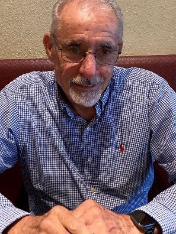
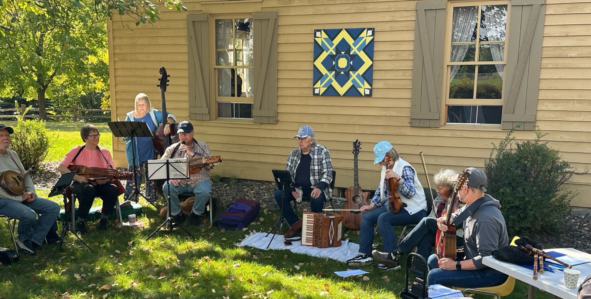

<html>
<head>
    <meta charset="UTF-8">
    <title>October 2026 Newsletter</title>
    <link rel="stylesheet" href="https://cdnjs.cloudflare.com/ajax/libs/font-awesome/6.0.0/css/all.min.css">
    <link rel="preconnect" href="https://fonts.googleapis.com">
    <link rel="preconnect" href="https://fonts.gstatic.com" crossorigin>
    <link href="https://fonts.googleapis.com/css2?family=DM+Sans:wght@400;500;700&family=Playfair+Display:wght@400;600;700&display=swap" rel="stylesheet">
    
</head>
<body>

    <button class="accessibility-toggle" onclick="toggleAccessibilityMenu()"><i class="fas fa-universal-access"></i> Accessibility</button>
    

        
Normal text

        
Large text

        
Larger text

        
Dyslexia-friendly

        
More spacing

        
Highlight links

        
Reset all

        
Close menu

    

    &#x2715; Back to newsletter
    
    

<!-- ════════════════════════════════════════════════════
     PAGE 1 — COVER
     ════════════════════════════════════════════════════ -->

    

        
October 2026

        

            <h1>Friends of the Karl Oskar House Newsletter</h1>
            
Preserve, Share and Celebrate Swedish Immigration and Culture

        

        

            
        

        

            

                
The Profile of the Month

                
Meet Ty Vadner, our &ldquo;Mr. Fix It&rdquo; &bull; Page 2

            

            

                
Native Americans and Immigrant Swedes

                
The Linn Family, Chapter 10 &bull; Page 3

            

        

        

            

                
A Busy September

                

                    

                        
                        
Gary Noren, President Friends of the Karl Oskar House

                    

                    
The last week of September is always one of the busiest weeks at the Karl Oskar House, and this year was no exception. In fact, it was a wonderful reminder of why this special place means so much to all of us. We celebrated the finale of our music series with our annual <strong>Music Jam</strong> on a perfect Sunday afternoon. The photo on page 4 shows only eight of the ten musicians who participated, and it doesn&rsquo;t show the 60-plus people who came to enjoy the music, visit with friends, and share the afternoon with us. Peggy Kamish-Eral, Holly Damm, Marty Harding, and I were kept busy throughout the afternoon setting out chairs, giving tours of the House, making coffee &mdash; twice! &mdash; and answering the many questions our visitors brought with them. We even welcomed two new members to the Friends of the Karl Oskar House.

                    
But what makes an afternoon like this so special goes beyond the music. You cannot imagine how many new connections are made in just a few hours of visiting before and after the entertainment. Old friendships are renewed, new friendships begin, and people who may have never met before find themselves sharing stories and discovering common interests. That, to me, is one of the greatest gifts of the Karl Oskar House. We are not simply preserving a historic building. We are creating a place where people come together, where history comes alive, and where community continues to grow.

                

                
Continued on page 4 &rarr;

            

            

                
Upcoming Events

                
The music season is over; here is what&rsquo;s left on the calendar.

                

                    

                        
Second-Grade Tours

                        
Four days this fall

                        
Tours for all of the second graders in the Chisago Lakes School District, coordinated by Bonnie Anderson and Becky Dudley. Full report in November.

                    

                    

                        
Closing Up the House

                        
October 12 &bull; 10:00 am

                        
Help us put the House to bed for the winter. Please let Gary know if you&rsquo;re coming (<a href="mailto:garynoren@gmail.com">garynoren@gmail.com</a>) so he can order enough pizza for everyone when the work is done.

                    

                    

                        
Closed for the Season

                        
October &ndash; May

                        
The House is otherwise closed until next spring. See you in 2027!

                    

                

                

                    
Swedish/English Blog

                    
Test your knowledge of Swedish with Sven&rsquo;s bilingual blog, <em>Den Gamle Emigranten</em>: <a href="https://dengamleemigranten.bloggplatsen.se/">dengamleemigranten.bloggplatsen.se</a>

                

            

        

    

<!-- ════════════════════════════════════════════════════
     PAGE 2 — PROFILE OF THE MONTH + JOKE
     ════════════════════════════════════════════════════ -->

    

        

            Friends of the Karl Oskar House Newsletter
            Page 2
        

        
The Profile of the Month

        
Meet Ty Vadner, Maintenance &mdash; our &ldquo;Mr. Fix It&rdquo;

        

            

                

                    
<strong style="color: var(--swedish-blue);">Name:</strong> Ty Vadner.

                    
<strong style="color: var(--swedish-blue);">Position in our organization:</strong> Maintenance, Mr. Fix It.

                    
<strong style="color: var(--swedish-blue);">Tell us a little about yourself:</strong> I have spent most of my life in Forest Lake. My wife, Corliss, and I moved to Chisago in 2018. I retired from Cub Foods in 2012, where I worked for 35 years. I also spent a lot of time creating display features for the Cub Foods stores. Corliss and I live on Green Lake and enjoy lake life with our pontoon. We have two adult children who both live in Lino Lakes, and between them we have 4 grandsons and 2 granddaughters.

                    
<strong style="color: var(--swedish-blue);">Why are you interested in the Karl Oskar House?</strong> I really like history. My ancestors were French, Norwegian and Danish, but I was born in St. Croix Falls, so I have an interest in the history of this area. My wife got involved, and she would come home and tell me about all of the simple repairs that needed to be made, and I thought I could help.

                    
<strong style="color: var(--swedish-blue);">Favorite activity at the Karl Oskar House:</strong> I like the annual Christmas party, when we get together, eat Swedish food, try to stay warm and share stories.

                    
<strong style="color: var(--swedish-blue);">Hobbies:</strong> I like to design and build things. Between 1978 and 1994, we built four houses in the Forest Lake area, and I did much of the work myself (while Corliss watched the kids!). Since moving into our house in Chisago, I have remodeled the kitchen and two bathrooms, connected the house to the garage with an addition (laundry and office), and added more storage to the garage. Right now, I&rsquo;m in the process of building a shed for the lawn equipment. I love to mow grass and plow snow, so Minnesota is a great place to be. I also like to find creative ways to fix things. If something is broken and I can&rsquo;t fix it with the tools I have, I often make a tool that will fix it.

                    
<strong style="color: var(--swedish-blue);">Favorite movie:</strong> <em>The Sting</em>, with Robert Redford and Paul Newman. We like to watch movies a lot, and there are a lot of other favorites depending on what genre you are talking about.

                    
<strong style="color: var(--swedish-blue);">Favorite music:</strong> The &rsquo;60s and &rsquo;70s &mdash; Bread, the Beatles, Barry Manilow, the Carpenters, John Denver.

                    
<strong style="color: var(--swedish-blue);">Favorite sport:</strong> I am not into sports very much. Occasionally I will watch tennis or golf, but I don&rsquo;t play any sports myself.

                

            

            

                
                
Ty Vadner

                

                    
The Profile of the Month

                    
In each issue we introduce one of our members. This month: Ty Vadner, who keeps the Karl Oskar House in good repair.

                

            

        

        

            

            

                <h3>Joke of the Month &bull; told by Sven Sj&ouml;stedt</h3>

                
Now that we are in the fall season: I heard that Humpty Dumpty had a great fall.

                
He said his summer was pretty good too.

                
By the way, do you know what a line of men waiting to have their hair cut is called?

                
A barberque.

            

        

    

<!-- ════════════════════════════════════════════════════
     PAGE 3 — THE EMIGRATION AND THE LINN FAMILY, CHAPTER 10
     ════════════════════════════════════════════════════ -->

    

        

            Friends of the Karl Oskar House Newsletter
            Page 3
        

        

            

                
Native Americans and Immigrant Swedes in the Mid-1800s

                
The Emigration and the Linn Family &bull; Chapter 10

                
By John Linn

            

            

                
                
Not Native Americans: a family of the indigenous, reindeer-herding S&aacute;mi people of northern Scandinavia

            

        

        

            
The early Swedish immigrants to Minnesota came to a new land that was quite different from their homeland. They had to adapt to their new environment. One big surprise for these new Americans was the nomadic Anishinaabe peoples already living here. The small white population of Minnesota at that time was mostly of British descent, and they were quite antagonistic and often cruel to the local natives. But for the Swedes, it was different.

            
Minnesota originally became part of the United States through the Louisiana Purchase from France on 20 December 1803. The territory officially belonged to France for only 20 days after Napoleon formally completed its acquisition from Spain. President Jefferson wanted New Orleans; Minnesota was merely a bonus. The territory now belonged to the US, but native peoples had no citizenship and had to wait until 1924 to have this neglect corrected.

            
As Moberg describes in <em>The Emigrants</em>, social, religious and financial circumstances instigated Swedish emigration to Minnesota. For those who left, many of their cultural beliefs turned out to be more aligned with the Anishinaabe natives than with the British-American citizens. In part, those common belief patterns were:

            
<strong style="color: var(--swedish-blue);">Land tenure.</strong> Traditional Swedish farming relied on more flexible land ownership. In 1850, most Swedes were peasant farmers making much use of communal woodlands, timber, and foraging. The Anishinaabe were quite similar.

            
<strong style="color: var(--swedish-blue);">Communal wealth.</strong> Swedish peasantry often shared resources and communal wealth during hard times. The Anishinaabe had a similar culture.

            
<strong style="color: var(--swedish-blue);">Kinship.</strong> The basic social unit for both groups was centered on the extended family, the tribe, or the village.

            
<strong style="color: var(--swedish-blue);">Nomadic lifestyle.</strong> Swedes moved around a lot, both seasonally and over a lifetime. Coming to America for a better life was part of that, and migrating around America continued to be common among Swedish immigrants. Sweden and Norway had their own indigenous peoples, too, not that different in lifestyle from the Plains Indians of the Midwest. The subjects in the photograph at the top of this article may look like Native Americans, but are actually the nomadic, indigenous, reindeer-herding S&aacute;mi people of the far north.

            
Swedish immigrants, starting around 1850, joined the mass westward occupation of lands recently ceded by the Anishinaabe. The shared ancestral reliance on the land allowed early Scandinavian settlers to empathize and adapt. For these people, in this time and this place, socialism &ldquo;worked.&rdquo;

            
Alice Tudor writes in her book:1

            

                
Father2, as well as the other men, worked at such occupations as could be found in a new country &mdash; in the woods and driving logs on the rivers, and farming in the summer time. He learned the English language from Scotchmen and some free French; his accent was of those two instead of Swedish. He spoke the Chippewa language fluently. I wish we had written some of the words, but only remember &ldquo;Chickamon mon-mon&rdquo; which, I believe, meant money.

                
Father found the Chippewa very friendly, so much so that when there was an uprising of the Sioux in western Minnesota and people were afraid the same would happen around Chisago Lake and built a block house to be used for protection, Father refused to go there, saying he knew the Chippewa would never attack.

                
An Indian family stopped by once. The mother had a baby only a few days old. She complained of not feeling well. The baby was named Mary.

            

            
There are many such stories of early immigrant Swedes in Minnesota with cultural similarity to, and sympathy for, the local Indians&rsquo; plight.

            
John Linn, 4 July 2026

            

                1 <em>A Good Life in a Good Land</em>, Alice Linn Tudor. 
                2 John Jonasson Linn, Carl Linn&rsquo;s younger brother.
            

        

        

            
            

                
Anishinaabe Territory Circa 1850

                The Anishinaabe (Ojibwe, or Chippewa) moved westward over centuries from the Atlantic coast to the Great Lakes and Minnesota. The shaded area shows where they lived around 1850, the black areas today&rsquo;s reservations, and the inset the location of Chisago County. Map labels are in Swedish. Click the map to enlarge.
            

        

    

<!-- ════════════════════════════════════════════════════
     PAGE 4 — A BUSY SEPTEMBER, CONTINUED + BACK PAGE
     ════════════════════════════════════════════════════ -->

    

        

            Friends of the Karl Oskar House Newsletter
            Page 4
        

        

            
            
Eight of the ten musicians at our season-ending Music Jam on the lawn of the Karl Oskar House

        

        
A Busy September at the Karl Oskar House

        
Word from the President, continued from page 1 &bull; By Gary Noren

        

            
And as soon as the music season ends, we move on to another wonderful tradition: four days of tours for all of the second graders in the Chisago Lakes School District. This annual event is coordinated by Bonnie Anderson and Becky Dudley. It is such fun to welcome these young students to the Karl Oskar House. They arrive with lots of energy, curiosity, questions, and observations &mdash; and they remind us just how important it is to share our history with the next generation. Because we need to go to press before the second-grade tours take place, Bonnie will provide a full report in our November newsletter.

            
Our next-to-last event of the season at the Karl Oskar House will be <strong>Closing Up, scheduled for October 12 at 10:00 a.m.</strong> If you would like to help, please let me know. I need to know how many people will be joining us so I can order enough pizza for everyone when our work is finished.

            
As I look back on another busy season, I am struck by how fortunate we are to have so many wonderful volunteers, musicians, members, visitors, and friends who continue to support the Karl Oskar House. The House may be a place from the past, but the friendships, memories, and community we create there are very much alive today. Thank you to everyone who helped make this another memorable season.

        

        

            

                <h3>Become a Member</h3>
                <ul>
                    <li>Individual: $20 annually</li>
                    <li>Family: $30 annually</li>
                </ul>
                
Mail checks to: <strong>PO Box 12, Lindstrom, MN 55045</strong>

            

            

                <h3>Buy a Brick</h3>
                
Help extend our brick paver walkway from the front door to the parking lot. A wonderful gift, memorial, or tribute to your family&rsquo;s heritage. Order at <a href="https://thatsmybrick.com/karloskar">thatsmybrick.com/karloskar</a>.

            

            

                <h3>Volunteer</h3>
                <ul>
                    <li>Closing Up crew, October 12</li>
                    <li>Welcome Hosts for next season</li>
                    <li>Newsletter contributors</li>
                </ul>
                
Interested? Call Corliss at 952-454-3355.

            

        

        

            <h3>Stay Connected</h3>
            
<strong style="color: var(--swedish-yellow);">Board members:</strong> Gary Noren (President), Pam Deimel (Treasurer), Marilyn Wahlstr&ouml;m (Secretary), Charles Gramling, Peter Osterberg, Becky Dudley, Bonnie Anderson, Carla Norelius, Peggy Kamish-Eral, Corliss Vadner, Peter Lindberg, Sven Sj&ouml;stedt

            

                Website: <a href="https://friendsofthekarloskarhouse.org">friendsofthekarloskarhouse.org</a> &bull;
                Facebook: <a href="https://www.facebook.com/LindHistSoc">Friends of the Karl Oskar House</a>
            

            

                

                    <strong>General Info</strong>
                    Gary Noren 
                    garynoren@gmail.com
                

                

                    <strong>Newsletter</strong>
                    Sven Sj&ouml;stedt &bull; svendasvede@aol.com 
                    Peter Grund &bull; peter_grund@me.com
                

                

                    <strong>Music Events</strong>
                    Marilyn Wahlstrom 
                    mjwahls@msn.com
                

            

        

    

</body>
</html>
