<html>
<head>
    <meta charset="UTF-8">
    <title>November 2026 Newsletter</title>
    <link rel="stylesheet" href="https://cdnjs.cloudflare.com/ajax/libs/font-awesome/6.0.0/css/all.min.css">
    <link rel="preconnect" href="https://fonts.googleapis.com">
    <link rel="preconnect" href="https://fonts.gstatic.com" crossorigin>
    <link href="https://fonts.googleapis.com/css2?family=DM+Sans:wght@400;500;700&family=Playfair+Display:wght@400;600;700&display=swap" rel="stylesheet">
    
</head>
<body>

    <button class="accessibility-toggle" onclick="toggleAccessibilityMenu()"><i class="fas fa-universal-access"></i> Accessibility</button>
    

        
Normal text

        
Large text

        
Larger text

        
Dyslexia-friendly

        
More spacing

        
Highlight links

        
Reset all

        
Close menu

    

    &#x2715; Back to newsletter
    
    

<!-- ════════════════════════════════════════════════════
     PAGE 1 — COVER
     ════════════════════════════════════════════════════ -->

<!-- ════════════════════════════════════════════════════
     PAGE 1 - COVER
     ════════════════════════════════════════════════════ -->

    

        
November 2026

        

            <h1>Friends of the Karl Oskar House Newsletter</h1>
            
Preserve, Share and Celebrate Swedish Immigration and Culture

        

        

            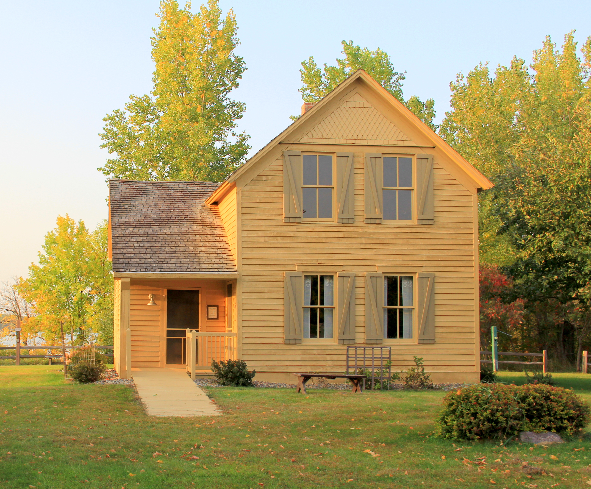
        

        

            

                
The Profile of the Month

                
Meet Pam Deimel, our treasurer and a Linn descendant. <strong>Page 2</strong>

            

            

                
Second Graders Visit the House

                
Seven classes, twelve volunteers, one spinning wheel. <strong>Page 3</strong>

            

            

                
The Linn Family, Chapter 11

                
Andreas Carlsson Taylor arrives at Chisago Lake, with a family chart. <strong>Pages 4 and 5</strong>

            

        

        

            

                
Another Wonderful Season

                

                    

                        
                        
Gary Noren, President Friends of the Karl Oskar House

                    

                    
October 12 marked the close of another memorable season at the Karl Oskar House, filled with history, cultural education, tours, and the music and entertainment of our Scandinavian heritage. As the season came to an end, 13 dedicated volunteers gathered for a fun morning of work and fellowship (see the photos on page 3), preparing the house and grounds for winter. Along the way, we shared memories, laughter, and reflections on another successful summer. It was a wonderful reminder that the heart of the Karl Oskar House is not just the history we preserve, but the people who bring it to life.

                    
Now, as we turn toward the holiday season, we look forward to one of our favorite traditions: our annual <strong>God Jul Party on December 7 at 11:30 am!</strong> Join us for good food, good company, and plenty of holiday cheer in our Verkstad, the red shed next to the Karl Oskar House. Bring a dish to share for our potluck and dress warmly, with coats, hats and warm footwear. Our trusty woodstove will provide some warmth, and the laughter and friendship of those gathered will provide the rest! The ever-creative Carla Norelius is once again taking charge of the program, so we can look forward to some special surprises.

                    
Come celebrate the season with us! It&rsquo;s a chance to reconnect with friends, welcome the holidays, and enjoy the warmth of the community that makes the Karl Oskar House such a special place. We hope to see you there!

                

            

            

                
Upcoming Events

                
The House is closed for the season, October to May. See you in 2027!

                

                    

                        
God Jul Party

                        
Monday, December 7, 11:30 am, in the Verkstad

                        
Our annual potluck lunch and smorgasbord in the cozy, wood-heated Verkstad. Bring a dish to share and dress warmly! Questions: Carla, 651-253-3373.

                    

                    

                        
Pratstund on Zoom

                        
Monday, November 9, 7 to 8 pm Minnesota time

                        
Relaxed conversation in Swedish on Zoom, the second Monday of each month. Details on page 3.

                    

                

                

                    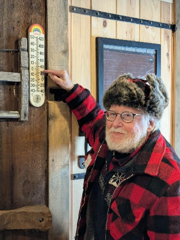
                    
Checking the thermometer at a past God Jul party. Dress warmly!

                

            

        

    

<!-- ════════════════════════════════════════════════════
     PAGE 2 - PROFILE OF THE MONTH + JOKE + GOD JUL PARTY
     ════════════════════════════════════════════════════ -->

    

        

            Friends of the Karl Oskar House Newsletter
            Page 2
        

        
The Profile of the Month

        
Meet Pam Deimel, Treasurer, whose great-great-grandparents lived in the Karl Oskar House

        

            

                

                    
<strong style="color: var(--swedish-blue);">Name:</strong> PamElla Noreen-Deimel.

                    
<strong style="color: var(--swedish-blue);">Position in our organization:</strong> Treasurer.

                    
<strong style="color: var(--swedish-blue);">Tell us a little about yourself:</strong> I was born and raised in the Chisago Lakes area and moved back in 1985 because my husband of 53 years, Phil, wanted our two sons to grow up in an area where there was family history. We live on North Lindstrom Lake and enjoy the lake summer and winter. We have seven grandchildren (four boys and three girls). I taught Business Education in the Cambridge-Isanti school district for 36 years and was a webinar coordinator at Hazelden for six years. Swedish traditions were always a big part of my early years, as both of my parents were of Swedish descent. This includes lutefisk at Christmas, which we still serve today.

                    
<strong style="color: var(--swedish-blue);">Why are you interested in the Karl Oskar House?</strong> The Karl Oskar House is my ancestral home. I am the great-great-granddaughter of Carl Linn and Lena Kajsa Falk.

                    
<strong style="color: var(--swedish-blue);">Favorite activity at the Karl Oskar House:</strong> As a retired educator, I like to present to our second-grade visitors, especially when our great-niece and great-nephew came to learn about their own history. It is a great opportunity, and the kids are so much fun. I also enjoy the fellowship found in the Friends of the Karl Oskar House.

                    
<strong style="color: var(--swedish-blue);">Hobbies:</strong> I like flower arranging, which I do whenever I get the chance. I also really like interior design and any kind of travel. Phil and I have traveled both within the U.S. and internationally, and we always enjoy meeting new people and seeing different cultures.

                    
<strong style="color: var(--swedish-blue);">Favorite movie:</strong> Disney&rsquo;s original <em>Swiss Family Robinson</em> has been my favorite since Mom and Dad took me to it at the old Auditorium Theater in St. Croix Falls in the late &rsquo;50s.

                    
<strong style="color: var(--swedish-blue);">Favorite music:</strong> Dolly Parton&rsquo;s &ldquo;I Will Always Love You.&rdquo; Also, most instrumentals from the &rsquo;60s.

                    
<strong style="color: var(--swedish-blue);">Favorite sport:</strong> Water skiing in the past, as well as regular walking with friends.

                    
<strong style="color: var(--swedish-blue);">Any last comments:</strong> I enjoy keeping the Swedish legacy alive through our organization.

                

            

            

                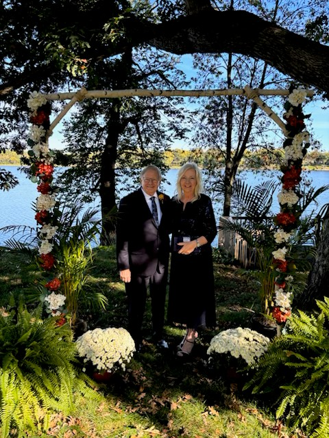
                
Pam Deimel with her husband, Phil

                

                    
The Profile of the Month

                    
In each issue we introduce one of our members. This month: Pam Deimel, who keeps our books as treasurer and whose great-great-grandparents, Carl and Lena Linn, once lived in the House.

                

            

        

        

        

            <h3>Joke of the Month told by Sven Sj&ouml;stedt</h3>

            

                
Why couldn&rsquo;t the bicycle stand up by itself? 
                It was two tired.

                
Why did the student eat his homework? 
                Because his teacher told him it was a piece of cake.

                
Why was six afraid of seven? 
                Because 7-8-9. 
                (This one I had to say out loud to get.)

            

        

        

            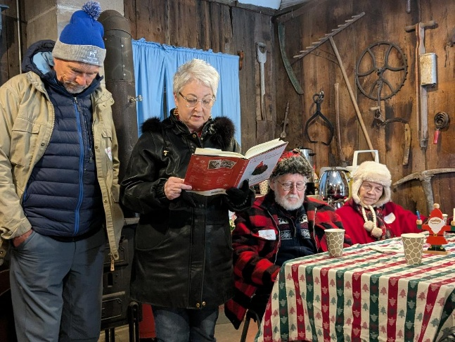
            

                
God Jul Party and Potluck

                
Monday, December 7, 11:30 am, in the Verkstad

                
All are invited to our annual God Jul potluck lunch. We gather in the cozy, wood-heated Verkstad next to the Karl Oskar House for celebration and smorgasbord. Bring a dish to share, and dress warmly: coats, hats and warm footwear are the order of the day. Carla Norelius is once again in charge of the program, so expect a few surprises.

                
<strong>Questions?</strong> Contact Carla at 651-253-3373.

            

        

    

<!-- ════════════════════════════════════════════════════
     PAGE 3 - SECOND GRADE FIELD TRIP + CLOSING UP + PRATSTUND
     ════════════════════════════════════════════════════ -->

    

        

            Friends of the Karl Oskar House Newsletter
            Page 3
        

        
Second Graders Visit the Karl Oskar House

        
Seven classes from Lakeside Elementary in Chisago City toured the House in the last week of September

        

            

                

                    
In the last week of September, second graders from Lakeside Elementary in Chisago City visited the Karl Oskar House. The second graders bring energy and enthusiasm with them as they participate in this field trip. Becky and Bonnie, aided by other volunteers, tell the story of the first Swedes leaving Sweden and coming to Minnesota, the Vilhelm Moberg story of the Karl Oskar House, and then the true story of the Linn family who once lived in the house.

                    
Volunteers help the second graders by pointing out the artifacts in the bedrooms, the kitchen and upstairs. Beth Engstrom brought her spinning wheel to show the students how to spin wool into yarn. Each student receives a puff of wool to take home to remember the experience of the spinning process. Gloria demonstrates how the loom works and shows them a rug on which she is working.

                    
This year seven classes (24 students plus one or two adults with each class) came to the Karl Oskar House. We were so fortunate to have 12 volunteers from the Friends of the Karl Oskar House and the community to add interest and details to the rooms and the old and antique items. Community members have told us they fondly remember the second-grade field trips. We are happy we can encourage interest in our local history through these second-grade tours.

                

                

                
Closing Up for the Winter

                
Thirteen volunteers put the House and grounds to bed on October 12

                

                    

                        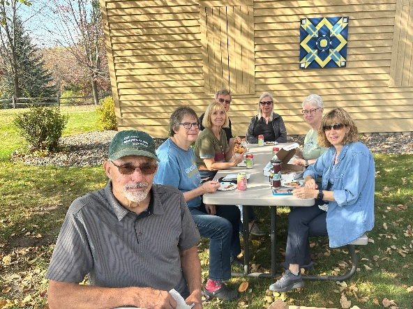
                        
Work done, it was time for fellowship beside the Verkstad

                    

                    

                        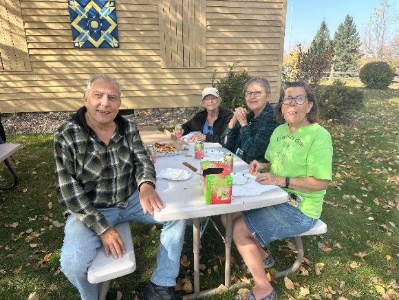
                        
Sharing memories and laughter after another successful summer

                    

                

            

            

                

                    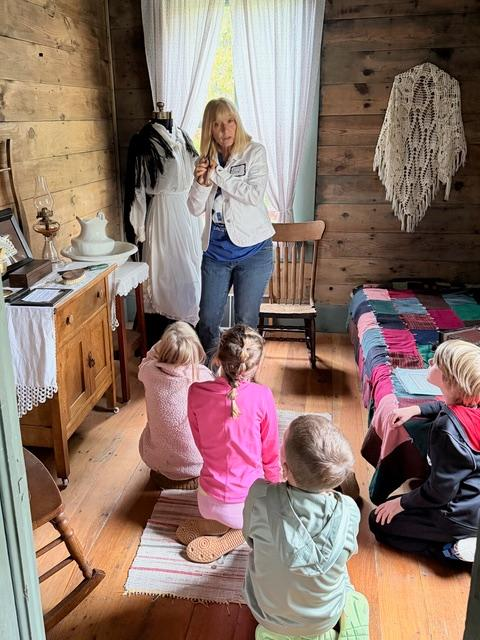
                    
Demonstration of an old curling iron

                

                

                    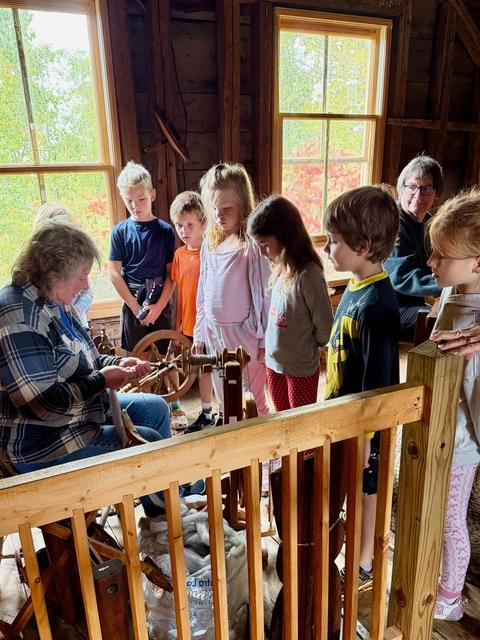
                    
At the spinning wheel: how wool becomes yarn

                

            

        

        

            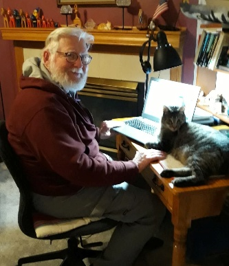
            

                
Pratstund i svenskbygderna: Monday, November 9, 7 to 8 pm (Minnesota time)

                

                    
<strong>Pratstund</strong> is a Friends activity that does not happen at the House: a monthly Zoom meeting where we meet and talk Swedish. There are no lessons; we simply chat about anything and everything, except religion and politics. Most participants are local, but people join from all over the US and now and then from other countries. All are welcome. The invitation goes out every month on Facebook, including on the Friends of the Karl Oskar House page. Here it is, in Swedish.

                    
<strong>Vill du prata svenska?</strong> Då kan du delta i vår &ldquo;Pratstund i svenskbygderna&rdquo; under värdskap av Friends of the Karl Oskar House på Zoom den andra måndagen i månaden klockan 19 till 20, Minnesota-tid. Det är inget speciellt ämne vi talar om utan bara en trevlig pratstund vänner emellan. Du behöver inte kunna svenska flytande, och du behöver inte alls vara svensk, bara vilja prata svenska. Vi ses och hörs! 
                    <strong>Zoom:</strong> <a href="https://us06web.zoom.us/j/84025695345">us06web.zoom.us/j/84025695345</a> 
                    <strong>Meeting ID:</strong> 840 2569 5345 <strong>Passcode:</strong> 431587

                

            

        

    

<!-- ════════════════════════════════════════════════════
     PAGE 4 - THE EMIGRATION AND THE LINN FAMILY, CHAPTER 11
     ════════════════════════════════════════════════════ -->

    

        

            Friends of the Karl Oskar House Newsletter
            Page 4
        

        
Andreas Carlsson Taylor&rsquo;s Arrival at Chisago Lake

        
The Emigration and the Linn Family, Chapter 11

        
By John Linn

        

            
In an unpublished article, <em>The Family History of Andreas and Ingrid Maria Carlson/Taylor</em>, Ben Carlson describes the 1854 arrival of Andreas Carlsson Taylor and his wife Ingrid Maria Johansdotter at their new home in Chisago Lake, Minnesota. He relates how, on arrival, they &ldquo;stopped at a farmhouse and were taken across the lake to the Jonson&rsquo;s home.&rdquo;1

            
Like most family stories that are told and retold over the years, this story is based in fact but has likely been distorted by time and history. The story was true, but the names and relationships have been garbled or forgotten over time. Modern genealogy and instant Internet access to the old records allow us to reconstruct and restore these old stories and bring them back to life. I will attempt to do so with this one.

            
Andreas Carlsson was born 24 February 1822 in T&auml;llekullen, Hovmantorp, Kronoberg, Sweden. T&auml;llekullen is approximately one kilometer east of Linnehult, from where Carl (Jonasson) Linn emigrated.

            
Andreas was the son of Carl Magnus Andersson and Ingrid Andersdotter. Ingrid had two children before Andreas was born: a daughter, Lena, with Carl Magnus, and a son, Johan, born out of wedlock to an unknown father, who may very well have been Carl Magnus but is not identified in the clerical record.

            
Andreas had two first cousins via his grandparents Anders M&aring;nsson and Stina Gummesdotter. Anders M&aring;nsson was a soldier at the time of Andreas&rsquo; mother Ingrid&rsquo;s birth. The cousins were Lena Kajsa and Lisa Stina (Jonasdotter) Falk. They were surely central to Andreas&rsquo; decision to emigrate from T&auml;llekullen to Chisago Lake in 1854. Lisa and Lena had been living in Chisago Lake for over a year when he decided to emigrate.

            
Anders M&aring;nsson&rsquo;s parents (Andreas&rsquo; great-grandparents) were M&aring;ns (Jonasson) Hessman and Elin Gummesdotter. Anders&rsquo; father M&aring;ns was a <em>ryttare</em> (cavalry soldier), and &ldquo;Hessman&rdquo; was his military name.

            

                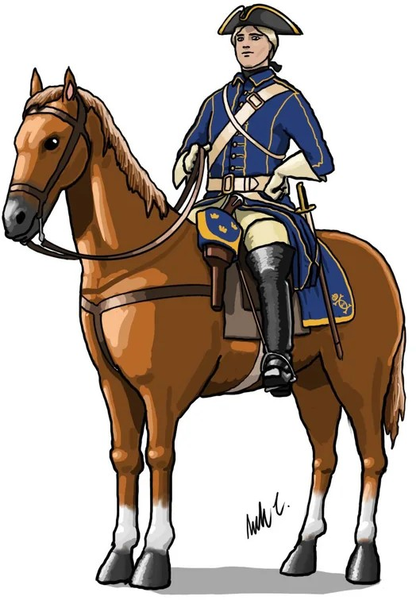
                
A ryttare of 1750

            

            
A ryttare in peacetime lived on a farm called a <em>soldattorp</em> (soldier&rsquo;s cottage). It included outbuildings, a horse, military equipment, and a plot of land to farm. The ryttare may have received a little basic food and pay as well.

            
During war, the ryttare were integrated with the foot soldiers and sent to some faraway place to fight for the King. M&aring;ns died in the Pomeranian War in Prussia around the time of Anders&rsquo; birth. As a soldier&rsquo;s family, they moved back and forth between Ormeshaga Hult and Tollstorp Glashomen. M&aring;ns&rsquo; fatherless family is listed in both places in all the clerical censuses taken from before 1788 through 1816. No explanation for the multiple entries is given.

            

                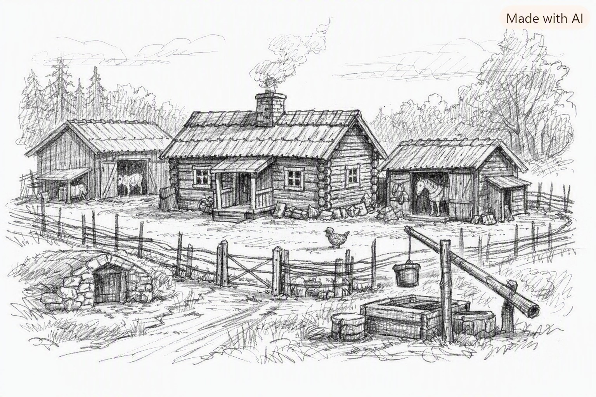
                
A ryttare torp of 1750 (AI-generated illustration)

            

            
Stina Gummesdotter and Anders M&aring;nsson had seven children. One daughter, Anna Maria Andersdotter, was Andreas Carlsson&rsquo;s aunt and played an important role in his emigration story. Anna Maria married a soldier&rsquo;s son, Jonas Peter Petersson, around 1818 in Hovmantorp. Jonas Peter later took his father&rsquo;s military surname, &ldquo;Falk.&rdquo;

            
Anna and Jonas had five children, two sons and three daughters. One son died as an infant and one son died during the famine of 1868, leaving Jonas Peter with only daughters.

            
Jonas and Anna&rsquo;s oldest daughter, Lisa Stina Falk, married Magnus Jonasson from V&auml;storp Lambritsg&aring;rd in 1838, and they immediately moved to Kuppram&aring;la Skatteg&aring;rd in Linneryd parish. Then in 1852 they emigrated to Chisago Lake, in a story very similar to Vilhelm Moberg&rsquo;s fictional novel <em>The Emigrants</em>. The letters Magnus wrote back home from Chisago Lake surely encouraged Andreas, as well as many other friends and relatives, to come to America.

            
At the start of 1854, two of Andreas Carlsson&rsquo;s cousins now lived in America. Lena Falk and Carl Linn were married in March of 1854 in Chisago Lake. This was the setting for Andreas Carlsson&rsquo;s emigration to America in 1854. He had read or heard of Magnus&rsquo; letters encouraging other family and friends to come to Chisago Lake, so he and his family decided to follow.

            
On arrival at Chisago Lake, Andreas Carlsson and his pregnant wife Ingrid Maria stopped at a farmhouse and were directed across the southern end of what is now called South Center Lake to the cabin of cousin Lisa Falk. The cabin was situated on an island named L&ouml;nn &Ouml;, which later evolved into the modern peninsula Sunset Point.

            
Andreas and Ingrid stayed with Magnus and Lisa a few weeks. But since it was crowded, they rented living quarters with cousin Lena (Falk) Linn, Carl Linn&rsquo;s new bride.

            
In 1866, Andreas&rsquo; younger brother Johannes Carlsson also immigrated to Chisago Lake.

            
As with most of the early Swedes from Sm&aring;land: &ldquo;They&rsquo;re all connected!&rdquo; The family chart on page 5 shows how.

            
John Linn, 25 August 2026

            

                1 Ben Carlson, <em>The Family History of Andreas and Ingrid Maria Carlson/Taylor</em> (private document, 2011).
            

        

        

            

                <h3>Become a Member</h3>
                <ul>
                    <li>Individual: $20 annually</li>
                    <li>Family: $30 annually</li>
                </ul>
                
Mail checks to: <strong>PO Box 12, Lindstrom, MN 55045</strong>

            

            

                <h3>Buy a Brick</h3>
                
Help extend our brick paver walkway from the front door to the parking lot. A wonderful gift, memorial, or tribute to your family&rsquo;s heritage. Order at <a href="https://thatsmybrick.com/karloskar">thatsmybrick.com/karloskar</a>.

            

            

                <h3>Volunteer</h3>
                <ul>
                    <li>God Jul Party helpers, December 7</li>
                    <li>Welcome Hosts for the 2027 season</li>
                    <li>Newsletter contributors</li>
                </ul>
                
Interested? Call Corliss at 952-454-3355.

            

        

    

<!-- ════════════════════════════════════════════════════
     PAGE 5 - FAMILY CHART + BACK PAGE
     ════════════════════════════════════════════════════ -->

    

        

            Friends of the Karl Oskar House Newsletter
            Page 5
        

        

            

                
They&rsquo;re All Connected

                
The Emigration and the Linn Family, Chapter 11: the family chart

            

            
Five generations from the cavalry soldier Jonas Hessman to the cousins who settled at Chisago Lake. From the research of John Linn. Click the chart to enlarge it.

        

        

            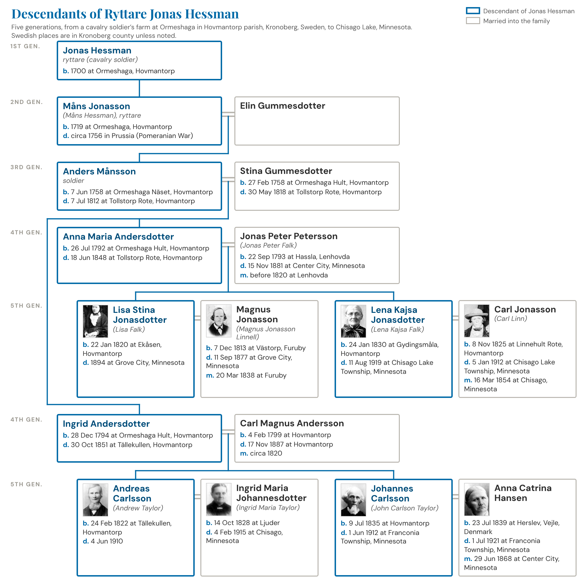
        

        

            <h3>Stay Connected</h3>
            
<strong style="color: var(--swedish-yellow);">Board members:</strong> Gary Noren (President), Pam Deimel (Treasurer), Marilyn Wahlstr&ouml;m (Secretary), Charles Gramling, Peter Osterberg, Becky Dudley, Bonnie Anderson, Carla Norelius, Peggy Kamish-Eral, Corliss Vadner, Peter Lindberg, Sven Sj&ouml;stedt

            

                Website: <a href="https://friendsofthekarloskarhouse.org">friendsofthekarloskarhouse.org</a> &nbsp;|&nbsp;
                Facebook: <a href="https://www.facebook.com/LindHistSoc">Friends of the Karl Oskar House</a>
            

            

                

                    <strong>General Info</strong>
                    Gary Noren 
                    garynoren@gmail.com
                

                

                    <strong>Newsletter</strong>
                    Sven Sj&ouml;stedt, svendasvede@aol.com 
                    Peter Grund, peter_grund@me.com
                

                

                    <strong>Music Events</strong>
                    Marilyn Wahlstrom 
                    mjwahls@msn.com
                

            

        

    

</body>
</html>
