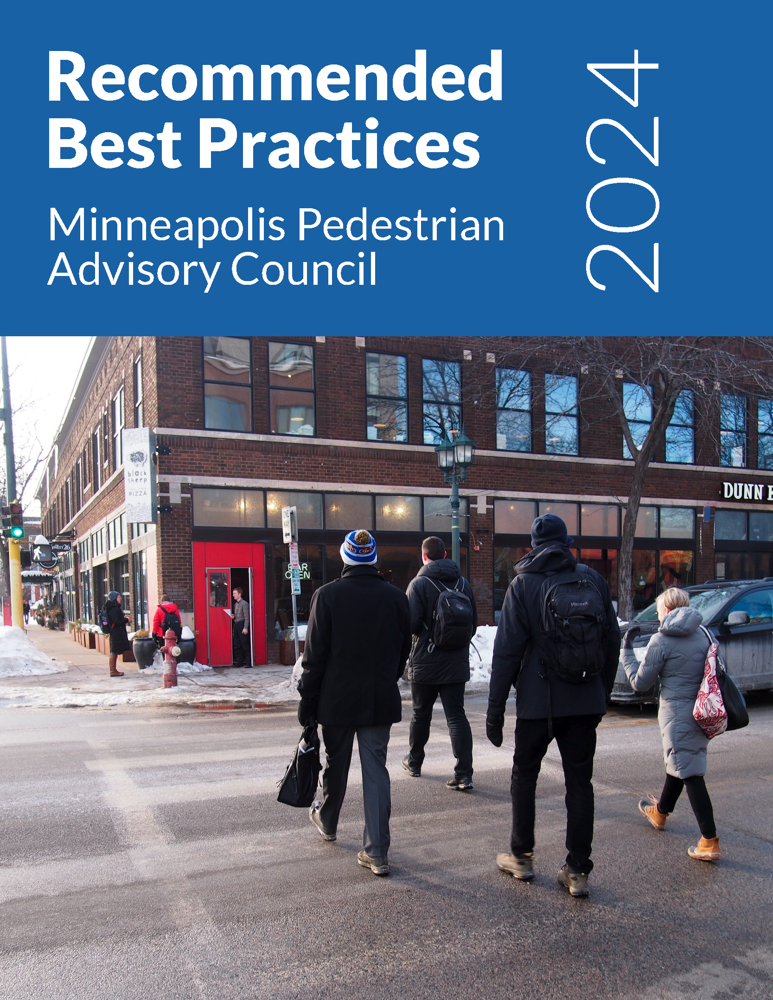

I am sharing my idea for a special taskforce under the P&P subcommittee dedicated to thoroughly reviewing city, county, and state policies, laws, and standard practices related to pedestrian infrastructure and policies. The primary aim of the taskforce would be to examine existing policies, regulations, and practices concerning pedestrian infrastructure (for instance, traffic circles, slip lanes, RRFBs, No Turn on Red, etc.) and to understand their implications on our city's walkability and safety beyond our personal anecdotes. While I don't want to take away from the PAC's ability to make recommendations based on our lived experiences (these are powerful and important), I think it would be beneficial to have an additional layer of evidence-based recommendations that could be used to support our decisions. 

This taskforce would develop a comprehensive recommendation system that could serve as a standardized method for evaluating various aspects of projects presented to the PAC, ensuring consistency and clarity in our decisions. We could pull together all sorts of evidence, like articles and case studies, to back up our recommendations and put it all together into a "2024 Recommended Best Practices" guide from the PAC. We could make the recommendations broad (such as eliminating No Turn on Red) or provide specific examples for where we think certain infrastructure or policy changes would be most impactful throughout the city. I think it could be a great way to standardize how we evaluate certain projects as well as provide Public Works, City Council, etc. an ability to anticipate where the PAC stands and can get a head start on some of our recommendations early on in the design/policy stage.

<small>Potential cover for the 2024 Recommended Best Practices guide from the PAC</small>

## Evaluation criteria
The committee would begin by developing a standardized evaluation system that could be used to assess the impact of various pedestrian infrastructure and policy changes. The evaluation system could be based on the following criteria:
* Safety
* Accessibility
* Equity
* Efficiency
* Sustainability
* Difficulty of implementation

The committee would then use the following evaluation system (or something like it) to assess the impact of various pedestrian infrastructure and policy changes on the city's walkability and safety. The committee would also consider the potential benefits and drawbacks of each recommendation, as well as the potential costs and feasibility of implementation.

## Timeline of taskforce 
1. **Formation of taskforce**: The taskforce would be formed under the P&P subcommittee after the start of the next cycle.
2. **Development of recommendation system**: The taskforce would develop a recommendation system that could serve as a standardized method for evaluating various policies or infrastructure changes (hereinafter referred to as "interventions")
3. **Order of recommendations**: The taskforce would compile a list of interventions to be reviewed and prioritized based on importance to members.
4. **Assign to P&P meetings**: Each intervention would be assigned a date that it would be reviewed by the P&P subcomittee. Prior to the meeting, the chair would share some background information on the intervention. Members should come prepared to discuss the intervention.
5. **P&P discussion**: The P&P subcommittee would then discuss the intervention and work to develop a recommendation. 
6. **Vote**: The P&P subcommittee would then vote on the draft recommendation. If adopted, the recommendation would be added to the draft 2024 Recommended Best Practices guide from the PAC.
7. **Final approval**: Once the guide is complete, it would be presented to the PAC for final approval. PAC members would have the opportunity to review the guide and provide feedback before it is finalized. Individual recommendations could be removed or revised based on feedback from the PAC.

## Example of a recommendation system
<table>
    <tr>
        <th>Strength of recommendation</th>
        <th>Wording</th>
        <th>Symbols</th>
        <th>Implications</th>
    </tr>
    <tr style="border-bottom: 1px solid black">
        <td>Strong recommendation for the use of an intervention</td>
        <td>“We recommend...”</td>
        <td style="background-color: green; text-align: center;">↑↑</td>
        <td>Evidence strongly supports the efficacy of the intervention in enhancing safety and walkability. Implementation is recommended as policy.</td>
    </tr>
    <tr style="border-bottom: 1px solid black">
        <td>Weak recommendation for the use of an intervention</td>
        <td>“We suggest...”</td>
        <td style="background-color: lightgreen; text-align: center;">↑</td>
        <td>Evidence supports the efficacy of the intervention, but there are circumstances where the intervention may not be appropriate. Implementation is recommended in all cases unless certain conditions or circumstances are present.</td>
    </tr>
    <tr style="border-bottom: 1px solid black">
        <td>No recommendation with respect to an intervention</td>
        <td>“We cannot make a recommendation with respect to...”</td>
        <td style="background-color: yellow; text-align: center;">–</td>
        <td>The evidence is insufficient or mixed, and a clear recommendation cannot be made. (e.g., unclear or balanced benefit-risk ratio, no data available).</td>
    </tr>
    <tr style="border-bottom: 1px solid black">
        <td>Weak recommendation against the use of an intervention</td>
        <td>“We suggest against...”</td>
        <td style="background-color: #FAA0A0; text-align: center;">↓</td>
        <td>Evidence suggests that the intervention may not be effective in enhancing safety and walkability. Implementation is not recommended unless certain conditions or circumstances are present.</td>
    </tr>
    <tr style="border-bottom: 1px solid black">
        <td>Strong recommendation against the use of an intervention</td>
        <td>“We recommend against...”</td>
        <td style="background-color: #FF0000; text-align: center;">↓↓</td>
        <td>Evidence strongly suggests that the intervention is not effective in enhancing safety and walkability. Implementation is not recommended as policy.</td>
    </tr>
</table>

Once the taskforce settles on a recommendation system, we could compile a list of policies and infrastructure treatments to begin with. Here is a simple example of what that could look like:
* No Turn on Red
* Slip lanes
* Traffic circles 
* RRFBs

It would be my job to compile information on each of these topics and prepare a brief for the taskforce to review. The taskforce would then review the evidence and work to develop a recommendation based on the evidence. I was thinking that we could either have a seperate meeting for the taskforce or add it to the P&P subcommittee meeting. I am open to suggestions on how to best implement this idea. 

## Consensus 
Each draft recommendation would be presented with relevant evidence or justification; this would be followed by open discussion, preliminary voting or collection of suggestions for alternative wording, and then the final vote. Unlike our other resolutions where we don't keep track of who voted for what, I think it would be important to keep track of at least the number of votes for and against each recommendation.

Strong consensus was defined as 90% agreement or higher, and consensus as 70–89% agreement. Agreement of the majority could be defined as 50–69% agreement. If consensus was not reached, the recommendation would be revised and re-voted on at a later date or tabled.
